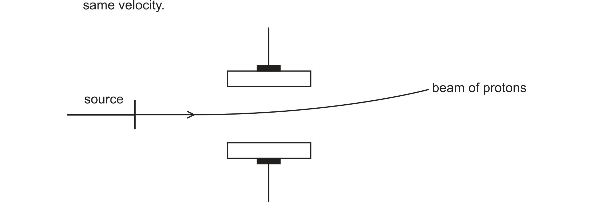
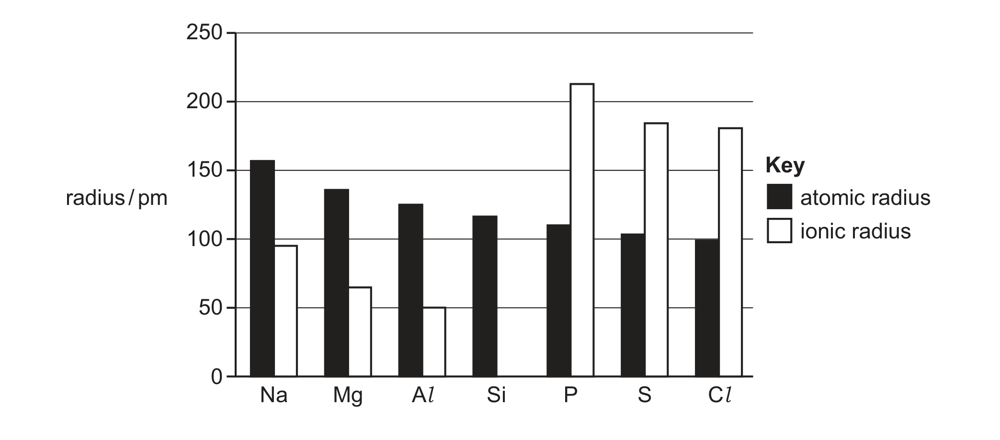
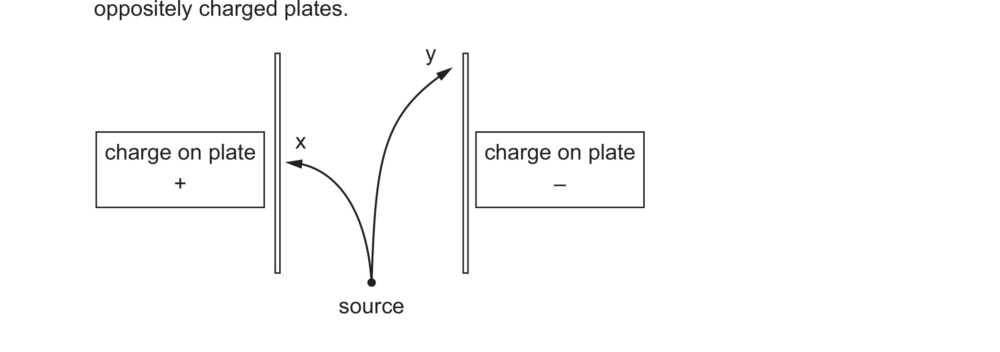

# Chapter 1 atomic structure
## 1.1 Particles in the atom and atomic radius

### A. atomic model

```tikz
\usepackage{tikz}
\begin{document}
\begin{tikzpicture}[scale=1.15, every node/.style={font=\large},
    nucleon/.style={circle, draw=black!70, minimum size=6mm, inner sep=0pt},
    proton/.style={nucleon, fill=red!75},
    neutron/.style={nucleon, fill=blue!60},
    electron/.style={circle, fill=black!85, minimum size=3.2mm, inner sep=0pt},
    shell/.style={draw=black!45, dashed},
    lead/.style={draw=black!60, thin},
    guide/.style={draw=black!55, densely dotted, semithick}]

  % electron shell (helium has one shell only)
  \draw[shell] (0,0) circle (2.3);

  % nucleus: 2 protons + 2 neutrons, close-packed 2 x 2
  \node[proton]  at (-0.26, 0.26) {};
  \node[neutron] at ( 0.26, 0.26) {};
  \node[neutron] at (-0.26,-0.26) {};
  \node[proton]  at ( 0.26,-0.26) {};

  % ring enclosing the nucleus, with its own label
  \draw[blue!70, thick] (0,0) circle (0.74);
  \draw[blue!70, ->] (2.1,-1.75) -- (0.6,-0.55);
  \node[anchor=west, blue!70, align=left] at (2.15,-1.9)
    {nucleus\\[-1pt] \normalsize very dense (almost 99\% of mass)};

  % electrons: 2 in the single shell
  \foreach \a in {90,270} {\node[electron] at (\a:2.3) {};}

  % shell and empty space
  \draw[lead, ->] (2.2,2.2) -- (45:2.3);
  \node[anchor=west, black!70] at (2.25,2.25) {shell};
  \draw[lead, ->] (-2.75,1.75) -- (152:1.5);
  \node[anchor=east, black!70, align=right] at (-2.8,1.8)
    {mostly empty\\[-1pt] space};

  % nucleus diameter, measured inside the shell
  \draw[guide] (-0.74, 0.05) -- (-0.74, 1.0);
  \draw[guide] ( 0.74, 0.05) -- ( 0.74, 1.0);
  \draw[<->, blue!70] (-0.74, 0.9) --
    node[above, inner sep=2pt, text=blue!70] {0.0034 pm}
    (0.74, 0.9);

  % atom diameter, measured just below the shell
  \draw[guide] (-2.3,-2.35) -- (-2.3,-2.75);
  \draw[guide] ( 2.3,-2.35) -- ( 2.3,-2.75);
  \draw[<->, black!70] (-2.3,-2.6) --
    node[below, inner sep=3pt, text=black!70] {62 pm}
    (2.3,-2.6);

  % key
  \node[proton,   label=right:{\ proton, p}]    at (5.2,0.9)  {};
  \node[neutron,  label=right:{\ neutron, n}]   at (5.2,0.3)  {};
  \node[electron, label=right:{\ electron, e}]  at (5.2,-0.3) {};

  % proton + neutron are both nucleons
  \draw[lead] (7.5,0.9) -- (8.05,0.6);
  \draw[lead] (7.5,0.3) -- (8.05,0.6);
  \node[anchor=west, black!70] at (8.1,0.6) {nucleon};
\end{tikzpicture}
\end{document}
```
diagram shows a bohr atomic model of $^{4}_{2}He$ (does not include electron cloud, not drawn in actual scale)

>learning outcome:
>- [ ] understand that atoms are mostly empty space surrounding a very small, dense nucleus that contains protons and neutrons; electrons are found in shells in the empty space around the nucleus

### B. Relative charge and mass

三种 subatomic particle 的 relative charge 与 relative mass 都是相对值：以 proton 的
charge（+1.60 × 10⁻¹⁹ C）和 mass（1.67 × 10⁻²⁷ kg）为标准，所以没有单位。

| Particle | Symbol | Relative charge | Relative mass | 位置 |
| --- | --- | ---: | ---: | --- |
| proton | p | +1 | 1 | nucleus |
| neutron | n | 0 | 1 | nucleus |
| electron | e | −1 | 1/1836| shells，nucleus 外 |

记忆要点：

- proton 和 neutron 合称 nucleon，两者 relative mass 都是 1，所以 atom 的 mass 几乎全部集中在
  nucleus 里（对应上图的 almost 99% of mass）。
- electron 的 mass 只有 proton 的约 1/1836，计算 relative atomic mass 时可以忽略。
- neutral atom 里 proton 数 = electron 数，所以整体 charge 为 0；nucleus 因为只有 proton 和
  neutron，带 positive charge。

>learning outcome:
>- [ ] identify and describe protons, neutrons and electrons in terms of their relative charges and relative masses
>- [ ] describe the distribution of mass and charge within an atom

### C. Standard Representation of Atom

$$^{A}_{Z}X$$
$$A=mass number / nucleon number$$
$$Z=atomic number / proton number$$
$$X=symbol of element$$

- mass number / nucleon number（*A*）= the sum of the number of protons and neutrons in the
  nucleus of an atom
- atomic number / proton number（*Z*）= the number of protons in the nucleus of an atom

| 数量 | 算法 |
| --- | --- |
| number of protons | *Z* |
| number of neutrons | *A* − *Z* |
| number of electrons（neutral atom） | *Z* |
| number of electrons（ion，charge *q*） | *Z* − *q* |

- ex. $^{23}_{11}Na^{+}$ :p=11,n=12,e=10

>learning outcome:
>- [ ] understand the terms atomic and proton number; mass and nucleon number
>- [ ] determine the numbers of protons, neutrons and electrons present in both atoms and ions given atomic or proton number, mass or nucleon number and charge
>- [ ] （1.2）understand the notation $^{x}_{y}\text{A}$ for isotopes, where *x* is the mass or nucleon number and *y* is the atomic or proton number

### D. Behaviour of beams in an electric field

p、n、e 以**相同的 velocity** 射入两块带电 plate 之间的 electric field（上 positive plate，
下 negative plate）：

<svg viewBox="0 0 760 380" width="100%" style="max-width:760px" xmlns="http://www.w3.org/2000/svg" font-family="system-ui, sans-serif">
  <defs>
    <marker id="ah-r" viewBox="0 0 10 10" refX="9" refY="5" markerWidth="7" markerHeight="7" orient="auto-start-reverse">
      <path d="M0,0 L10,5 L0,10 z" fill="#c0392b"/>
    </marker>
    <marker id="ah-b" viewBox="0 0 10 10" refX="9" refY="5" markerWidth="7" markerHeight="7" orient="auto-start-reverse">
      <path d="M0,0 L10,5 L0,10 z" fill="#4a5fd0"/>
    </marker>
    <marker id="ah-k" viewBox="0 0 10 10" refX="9" refY="5" markerWidth="7" markerHeight="7" orient="auto-start-reverse">
      <path d="M0,0 L10,5 L0,10 z" fill="#222"/>
    </marker>
  </defs>

  <!-- plates -->
  <rect x="170" y="72" width="360" height="10" fill="#d8d8d8" stroke="#8a8a8a"/>
  <rect x="170" y="280" width="360" height="10" fill="#d8d8d8" stroke="#8a8a8a"/>
  <text x="350" y="44" text-anchor="middle" font-size="16" fill="#c0392b">positive plate</text>
  <text x="350" y="332" text-anchor="middle" font-size="16" fill="#4a5fd0">negative plate</text>
  <g font-size="17" fill="#8a8a8a" text-anchor="middle">
    <text x="210" y="68">+</text><text x="270" y="68">+</text><text x="330" y="68">+</text>
    <text x="390" y="68">+</text><text x="450" y="68">+</text><text x="500" y="68">+</text>
    <text x="210" y="304">−</text><text x="270" y="304">−</text><text x="330" y="304">−</text>
    <text x="390" y="304">−</text><text x="450" y="304">−</text><text x="500" y="304">−</text>
  </g>

  <!-- incoming beam -->
  <line x1="150" y1="190" x2="200" y2="190" stroke="#666" stroke-width="2"/>
  <text x="10" y="176" font-size="15" fill="#444">beam of p, n, e</text>
  <text x="10" y="196" font-size="15" fill="#444">(same velocity)</text>

  <!-- neutron: undeflected -->
  <path d="M200,190 L620,190" fill="none" stroke="#4a5fd0" stroke-width="2.5" marker-end="url(#ah-b)"/>
  <text x="634" y="195" font-size="16" fill="#4a5fd0">neutron, n</text>

  <!-- proton: deflected down, towards the negative plate -->
  <path d="M200,190 Q430,190 530,252 L610,302" fill="none" stroke="#c0392b" stroke-width="2.5" marker-end="url(#ah-r)"/>
  <text x="624" y="307" font-size="16" fill="#c0392b">proton, p</text>

  <!-- electron: deflected up much more, towards the positive plate -->
  <path d="M200,190 Q330,190 388,94" fill="none" stroke="#222" stroke-width="2.5" marker-end="url(#ah-k)"/>
  <text x="398" y="120" font-size="16" fill="#222">electron, e</text>

  <text x="10" y="366" font-size="14" fill="#888">not to scale — the real deflection of an electron is about 1836 times that of a proton</text>
</svg>

| Particle | Charge | Direction of deflection | Size of deflection |
| --- | --- | --- | --- |
| proton | +1 | towards the negative plate | small |
| neutron | 0 | none — travels straight through | none |
| electron | −1 | towards the positive plate  | large, about 1836 times that of the proton |

Explanation:
- electron deflect more compare to proton because electron are lighter than proton

>learning outcome:
>- [ ] describe the behaviour of beams of protons, neutrons and electrons moving at the same velocity in an electric field

### E1. Atomic radius
- definition: atomic radius are half distance between the nuclei of 2 bonded atom of same type


图中每个亮点是一个 atom 的位置，红线量的是两个相邻 nucleus 之间的距离，它的一半就是
atomic radius。

### E2 factor of atomic radius

### nuclear charge
- proton number ↑
- positive charge in nucleus ↑
- attraction force between nucleus and outer electrons ↑
- atomic radius ↓

### shielding effect
- definition: the inner shells of electrons repel the outer electrons and so reduce the
  attraction between the nucleus and the outer electrons（内层 electron 把 nucleus 的吸引
  "挡" 掉一部分）
- number of inner shells ↑
- shielding ↑
- attraction force between nucleus and outer electrons ↓
- atomic radius ↑

两个 factor 方向相反，比较任何两个 atom 时都要判断哪一个占上风（which effect outweighs the
other）。

### trends across group and period

| | down a group | across a period (left → right) |
|---|---|---|
| atomic radius | increases | decreases |
| number of (electron) shells | increases — one extra shell each period | same |
| shielding | increases | similar |
| nuclear charge | increases | increases |
| which effect wins | the extra shell and increased shielding outweigh the increased nuclear charge | nuclear charge, because shielding is similar |
| net attraction on outer electrons | weaker | stronger |

写答案时的标准句式（取自 mark scheme）：

- **across a period**：**nuclear charge increases** and there is **similar shielding**; 
  **increase in nuclear charge outweight the shielding effect**
  greater / stronger attraction to the nucleus, so the atomic radius decreases.
  （9701/21 Oct/Nov 2025 Q2(a)(i)）
- **down a group**：there is an **extra shell** (of electrons) / more shells, so **increased shielding**;
  the effect of the **additional shell outweighs** the increase in nuclear charge, so there is
  **less attraction** for the outer electrons and the atomic radius increases.
  （9701/22 Feb/Mar 2025 Q2(b)(i)、9701/22 May/June 2026 Q2(b)(iii)）


### E3. Ionic radius

- cation（正离子）比原来的 atom **小**：loss of the outer / valence shell of electrons, and with
  fewer electrons there is an increase in nuclear attraction on the remaining electrons.
  例：an Fe atom (1.26 × 10⁻¹⁰ m) → Fe³⁺ is smaller.（9701/22 May/June 2025 Q2(e)）
- anion（负离子）比原来的 atom **大**：the atom gains electrons, so there are more electrons than
  protons; the nuclear attraction per electron is weaker and there is greater repulsion between
  the electrons, so the electron cloud expands.
- 所以同一 period 里 cation 和 anion 之间会有一个大跳跃：Al loses 3 electrons (Al³⁺) while P
  gains 3 electrons (P³⁻), and Al³⁺ has one fewer shell than P³⁻.
  （9701/21 Oct/Nov 2025 Q2(a)(ii)）

### trends of ionic radius

| | down a group | across a period |
|---|---|---|
| ionic radius | increases — extra shell (of electrons) | 先在 cation 内逐渐减小，到 anion 跳大，再逐渐减小 |
| 理由 | 同 atomic radius：more shells，increased shielding | 同电荷类型的 ion 之间：same shielding **and** greater nuclear charge |

Period 3（Na → Cl）的 atomic radius 与 ionic radius：

<svg viewBox="0 0 720 420" width="100%" style="max-width:720px" xmlns="http://www.w3.org/2000/svg" font-family="system-ui, sans-serif">
  <g stroke="#e2e2e0" stroke-width="1">
    <line x1="70" y1="330" x2="660" y2="330"/><line x1="70" y1="265" x2="660" y2="265"/><line x1="70" y1="201" x2="660" y2="201"/><line x1="70" y1="136" x2="660" y2="136"/><line x1="70" y1="71" x2="660" y2="71"/>
  </g>
  <g font-size="13" fill="#777" text-anchor="end">
    <text x="60" y="335">0</text><text x="60" y="270">50</text><text x="60" y="206">100</text><text x="60" y="141">150</text><text x="60" y="76">200</text>
  </g>
  <text x="20" y="200" font-size="14" fill="#555" transform="rotate(-90 20 200)" text-anchor="middle">radius / pm</text>
  <line x1="70" y1="40" x2="70" y2="330" stroke="#bbb" stroke-width="1"/>
  <g font-size="15" fill="#333" text-anchor="middle">
    <text x="80" y="352">Na</text><text x="170" y="352">Mg</text><text x="260" y="352">Al</text><text x="350" y="352">Si</text><text x="440" y="352">P</text><text x="530" y="352">S</text><text x="620" y="352">Cl</text>
  </g>
  <polyline points="80,89 170,123 260,145 350,177 440,188 530,195 620,202" fill="none" stroke="#4a5fd0" stroke-width="2"/>
  <g fill="#4a5fd0" stroke="#fff" stroke-width="2">
    <circle cx="80" cy="89" r="5"/><circle cx="170" cy="123" r="5"/><circle cx="260" cy="145" r="5"/><circle cx="350" cy="177" r="5"/><circle cx="440" cy="188" r="5"/><circle cx="530" cy="195" r="5"/><circle cx="620" cy="202" r="5"/>
  </g>
  <polyline points="80,207 170,246 260,265" fill="none" stroke="#c0392b" stroke-width="2"/>
  <polyline points="440,56 530,92 620,96" fill="none" stroke="#c0392b" stroke-width="2"/>
  <line x1="260" y1="265" x2="440" y2="56" stroke="#c0392b" stroke-width="2" stroke-dasharray="5 5" opacity="0.45"/>
  <g fill="#c0392b" stroke="#fff" stroke-width="2">
    <circle cx="80" cy="207" r="5"/><circle cx="170" cy="246" r="5"/><circle cx="260" cy="265" r="5"/><circle cx="440" cy="56" r="5"/><circle cx="530" cy="92" r="5"/><circle cx="620" cy="96" r="5"/>
  </g>
  <g font-size="13" fill="#555">
    <text x="90" y="82">Na 186</text><text x="586" y="220">Cl 99</text><text x="270" y="283">Al&#179;&#8314; 50</text><text x="440" y="42" text-anchor="middle">P&#179;&#8315; 212</text><text x="86" y="252">Na&#8314; 95</text>
  </g>
  <text x="350" y="310" font-size="13" fill="#999" text-anchor="middle">cation to anion 的跳跃</text>
  <text x="350" y="374" font-size="13" fill="#999" text-anchor="middle">Si 不形成简单 ion，无 ionic radius</text>
  <g font-size="15">
    <circle cx="420" cy="396" r="5" fill="#4a5fd0"/><text x="434" y="401" fill="#333">atomic radius</text><circle cx="560" cy="396" r="5" fill="#c0392b"/><text x="574" y="401" fill="#333">ionic radius</text>
  </g>
</svg>

| element | Na | Mg | Al | Si | P | S | Cl |
|---|---|---|---|---|---|---|---|
| atomic radius / pm | 186 | 160 | 143 | 118 | 110 | 104 | 99 |
| ion | Na⁺ | Mg²⁺ | Al³⁺ | — | P³⁻ | S²⁻ | Cl⁻ |
| ionic radius / pm | 95 | 65 | 50 | — | 212 | 184 | 181 |

读图要点：

- The atomic radius decreases steadily across the period: nuclear charge increases while the
  shielding stays similar, so there is a stronger attraction on the outer electrons.
- The cations Na⁺ → Al³⁺ are all much smaller than their atoms, because each has lost its whole
  outer shell; within the cations the radius still decreases (same shielding, greater nuclear
  charge).
- There is a sharp jump at P³⁻: the anions have gained electrons into the third shell, so they
  are much larger than the cations — Al³⁺ has one fewer shell than P³⁻.
- The anions P³⁻ → Cl⁻ then decrease again for the same reason as the cations（same shielding,
  greater nuclear charge）。

### isoelectronic species

electronic configuration 相同（same number of electrons / isoelectronic）的 ion 与 atom，半径
只由 nuclear charge 决定：

- 例：**Na⁺ < Ne < F⁻**（increasing radius）。
- 理由：they all have the same number of electrons / are isoelectronic; the larger species has a
  smaller nuclear charge / fewer protons, so there is smaller nuclear attraction to the outer
  electrons.（9701/23 May/June 2025 Q1(b)(iii)）
- 同理 Al³⁺ 比 Mg²⁺ 小：same shielding effect **and** greater nuclear charge, so greater nuclear
  attraction for the remaining electrons.（9701/22 May/June 2024 Q1(b)）

>learning outcome:
>- [ ] state and explain qualitatively the variations in atomic radius and ionic radius across a period and down a group

## 1.2 Isotopes
- definition: atoms of the same element with the **same number of protons** but **different
  numbers of neutrons**
- 等价说法（补充，别用来代替上面那句）：same proton number / atomic number but different nucleon
  number / mass number

>learning outcome:
>- [ ] define the term isotope in terms of numbers of protons and neutrons

### properties of isotope
|chemical properties|physical properties (mass,density)|
|---|---|
|same|different|
|same proton number, same electron configuration|different mass number,different mass per atom,same volume (same atomic radius),different density|

## Practice

2024–2026 Paper 2 里所有考 1.1 / 1.2 的小问，按原卷的题号顺序排列（Q1(a)、Q1(b)…），
不分 1.1 和 1.2。原卷与判分细则见
[`passyear/extracted/ch01-atomic-structure/`](passyear/extracted/ch01-atomic-structure/)。
先自己写，再展开 **答案**。

### 9701/22 May/June 2024

#### Q1(a) [2]

Complete Table 1.1 using relevant information from the Periodic Table.

| | nucleon number | proton number | number of electrons |
|---|---|---|---|
| Mg²⁺ | 24 | | |
| Al³⁺ | 27 | | |

<details><summary>答案</summary>

| | nucleon number | proton number | number of electrons |
|---|---|---|---|
| Mg²⁺ | 24 | 12 | 10 |
| Al³⁺ | 27 | 13 | 10 |

判分：4 个空全对 2 分；对 2 或 3 个 1 分；对 0 或 1 个 0 分。

</details>

#### Q1(b) [3]

State and explain the difference in the ionic radius of Al³⁺ compared to Mg²⁺.

<details><summary>答案</summary>

- M1 it / Al³⁺ is smaller (compared to Mg²⁺)
- M2 greater nuclear attraction for remaining electrons
- M3 same shielding effect **AND** greater nuclear charge

</details>

### 9701/21 Oct/Nov 2024

#### Q1(b) [3]

Table 1.1 gives some details of the stable naturally occurring isotopes of rhodium and iridium.
Complete Table 1.1.

| isotope | number of protons | number of neutrons | total number of electron shells |
|---|---|---|---|
| $^{103}_{45}\text{Rh}$ | | 58 | |
| $^{191}_{77}\text{Ir}$ | | | 6 |
| $^{193}_{77}\text{Ir}$ | | | 6 |

<details><summary>答案</summary>

| isotope | number of protons | number of neutrons | total number of electron shells |
|---|---|---|---|
| $^{103}_{45}\text{Rh}$ | **45** | 58 | **5** |
| $^{191}_{77}\text{Ir}$ | **77** | **114** | 6 |
| $^{193}_{77}\text{Ir}$ | **77** | **116** | 6 |

</details>

### 9701/22 Oct/Nov 2024

#### Q1(b)(i) [2]

Pelopium was later found to be a mixture of niobium, Nb, and tantalum, Ta. Only one naturally
occurring isotope exists for each of Nb and Ta. Complete Table 1.1.

| isotope | relative isotopic mass | number of protons | number of neutrons |
|---|---|---|---|
| $^{93}_{41}\text{Nb}$ | 92.91 | | |
| $^{181}_{73}\text{Ta}$ | 180.95 | | |

<details><summary>答案</summary>

Nb-93 → 41 protons、52 neutrons；Ta-181 → 73 protons、108 neutrons。

</details>

### 9701/22 Feb/Mar 2025

#### Q2(b)(i) [2]

The Group 2 elements form stable 2+ cations.
State and explain the variation in ionic radius of the Group 2 elements down the group.

<details><summary>答案</summary>

ionic radius increases / ions larger (down the group)；extra shell (of electrons)

</details>

#### Q2(c)(i) [2]

Beryllium exists as the single isotope $^{9}_{4}\text{Be}$.
Describe the distribution of mass within an atom of $^{9}_{4}\text{Be}$.

<details><summary>答案</summary>

most of the mass is in the nucleus；because protons and neutrons / nucleons are found in the
nucleus

</details>

#### Q2(c)(ii) [2]

Complete Table 2.2 to show the numbers of protons and neutrons in the isotopes of magnesium.

| isotope | number of protons | number of neutrons |
|---|---|---|
| magnesium-24 | | |
| magnesium-25 | | |
| magnesium-26 | | |

<details><summary>答案</summary>

Mg-24 → 12 p、12 n；Mg-25 → 12 p、13 n；Mg-26 → 12 p、14 n。

</details>

#### Q2(c)(iii) [3]

Fig. 2.1 shows the behaviour of a beam of protons in an electric field. Complete Fig. 2.1 to show
the behaviour of separate beams of neutrons and electrons in the same electric field. Label your
diagram clearly. Assume that the beams of each particle are moving at the same velocity.



<details><summary>答案</summary>

neutron beam：从同一 source 出发的水平直线；electron beam：从同一 source 出发、向与 proton
相反的方向弯曲的曲线，且偏转幅度比 proton beam 大得多。

</details>

### 9701/21 May/June 2025

#### Q2(a) [1]

Define isotopes.

<details><summary>答案</summary>

atoms (of an element) with same number of protons and different number of neutrons

</details>

#### Q2(b)(ii) [2]

Complete Table 2.1 to show the number of protons and nucleons in one atom of ⁵⁶Fe.

| particle | number of particles in one atom of ⁵⁶Fe |
|---|---|
| protons | |
| nucleons | |

<details><summary>答案</summary>

protons = 26；nucleons = 56

</details>

### 9701/22 May/June 2025

#### Q2(d) [2]

Complete Table 2.2 to show information about particles in one ion of ⁵⁶Fe³⁺.

| particle | number of particles present in one ion of ⁵⁶Fe³⁺ |
|---|---|
| electrons | |
| | 30 |

<details><summary>答案</summary>

electrons = 23；30 那一行的粒子是 **neutrons**。

</details>

#### Q2(e) [2]

The atomic radius of iron is 1.26 × 10⁻¹⁰ m. Suggest the change to the radius, if any, after an
iron atom reacts to produce an Fe³⁺ ion. Explain your answer.

<details><summary>答案</summary>

- M1 smaller / decreases
- M2 loss of outer / valence shell (of electrons) **OR** loss of electrons so increase in (force
  of) attraction from nucleus

</details>

### 9701/23 May/June 2025

#### Q1(b)(iii) [4]

Arrange the three species F⁻, Ne and Na⁺ in order of increasing radius. Explain your answer.

<details><summary>答案</summary>

- M1 Na⁺ < Ne < F⁻
- M2 (all have) same number of electrons / isoelectronic
- M3 larger species has smaller nuclear charge / fewer protons
- M4 (so) smaller nuclear attraction (to outer electrons)

</details>

### 9701/21 Oct/Nov 2025

#### Q1(a)(i) [1]

Cr exists as four stable isotopes. The most common isotope of Cr is chromium-52. Determine the
number of protons, neutrons and electrons in an atom of chromium-52.

<details><summary>答案</summary>

protons = 24；neutrons = 28；electrons = 24

</details>

#### Q1(a)(ii) [1]

Describe how an atom of chromium-54 differs from an atom of chromium-52. Refer to numbers of
particles in your answer.

<details><summary>答案</summary>

(⁵⁴Cr has two) more neutrons (than ⁵²Cr)

</details>

#### Q2(a)(i) [2]

Fig. 2.1 shows the variation in atomic and ionic radii of the Period 3 elements Na to Cl. The
ionic radius of Si is not shown. Explain the trend shown in the atomic radii of the Period 3
elements Na to Cl.



<details><summary>答案</summary>

- M1 nuclear charge increases (across the period) **AND** (there is) similar shielding
- M2 greater / stronger attraction to (the) nucleus

</details>

#### Q2(a)(ii) [2]

Explain why there is a large difference in the ionic radii of Al and P.

<details><summary>答案</summary>

- M1 Al loses (3) electrons / Al is 3+，and P gains (3) electrons / P is 3−
- M2 Al³⁺ has (one) fewer shell (than P³⁻)

</details>

### 9701/22 Oct/Nov 2025

#### Q1(a)(i) [1]

Mn is usually found as a single isotope, manganese-55. Determine the number of protons, neutrons
and electrons in an atom of manganese-55.

<details><summary>答案</summary>

protons = 25；neutrons = 30；electrons = 25

</details>

#### Q1(a)(ii) [1]

Define isotopes.

<details><summary>答案</summary>

(atoms of an element) with the same number of protons and different number of neutrons

</details>

### 9701/22 May/June 2026

#### Q2(a)(i) [1]

Protons, neutrons and electrons are released with the same velocity from a source. Figure 2.1
shows the movement of two of these types of particle when they travel between oppositely charged
plates. Name each type of particle that produces the deflection shown by curves x and y.



<details><summary>答案</summary>

curve x = electron **AND** curve y = proton

</details>

#### Q2(a)(ii) [1]

Suggest why the particles producing curve y are deflected less than the particles producing
curve x.

<details><summary>答案</summary>

particles in y are deflected less because they have larger mass。

判分：A heavier / higher mass-to-charge ratio / greater momentum /（particles in）x are lighter；
**I** 只说 "electrons have negligible mass"（没有比较）、lower charge density、kinetic energy；
**R** protons have greater charge density。

</details>

#### Q2(b) 题干

A student considers the information in Table 2.1 and proposes hypothesis 1: *'Atoms with a higher
nuclear charge are always larger.'*

| atom | atomic number | mass number | atomic radius / nm |
|---|---|---|---|
| A | 6 | 12 | 0.077 |
| B | 17 | 37 | 0.099 |
| C | 14 | 28 | 0.117 |

#### Q2(b)(i) [1]

Identify a pair of atoms from Table 2.1 that supports hypothesis 1.

<details><summary>答案</summary>

(atom) A and (atom) B **OR** (atom) A and (atom) C

</details>

#### Q2(b)(ii) [1]

Identify a pair of atoms from Table 2.1 that shows hypothesis 1 is false.

<details><summary>答案</summary>

(atom) B and (atom) C

</details>

#### Q2(b)(iii) [2]

Explain why atom A is smaller than atom C.

<details><summary>答案</summary>

- M1 atom A has (one) fewer (electron) shell(s)（so decreased shielding effect）
- M2 (so) more attraction of nucleus for outer / valence electrons **OR** in atom C the effect of
  more protons / increased nuclear charge is less significant than / outweighed by the effect of
  the additional shell

</details>

## learning outcome

### 1.1 Particles in the atom and atomic radius

*Candidates should be able to:*

- [ ] 1. understand that atoms are mostly empty space surrounding a very small, dense nucleus that contains protons and neutrons; electrons are found in shells in the empty space around the nucleus
- [ ] 2. identify and describe protons, neutrons and electrons in terms of their relative charges and relative masses
- [ ] 3. understand the terms atomic and proton number; mass and nucleon number
- [ ] 4. describe the distribution of mass and charge within an atom
- [ ] 5. describe the behaviour of beams of protons, neutrons and electrons moving at the same velocity in an electric field
- [ ] 6. determine the numbers of protons, neutrons and electrons present in both atoms and ions given atomic or proton number, mass or nucleon number and charge
- [ ] 7. state and explain qualitatively the variations in atomic radius and ionic radius across a period and down a group

### 1.2 Isotopes

*Candidates should be able to:*

- [ ] 1. define the term isotope in terms of numbers of protons and neutrons
- [ ] 2. understand the notation $^{x}_{y}\text{A}$ for isotopes, where *x* is the mass or nucleon number and *y* is the atomic or proton number
- [ ] 3. state that and explain why isotopes of the same element have the same chemical properties
- [ ] 4. state that and explain why isotopes of the same element have different physical properties, limited to mass and density
