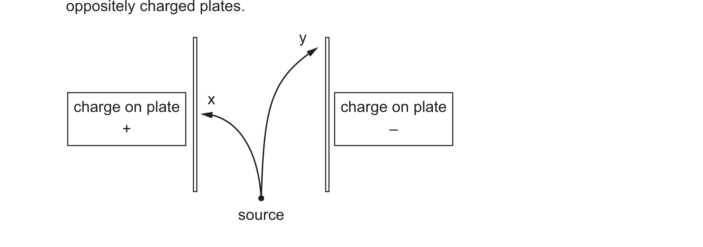

# ch01 Atomic structure · 9701/22 May/June 2026

> 题卷 `originalpdf/9701_s26_qp_22.pdf` ｜ 答案 `originalpdf/9701_s26_ms_22.pdf`
> 本卷本章共 1 题 / 6 分：本章主管 Q2 [6]

---

## Q2 [6]

### (a) Protons, neutrons and electrons are released with the same velocity from a source. Figure 2.1 shows the movement of two of these types of particle when they travel between oppositely charged plates.

（图示：source 位于两块平行板正下方，左板带 +、右板带 −；曲线 x 从 source 向左上方偏折，
指向 + 板一侧；曲线 y 从 source 向右上方偏折，指向 − 板一侧，偏折幅度比 x 小。）

### (a)(i) [1]

Name each type of particle that produces the deflection shown by curves x and y.

**答案** — curve x = electron　**AND**　curve y = proton

### (a)(ii) [1]

Suggest why the particles producing curve y are deflected less than the particles producing
curve x.

**答案** — particles in y are deflected less because they have larger mass
**判分** — A they are heavier / higher mass-to-charge ratio / greater weight / greater momentum /
(particles in) x are lighter；**I** "electrons have negligible mass"（除非有比较）、lower charge
density、density、protons are larger、kinetic energy；**R** protons have greater charge density

### (b) A student considers the information in Table 2.1 and proposes hypothesis 1: *'Atoms with a higher nuclear charge are always larger.'*

**Table 2.1**

| atom | atomic number | mass number | atomic radius / nm |
|---|---|---|---|
| A | 6 | 12 | 0.077 |
| B | 17 | 37 | 0.099 |
| C | 14 | 28 | 0.117 |

### (b)(i) [1]

Identify a pair of atoms from Table 2.1 that supports hypothesis 1.

**答案** — (atom) A and (atom) B　**OR**　(atom) A and (atom) C

### (b)(ii) [1]

Identify a pair of atoms from Table 2.1 that shows hypothesis 1 is false.

**答案** — (atom) B and (atom) C

### (b)(iii) [2]

Explain why atom A is smaller than atom C.

**答案**
- M1 atom A has (one) fewer (electron) shell(s) (so decreased shielding effect)
- M2 (so) more attraction of nucleus for outer/valence electrons　**OR** in atom C the effect of
  more protons/increased nuclear charge is less significant than/outweighed by the (increased
  shielding) effect of the additional shell

**判分** — 题目主语是 A，答案里的 "it" 默认指 A；反过来以 C 为主语论述同样接受；**I** 提及
subshells/orbitals；**I** 原子 A/B/C 身份认错；若写出具体 shell 数，须正确（A = 2、C = 3）

---

**[Total: 6]**
