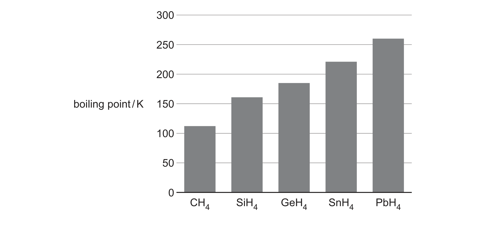

# ch01 Atomic structure · 9701/21 Oct/Nov 2024

> 题卷 `originalpdf/9701_w24_qp_21.pdf` ｜ 答案 `originalpdf/9701_w24_ms_21.pdf`
> 本卷本章共 2 题 / 36 分：本章主管 Q1 [16]；镜像 Q3 [20]（主章 ch3）
> 本卷与 9701/23 同卷（逐字一致，仅条形码与印刷码不同）

---

## Q1 [16]　(兼 ch2 Atoms, molecules and stoichiometry)

Cobalt, rhodium and iridium are metals in the same group of the Periodic Table.

### (a) The shorthand electronic configuration of cobalt is [Ar]3d⁷4s².

### (a)(i) [1] · ch1

Identify what is meant by [Ar] by giving its full electronic configuration.

**答案** — 1s² 2s² 2p⁶ 3s² 3p⁶

### (a)(ii) [1] · ch1

The lowest-energy electrons in cobalt are in the 1s orbital. Draw the shape of a 1s orbital.

**答案** — 画一个圆圈（spherical 1s orbital）

### (a)(iii) [1] · ch1

Deduce the number of unpaired electrons in a cobalt atom.

**答案** — 3 (three)

### (b) Table 1.1 gives some details of the stable naturally occurring isotopes of rhodium and iridium. Complete Table 1.1. [3] · ch1

**Table 1.1**

| isotope | number of protons | number of neutrons | total number of electron shells |
|---|---|---|---|
| $^{103}_{45}\text{Rh}$ | **45** | 58 | **5** |
| $^{191}_{77}\text{Ir}$ | **77** | **114** | 6 |
| $^{193}_{77}\text{Ir}$ | **77** | **116** | 6 |

（加粗为学生需要填的空；58、6（两处）为题目已给出。）

**答案** — 见上表加粗格

### (c) Table 1.2 shows the relative abundances of isotopes in a sample of an alloy containing rhodium and iridium only.

**Table 1.2**

| isotope | relative isotopic mass | relative abundance in alloy |
|---|---|---|
| $^{103}_{45}\text{Rh}$ | 102.91 | 50.00 |
| $^{191}_{77}\text{Ir}$ | 190.96 | 15.18 |
| $^{193}_{77}\text{Ir}$ | 192.96 | 34.82 |

### (c)(i) [2] · ch2

Define relative isotopic mass.

**答案**
- M1 mass of an (atom of an) isotope
- M2 compared to the mass of the unified atomic mass unit (amu)　**OR** on a scale on which a
  carbon-12 atom has a mass of exactly 12 units　**OR** divided by $\frac{1}{12}$ mass of a
  carbon-12 atom

### (c)(ii) [2] · ch22

Use Table 1.2 to calculate the relative atomic mass, *A*ᵣ, of iridium in the alloy. Give your
answer to two decimal places.

**答案**
$(190.96 \times 15.18 + 192.96 \times 34.82) / 50.00$

relative atomic mass of iridium = **192.35**

### (d) Hydrated rhodium(III) chloride, RhCl₃·xH₂O, catalyses the conversion of ethene to but-2-ene. Both stereoisomers of but-2-ene are formed in the reaction.

### (d)(i) [2] · ch2

Hydrated rhodium(III) chloride contains 20.5% by mass of water of crystallisation. Deduce the
integer value of *x* in RhCl₃·xH₂O. Show your working.

**答案**
- M1 $\dfrac{79.5}{209.4} : \dfrac{20.5}{18.0} = 0.380 : 1.14 = 1:3$
  （或等价解法：$\dfrac{18x}{102.9+3(35.5)+18x}=0.205$ 或 $\dfrac{102.9+3(35.5)}{209.4+18x}=0.795$）
- M2 *x* = **3**

### (d)(ii) [1] · ch13

Define stereoisomers.

**答案** — molecules with the same structural formula and same molecular formula with different
3D / different spatial arrangement of atoms / groups

### (d)(iii) [1] · ch13

Explain how the conversion of ethene to but-2-ene can be described as an addition reaction.

**答案** — a single product is made

### (d)(iv) [2] · ch13

Draw the two stereoisomers of but-2-ene.

**答案** — 两个骨架式：**E-but-2-ene**（trans，锯齿形骨架，双键两端的 CH₃ 分居 C=C 异侧）与
**Z-but-2-ene**（cis，双键处骨架拐折，两个 CH₃ 同侧）。

---

**[Total: 16]**

## Q3 [20]　⟨镜像 · 主章 ch3 Chemical bonding⟩

> 本题正本在 [`ch03-chemical-bonding/9701_w24_21.md`](../ch03-chemical-bonding/9701_w24_21.md)，此处为镜像。**不要在本文件里改它** —— 改正本，再跑 `python tools/mirror.py`。

The Group 14 elements show a change from non-metallic to metallic character down the group.

### (a) Table 3.1 shows some properties of two Group 14 elements, C and Sn, in their standard states. The table is incomplete.

**Table 3.1**

| element | C (graphite) | Sn |
|---|---|---|
| state and appearance in standard state | grey shiny solid | silvery solid |
| electrical conductivity | good / conductor | good |
| type of bonding | covalent | metallic |
| type of structure | giant | giant |

（加粗斜体两格为学生需要填的空：C 的 electrical conductivity、type of bonding；Sn 的 type of
structure。其余为题目已给出。）

### (a)(i) [3] · ch4

Complete Table 3.1.

**答案** — 见上表加粗格：C (graphite) electrical conductivity = good/conductor；C (graphite) type
of bonding = covalent；Sn type of structure = giant。

### (a)(ii) [1] · ch4

Identify the lattice structure shown by graphite.

**答案** — giant molecular

### (a)(iii) [1] · ch4

Explain why Sn has good electrical conductivity.

**答案** — its delocalised electrons are free to move

### (b) Carbon is found in inorganic compounds such as carbonates.

### (b)(i) [1] · ch10

Write an equation for the reaction of magnesium carbonate with dilute HCl(aq).

**答案** — MgCO₃ + 2HCl → MgCl₂ + CO₂ + H₂O

### (b)(ii) [1] · ch10

Describe the thermal stability of the carbonates down Group 2.

**答案** — thermal stability increases down the group

### (b)(iii) [2] · ch12

Ammonium carbonate undergoes an acid–base reaction with NaOH(aq). Explain this statement.

**答案**
- M1 NH₄⁺ / ammonium ion / ammonium cation is a proton / H⁺ donor
- M2 OH⁻ is a proton / H⁺ acceptor　**OR** the OH⁻ / NaOH is a stronger base than NH₃

### (c) Figure 3.1 shows a sketch of some of the ionisation energies of silicon, Si.

（图中已画出 1st、2nd 及 7th–14th 共 10 个点，1st、2nd 位置很低；7th 起逐级抬升到 14th。）

### (c)(i) [2] · ch1

Complete the graph in Figure 3.1 to show the third to sixth ionisation energies of Si.

**答案** — Si 的电子排布为 [Ne] 3s² 3p²，即最外层（3s3p）共 4 个价电子，IE1–IE4 都在移走这 4 个
价电子，能量应与已画出的 1st、2nd 相近、缓慢递增，所以 **3rd、4th 两点应画在与 1st、2nd 同一低
水平、略微升高**；从 IE5 开始移走的是次外层 (n=2) 的 8 个电子，能量会有一次明显跳升，**5th、6th
两点应大幅跳高到接近已画出的 7th 那个水平**，与 7th–14th 连成一条连续递增的曲线。
- M1：整体递增（general increase）
- M2：IE4 到 IE5 之间的跳升明显是所有已标出的相邻 IE 之间最大的一次跳升

### (c)(ii) [1] · ch1

Construct an equation to represent the second ionisation energy of Si.

**答案** — Si⁺(g) → Si²⁺(g) + e⁻

### (d) Figure 3.2 shows the boiling points of the simplest hydrides of the Group 14 elements, C to Pb.

（柱状图：CH₄ ≈110 K、SiH₄ ≈160 K、GeH₄ ≈185 K、SnH₄ ≈220 K、PbH₄ ≈260 K，逐级升高。）

### (d)(i) [2] · ch3

Explain the trend in the boiling points of the Group 14 hydrides shown in Figure 3.2.

**答案**
- M1 molecules CH₄ to PbH₄ have greater number of electrons / number of electrons increase
- M2 greater / stronger instantaneous dipole–induced (dipole) forces / London forces / dispersion
  forces　**OR** more energy required to overcome the instantaneous dipole–induced forces / London
  forces / dispersion forces

### (d)(ii) [1] · ch3

Deduce the shape of a molecule of SiH₄.

**答案** — tetrahedral

### (e) Silicon readily reacts with elements of high electronegativity.

### (e)(i) [1] · ch9

Write an equation for the formation of SiCl₄ from its constituent elements.

**答案** — Si + 2Cl₂ → SiCl₄

### (e)(ii) [1] · ch9

Describe what is observed when a small sample of SiCl₄ is added to water.

**答案** — effervescence / misty / steamy fumes

### (e)(iii) [2] · ch4

SiO₂ is a white solid that melts above 1700 °C. SiCl₄ is a colourless liquid at room temperature.
Explain the difference in the melting points of these two compounds with reference to their
structure and bonding.

**答案**
- M1 SiO₂ is giant covalent **AND** SiCl₄ is simple covalent / simple molecular / molecular
- M2 so need less energy to overcome IMF's in SiCl₄, compared to the bonds in SiO₂ (ora)

### (f) [1] · ch9

Tin forms an amphoteric oxide, SnO₂. Suggest the formula of the tin compound that forms when SnO₂
reacts with H₂SO₄ in an acid–base reaction.

**答案** — Sn(SO₄)₂

---

**[Total: 20]**
