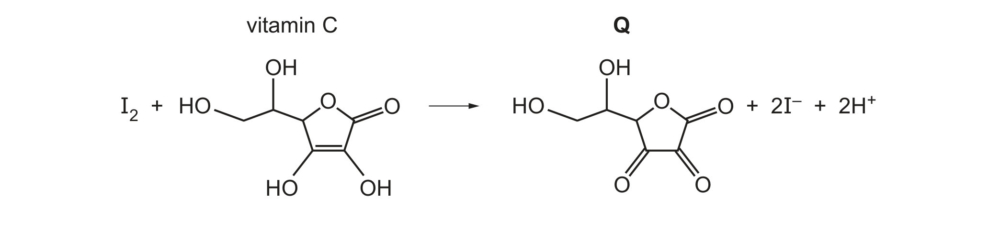
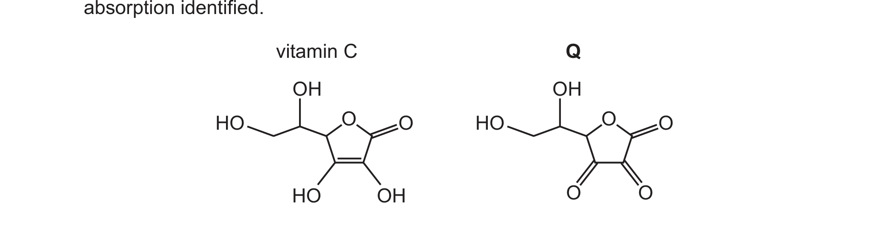

# ch02 Atoms, molecules and stoichiometry · 9701/21 May/June 2025

> 题卷 `originalpdf/9701_s25_qp_21.pdf` ｜ 答案 `originalpdf/9701_s25_ms_21.pdf`
> 本卷本章共 1 题 / 9 分：本章主管 Q4 [9]

---

## Q4 [9]

The structure of vitamin C is shown in Figure 4.1.

### (a) [1]

Deduce the empirical formula of vitamin C.

**答案** — C₃H₄O₃

### (b) [7]

The concentration of vitamin C is found by titration with I₂(aq).

A vitamin C tablet is dissolved in water to produce 200.0 cm³ of vitamin C solution.
5.00 cm³ of this vitamin C solution is added to a flask with approximately 150 cm³ of water
and an indicator.
Exactly 28.40 cm³ of 5.00 × 10⁻⁴ mol dm⁻³ I₂(aq) reacts with the sample of vitamin C solution
in the flask.

[*M*ᵣ: vitamin C, 176]

#### (b)(i) [1]

Calculate the amount, in mol, of I₂(aq) added to the flask in this titration.

**答案** — (28.40 / 1000 × 0.0005) = 1.42 × 10⁻⁵ mol

#### (b)(ii) [2]

Use your answer to (b)(i) to calculate the mass, in g, of vitamin C in the tablet. Show your
working.

（若 (b)(i) 算不出，官方给替代值 2.64 × 10⁻⁴ mol 代入继续算——声明这不是正确值）

**答案**
- (1.42 × 10⁻⁵ × 176 × 200 / 5) = 0.099968
- M1 correct method to deduce mass of vit C in 5 cm³ sample：(1.42 × 10⁻⁵ × 176) = 2.49 × 10⁻³
- M2 correct calculation for mass of vit C in original solution：(2.49 × 10⁻³ × 200 / 5) = 0.099968
- OR
- M1 correct method to deduce amount, mol, vit C in 5 cm³ sample：(1.42 × 10⁻⁵ × 200 / 5) = 5.68 × 10⁻⁴
- M2 correct calculation for mass of vit C in original solution = M1 × 176：(5.68 × 10⁻⁴) × 176 = 0.099968

#### (b)(iii) [1]

Deduce the role of I₂(aq) in the reaction in Figure 4.2.

**答案** — oxidising agent

#### (b)(iv) [2]

Suggest two reasons why hot concentrated acidified potassium manganate(VII) is not a suitable
reagent for producing **Q** from vitamin C.

**答案**
- M1 (also) oxidises / reacts with (primary and / or secondary) alcohol groups
- M2 (also) breaks the sigma and pi bond in C=C

### (c) [2]

Predict two absorptions that will be seen in the infrared spectra of both vitamin C and **Q**.
Describe the relevant bond and the specific functional group that is responsible for each
absorption identified.

题干附 Table 4.1 供作答参考：

| bond | functional groups containing the bond | characteristic infrared absorption range (in wavenumbers) / cm⁻¹ |
|---|---|---|
| C−O | hydroxy, ester | 1040–1300 |
| C=C | aromatic compound, alkene | 1500–1680 |
| C=O | amide carbonyl, carboxyl ester | 1640–1690 1670–1740 1710–1750 |
| C≡N | nitrile | 2200–2250 |
| C−H | alkane | 2850–2950 |
| N−H | amine, amide | 3300–3500 |
| O−H | carboxyl hydroxy | 2500–3000 3200–3650 |

**答案** — Any two complete rows from：

| wavenumber / cm⁻¹ | bond | functional group |
|---|---|---|
| 1040–1300 | C−O | ester / hydroxy |
| 3200–3650 | O−H | hydroxy / alcohols |
| 2850–2950 | C−H | alkane |
| 1710–1750 | C=O | ester |

---

**[Total: 9]**
