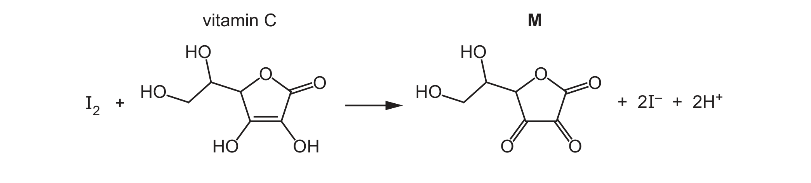

# ch02 Atoms, molecules and stoichiometry · 9701/22 May/June 2025

> 题卷 `originalpdf/9701_s25_qp_22.pdf` ｜ 答案 `originalpdf/9701_s25_ms_22.pdf`
> 本卷本章共 1 题 / 5 分：本章主管 Q5 [5]

---

## Q5 [5]

The structure of vitamin C is shown in Figure 5.1.

### (a) [1]

Deduce the empirical formula of vitamin C.

**答案** — C₃H₄O₃

### (b) [4]

The mass of vitamin C present in 150.0 g of lemon is found in an experiment.

- stage 1 — All the vitamin C in 150.0 g of lemon is extracted and dissolved in water to make
  100.0 cm³ of solution **L**.
- stage 2 — A 25.0 cm³ sample of solution **L** is titrated with 5.00 × 10⁻³ mol dm⁻³ I₂(aq).

Exactly 36.65 cm³ of I₂(aq) reacts with the 25.0 cm³ sample of solution **L**.

[*M*ᵣ: vitamin C, 176]

#### (b)(i) [1]

Calculate the amount, in mol, of I₂(aq) added in the titration.

**答案** — 5.00 × 10⁻³ × 36.65 / 1000 = 1.833 × 10⁻⁴ / 1.8325 × 10⁻⁴ mol

#### (b)(ii) [2]

Use your answer to (b)(i) to calculate the percentage by mass of vitamin C present in 150.0 g
of lemon.

（若 (b)(i) 算不出，官方给替代值 7.65 × 10⁻⁴ mol 代入继续算——声明这不是正确值）

**答案**
- M1 expression and / or correct calculation to show how the amount of vitamin C in 150 g of
  lemon peel is calculated：1.8325 × 10⁻⁴ mol × 176 × 4
- M2 correct calculation based on (M1 / 150) × 100 = 0.086(%)
- Using 1.8325 × 10⁻⁴ for M1, M2 = 0.086 OR 0.087(%)
- Alternative answer using 7.65 × 10⁻⁴：
  - M1 7.65 × 10⁻⁴ × 176 × 4 = 0.5386 / 0.539
  - M2 correct calculation based on (M1 / 150) × 100 = 0.359 / 0.36 (%)

#### (b)(iii) [1]

The progress of the reaction of vitamin C with I₂(aq) to produce **M** is monitored using
infrared spectroscopy.

Table 5.1 indicates the presence of some absorptions in the infrared spectrum of vitamin C.
Complete Table 5.1 to predict which of these absorptions, if any, are present in the infrared
spectrum of **M**.

Table 5.1

| absorption / cm⁻¹ | present in spectrum of vitamin C | present in spectrum of **M** |
|---|---|---|
| 1500–1680 | ✓ | |
| 2850–2950 | ✓ | |
| 3200–3650 | ✓ | |

题干附 Table 5.2 供作答参考：

| bond | functional groups containing the bond | characteristic infrared absorption range (in wavenumbers) / cm⁻¹ |
|---|---|---|
| C−O | hydroxy, ester | 1040–1300 |
| C=C | aromatic compound, alkene | 1500–1680 |
| C=O | amide carbonyl, carboxyl ester | 1640–1690 1670–1740 1710–1750 |
| C≡N | nitrile | 2200–2250 |
| C−H | alkane | 2850–2950 |
| N−H | amine, amide | 3300–3500 |
| O−H | carboxyl hydroxy | 2500–3000 3200–3650 |

**答案**

| absorption / cm⁻¹ | present in spectrum of vitamin C | present in spectrum of **M** |
|---|---|---|
| 1500–1680 | ✓ | ✗ / − / blank |
| 2850–2950 | ✓ | ✓ |
| 3200–3650 | ✓ | ✓ |

---

**[Total: 5]**
