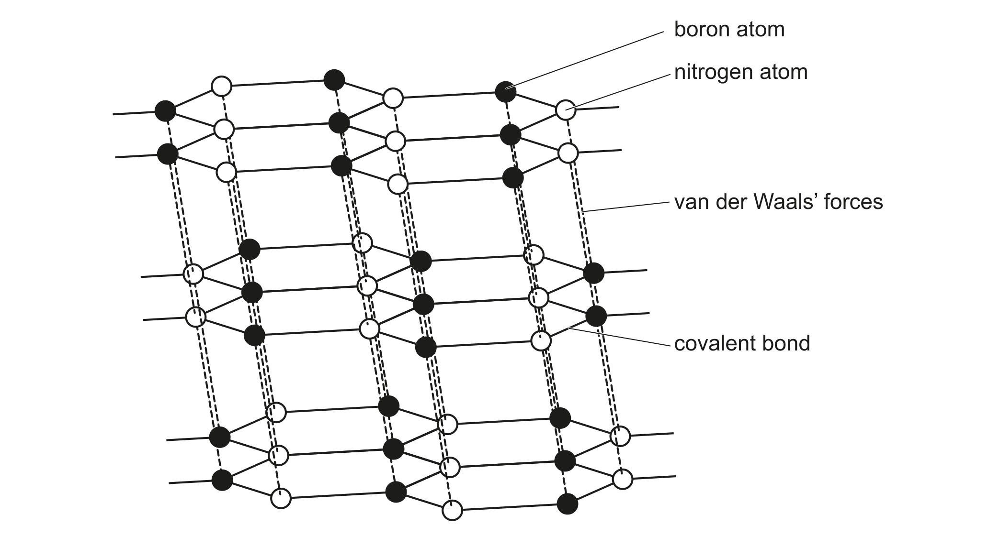
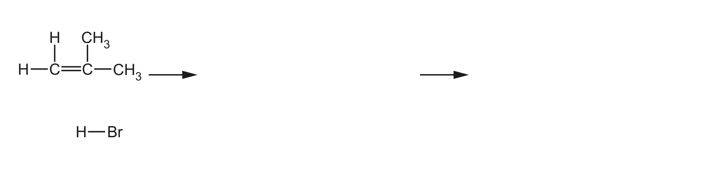

# ch03 Chemical bonding · 9701/21 May/June 2024

> 题卷 `originalpdf/9701_s24_qp_21.pdf` ｜ 答案 `originalpdf/9701_s24_ms_21.pdf`
> 本卷本章共 2 题 / 21 分：本章主管 Q2 [12]、Q5 [9]

---

## Q2 [12]　(兼 ch9 Period 3 chemistry)

### (a) Sulfur chloride, SCl₂, is a liquid at room temperature. When SCl₂ is added to water, misty fumes are seen and a solution is made that turns universal indicator red.

### (a)(i) [1] · ch9

Identify the type of reaction that occurs when SCl₂ is added to water.

**答案** — hydrolysis

### (a)(ii) [1] · ch9

Name a chloride of a different Period 3 element that is also a liquid at room temperature and
produces misty fumes when added to water.

**答案** — silicon(IV) chloride / silicon tetrachloride
**判分** — ALLOW phosphorus(III) chloride / phosphorus trichloride

### (b) A molecule of SCl₂ contains two S–Cl covalent bonds.

### (b)(i) [2] · ch3

Complete the dot-and-cross diagram in Figure 2.1 to show the arrangement of the outer electrons in
a molecule of SCl₂. Use × to show electrons from the chlorine atoms. Use ● to show electrons from
the sulfur atom.

**答案** — 三个圆圈横向相切：左 Cl、中 S、右 Cl。
- M1：S 与每个 Cl 的相切区各画 1 对共用电子对（一个 ×、一个 ●，即 shared pair between each S–Cl）
- M2：每个 Cl 圆圈外圈再画 6 个非成键电子（3 对 ×，only crosses）；S 圆圈外圈再画 4 个非成键电子
  （2 对 ●，only dots）

### (b)(ii) [2] · ch3

Predict the shape of, and bond angle in, a molecule of SCl₂ by using VSEPR theory.

**答案**
- shape：non-linear（V 形/bent，因为 S 上有 2 个 bonding pair + 2 个 lone pair）
- bond angle：103–105°

### (c) Solid magnesium nitride, Mg₃N₂, is a crystalline solid.

### (c)(i) [1] · ch6

Deduce the oxidation numbers of magnesium and nitrogen in magnesium nitride to complete
Table 2.1.

**Table 2.1**

| | oxidation number in Mg₃N₂ |
|---|---|
| magnesium | (+)II / 2(+) |
| nitrogen | −III / 3− |

**判分** — 两格都对才给 1 分（both correct for one mark）。

### (c)(ii) [1] · ch2

Magnesium nitride reacts with an excess of water to produce ammonia and magnesium hydroxide
only. Construct an equation to describe this reaction.

**答案** — Mg₃N₂ + 6H₂O → 3Mg(OH)₂ + 2NH₃

### (c)(iii) [2] · ch12

Explain why the solution produced in the reaction in (c)(ii) has a pH greater than 7. Refer to the
products of the reaction in your answer.

**答案**
- M1 due to OH⁻(aq)
- M2 **EITHER** acid-base reaction of water by ammonia **OR** dissociation of (some) Mg(OH)₂

### (d) Boron nitride is a white solid that melts above 2900 °C.

Figure 2.2 shows part of the lattice structure of a crystal of boron nitride — boron 原子与 nitrogen
原子交替排列成层状六方网络，层内以 covalent bond 相连，层间以 van der Waals' forces 相连（结构
与 graphite 类似）。

### (d)(i) [1] · ch2

Use Figure 2.2 to deduce the empirical formula of boron nitride.

**答案** — BN

### (d)(ii) [1] · ch4

Suggest the identity of another crystalline solid that has atoms arranged in layers similar to that of
solid boron nitride.

**答案** — graphite

---

**[Total: 12]**

---

## Q5 [9]　(兼 ch14 Alkenes)

Hydrocarbon molecules contain covalent bonds.

### (a) [1] · ch3

Define covalent bond.

**答案** — (electrostatic) attraction between nuclei of two atoms and shared pair of electrons

### (b) A C=C bond in an alkene is made from a σ bond and a π bond.

### (b)(i) [1] · ch3

Identify the hybridisation of the carbon atoms in a C=C bond in an alkene.

**答案** — sp²

### (b)(ii) [2] · ch3

Draw labelled diagrams to show, in terms of orbital overlap, how the σ and π bonds are made in a
C=C bond.

**答案**（答案本身是图，去看 MS 渲染页 `_img/9701_s24_21_msp10.png`）
- σ bond：两个 sp² 轨道沿键轴方向**头对头（direct/end-on）重叠**，重叠区域画在两个原子核连线
  正中间，呈纺锤/橄榄球形。
- π bond：两个碳各自未参与杂化的 p 轨道（每个 p 轨道是上下两瓣的哑铃形），**侧向（sideways）
  重叠**——上瓣与上瓣、下瓣与下瓣分别重叠，在 C=C 键轴上下各形成一个电子云叶瓣，标注
  "p (orbitals)" 及 "sideways overlap"。

### (c) In electrophilic reactions involving alkenes the π bond of C=C is broken.

### (c)(i) [1] · ch3

Suggest one difference between σ and π bonds that explains why the π bond is broken in
electrophilic addition reactions involving alkenes.

**答案** — **EITHER** (pair of) electrons in π bond are further away from the nuclei so weaker
attraction　**OR** (pair of) electrons in σ bond are closer to the two nuclei so stronger attraction

### (c)(ii) [4] · ch14

Complete Figure 5.1 to show the mechanism for the electrophilic addition of hydrogen bromide to
2-methylpropene to produce the major organic product. Include charges, dipoles, lone pairs of
electrons and curly arrows, as appropriate.

**答案**（机理三步：2-methylpropene + HBr → 叔碳正离子中间体 + Br⁻ → 2-bromo-2-methylpropane）
- M1 curly arrow：从 C=C 双键指向 H–Br 的 H
- M2：H–Br 上标出正确 dipole（Hᵟ⁺—Brᵟ⁻），并有 curly arrow 从 H–Br 键指向 Br
- M3：画出正确的（叔碳）carbocation intermediate，**AND** 最终产物为 2-bromo-2-methylpropane
- M4：curly arrow 从 Br⁻ 的 lone pair 指向中间体的 C⁺（C 上标 +ve 或 δ+ 电荷）

**判分** — 中间体必须是三级碳正离子（(CH₃)₃C⁺），因为 2-methylpropene 加成遵循 Markovnikov 规则。

---

**[Total: 9]**
