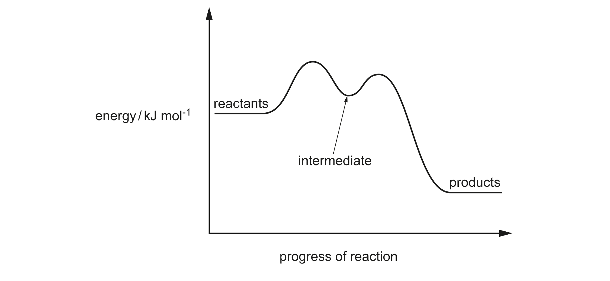
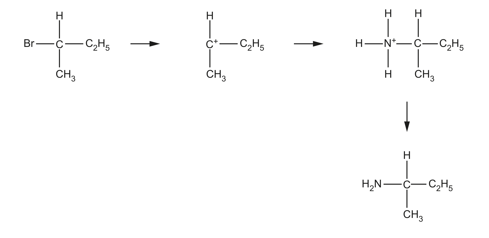

# ch03 Chemical bonding · 9701/23 May/June 2024

> 题卷 `originalpdf/9701_s24_qp_23.pdf` ｜ 答案 `originalpdf/9701_s24_ms_23.pdf`
> 本卷本章共 2 题 / 29 分：本章主管 Q1 [13]、Q4 [16]

---

## Q1 [13]　(兼 ch12 Nitrogen and sulfur)

### (a)(i) [2] · ch12

Explain the lack of reactivity of nitrogen gas, N₂(g).

**答案**
- M1 (N₂ molecules / molecule(s) of N₂) have a strong triple (covalent) bond
- M2 (N₂ molecules / molecule(s) of N₂) are non-polar

### (a)(ii) [4] · ch3

Covalent bonds can be σ bonds or π bonds. Complete Table 1.1 to show the number of σ and π bonds
in a molecule of N₂ and to describe how the orbitals overlap to form σ and π bonds.

**Table 1.1**

| | σ bond | π bond |
|---|---|---|
| number of bonds in N₂ | 1 | 2 |
| how the orbitals overlap | direct (orbital overlap) | sideways (overlap of adjacent p orbitals) |

### (b)(i) [1] · ch9

A sample of Al reacts with an excess of Cl₂. State the oxidation number of Al in the product of the
reaction.

**答案** — (+)III

### (b)(ii) [1] · ch9

State what determines the maximum oxidation number of the Period 3 elements in their oxides.

**答案** — number of outer / valence electrons

### (c) Separate samples of aluminium oxide, Al₂O₃, and phosphorus(V) oxide, P₄O₁₀, react with an excess of NaOH(aq) at room temperature.

### (c)(i) [1] · ch9

Give the state of Al₂O₃ and P₄O₁₀ at room temperature.

**答案** — both states shown as solid

### (c)(ii) [2] · ch9

Write an equation for the reaction of each oxide with an excess of NaOH(aq) at room temperature.

**答案**
- M1（Al₂O₃）：Al₂O₃ + 2NaOH + 3H₂O → 2NaAl(OH)₄
- M2（P₄O₁₀ 与过量 NaOH）：P₄O₁₀ + 12NaOH → 4Na₃PO₄ + 6H₂O

### (d) The oxide of silicon reacts with calcium oxide in an addition reaction to produce calcium silicate, CaSiO₃. The oxidation number of calcium in CaSiO₃ is +II.

### (d)(i) [1] · ch6

Deduce the oxidation number of silicon in calcium silicate.

**答案** — (+)IV

### (d)(ii) [1] · ch10

Calcium oxide can be made from calcium carbonate in a single-step reaction. Identify the type of
reaction that occurs.

**答案** — thermal decomposition

---

**[Total: 13]**

---

## Q4 [16]　(兼 ch19 Halogenoalkanes)

### (a) [2] · ch3

NH₃(g) reacts with HCl(g) to produce NH₄Cl(s): NH₃(g) + HCl(g) → NH₄Cl(s)

Draw a diagram to show the ionic, covalent and coordinate bonding present in a formula unit of
NH₄Cl.

**答案** — 中心 N 通过 4 条 N—H 键连接 4 个 H（其中 3 条为普通 covalent bond，1 条画成箭头
——由 N 指向该 H，表示 coordinate/dative bond，来自 N 提供的孤对电子），整个 NH₄⁺ 用方括号
框起并标 "+"；方括号外单独写一个 Cl⁻，两者以 ionic bond 结合（NH₄⁺ 与 Cl⁻ 之间无共用电子，
靠静电吸引）。
- M1：（ionic bond between）NH₄⁺ **AND** Cl⁻　**AND** 4 条 N—H covalent bond（或 4 对共用电子对）
- M2：其中 1 条 N—H 为 coordinate bond——用箭头表示方向正确，或只用同一种电子符号画出该 1 对
  成键电子

### (b) An exothermic reaction occurs when NH₄⁺(aq) is added to OH⁻(aq).

### (b)(i) [1] · ch12

Identify the type of reaction.

**答案** — acid–base reaction

### (b)(ii) [1] · ch12

Construct an ionic equation for the reaction of NH₄⁺ and OH⁻.

**答案** — NH₄⁺ + OH⁻ → NH₃ + H₂O

### (c) Substitution reactions of NH₃ and OH⁻ with halogenoalkanes both involve a lone pair of electrons.

### (c)(i) [1] · ch15

Name the role of NH₃ and OH⁻ in these reactions.

**答案** — nucleophile

### (c)(ii) [1] · ch15

Suggest which species, NH₃ or OH⁻, is more reactive during these reactions. Explain your answer.

**答案** — OH⁻（more reactive because）negatively charged species more attracted to halogenoalkane
and/or Cᵟ⁺ and/or intermediate and/or C⁺
　**OR** NH₃（more reactive because）N electrons less tightly held
　**OR** N is more able to donate (lp) electrons (to make the covalent bond)
　**OR** N is less electronegative

**判分** — 选 OH⁻ 或 NH₃ 皆可给分，只要解释逻辑自洽（ORA）。

### (d) [2] · ch5

When 2-bromo-2-methylpropane reacts with OH⁻, two mechanisms, SN1 and SN2, both
occur. The SN2 mechanism has a slower rate.

Figure 4.1 shows the reaction pathway diagram for the SN1 mechanism（reactants → 两个驼峰
经过 intermediate → products）。

Sketch a graph on Figure 4.1 to show the reaction pathway for the SN2 mechanism.

**答案** — 在同一坐标系里加画**单峰**曲线：起点（reactants）能量与终点（products）能量都跟
SN1 曲线一致，但中间**只有一个高峰、没有中间体谷底**，且这个高峰（transition state /
activation energy）明显高于 SN1 图中两个驼峰的能量（因为 SN2 反应更慢）。
- M1：起止能量与原曲线一致 **AND** 单峰（single hump）
- M2：新画曲线的 transition state / activation energy 高于原 SN1 图中两个 transition state
  的能量

### (e)(i) [3] · ch15

Complete Figure 4.2 to show the mechanism for the SN1 reaction that occurs when CH₃CHBrC₂H₅
reacts with NH₃ to produce CH₃CH(NH₂)C₂H₅. Include charges, dipoles, lone pairs of electrons and
curly arrows, as appropriate.

**答案**（三步机理：CH₃CHBrC₂H₅ → 二级碳正离子中间体 + Br⁻ → 经 NH₃ 进攻生成
CH₃CH(NH₃⁺)C₂H₅ → 失去 H⁺ 生成 CH₃CH(NH₂)C₂H₅）
- M1：2-bromobutane 的 C—Br 键上标正确 dipole，并有 curly arrow 从该键指向 Br
- M2：NH₃ 的 lone pair 上有 curly arrow 指向中间体的 C⁺
- M3：curly arrow 表示其中一条 N—H 键断裂、箭头指向 N（即该 H⁺ 被 later 转移走，得到中性胺
  产物）

### (e)(ii) [1] · ch19

Identify the inorganic product that forms in the reaction in Figure 4.2.

**答案** — NH₄Br / ammonium bromide

### (e)(iii) [1] · ch19

Give the systematic name for the organic product CH₃CH(NH₂)C₂H₅.

**答案** — butan-2-amine **OR** butyl-2-amine

### (f)(i) [1] · ch15

Complete Table 4.1 by drawing the structural formula of the intermediate that is formed when
2-bromo-2-methylpropane reacts in an SN1 reaction.

**Table 4.1**

| | 2-bromobutane | 2-bromo-2-methylpropane |
|---|---|---|
| structural formula of intermediate in SN1 reaction | C⁺ 连接 H、C₂H₅、CH₃（二级碳正离子） | （需自行画出） |

**答案** — 官方 mark scheme 该格实际留空（无印刷图样），按题目逻辑类推：2-bromo-2-methylpropane
是 (CH₃)₃CBr，失去 Br⁻ 后得到的中间体应画成 **C⁺ 上连接三个 CH₃ 基团**（三级碳正离子），
与左栏 2-bromobutane 那格的画法风格一致（C⁺ 居中，三条键分别标 CH₃、CH₃、CH₃）。

### (f)(ii) [2] · ch15

Identify the halogenoalkane in Table 4.1 that has the greater tendency to react using the
SN1 mechanism. Explain your answer.

**答案**
- M1 2-bromo-2-methylpropane **AND** more stable carbocation / C⁺
- M2 alkyl groups have an inductive effect (of alkyl groups) **AND** 2-bromo-2-methylpropane has
  more / most alkyl groups attached (to C⁺) / carbocation contains more alkyl groups

---

**[Total: 16]**
