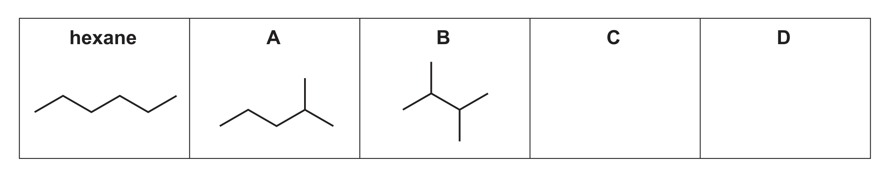
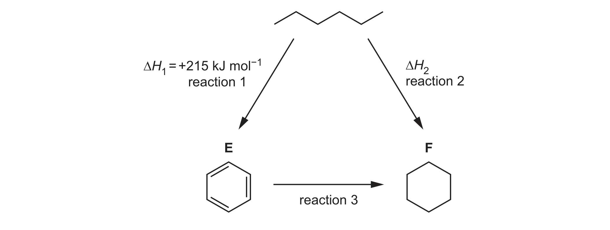

# ch03 Chemical bonding · 9701/22 Oct/Nov 2025

> 题卷 `originalpdf/9701_w25_qp_22.pdf` ｜ 答案 `originalpdf/9701_w25_ms_22.pdf`
> 本卷本章共 1 题 / 14 分：镜像 Q3 [14]（主章 ch14）

---

## Q3 [14]　⟨镜像 · 主章 ch14 Hydrocarbons⟩

> 本题正本在 [`ch14-hydrocarbons/9701_w25_22.md`](../ch14-hydrocarbons/9701_w25_22.md)，此处为镜像。**不要在本文件里改它** —— 改正本，再跑 `python tools/mirror.py`。

The alkanes are a homologous series of organic molecules. Alkanes are generally unreactive and
are commonly used as fuels.

### (a) [2] · ch13

Define homologous series.

**答案**
- M1 (family of molecules / compounds / series with) same general formula
  OR (family of molecules where) molecular formula differs (only) by (units of) CH₂(n)
- M2 similar chemical properties / reactions

### (b) [2] · ch14

Give two reasons to explain the general unreactivity of alkanes.

**答案**
- M1 strong C—H (bonds)
- M2 non-polar (C—H / molecule / bonds)

### (c) [1] · ch14

Alkanes with low relative molecular mass, *M*ᵣ, are more useful than those found in heavier crude
oil fractions. Name the process that is used to obtain alkanes with low *M*ᵣ from heavier crude oil
fractions.

**答案** — cracking

### (d) Hexane, C₆H₁₄, has four structural isomers. Fig. 3.1 shows hexane and two of its structural
isomers.

### (d)(i) [2] · ch13

Complete Fig. 3.1 by drawing structures for C and D, the other two structural isomers of hexane.

**答案** — Fig. 3.1 中已给出 hexane（直链）、A（2-methylpentane，支链在离端点第 2 个碳）、
B（2,3-dimethylbutane，两个 methyl 分别在相邻的第 2、3 个碳上）。还需再画出：
- C = 3-methylpentane：CH₃CH₂CH(CH₃)CH₂CH₃（methyl 支链在链正中间的第 3 个碳）
- D = 2,2-dimethylbutane：CH₃CH₂C(CH₃)₂CH₃（两个 methyl 都接在同一个碳，即第 2 个碳，
  上，形成 quaternary carbon）

### (d)(ii) [3] · ch3

A, B and hexane have different boiling points. Arrange A, B and hexane in order of increasing
boiling point. Explain your answer.

lowest ……… < ……… < ……… highest

**答案** — lowest **B** < **A** < **hexane** highest
- M1 B < A < hexane
- M2 hexane / unbranched has stronger / more IMFs
- M3 hexane / unbranched requires most / more energy

**判分** — B（2,3-dimethylbutane，2 个支链）比 A（2-methylpentane，1 个支链）分子更紧凑、
表面接触面积更小，instantaneous dipole–induced dipole 作用力更弱，沸点最低；hexane 完全
是直链，分子间接触面积最大、IMF 最强、沸点最高

### (e) Hexane can be converted into compounds E and F at high temperature and pressure. Fig. 3.2
shows the reaction scheme involving hexane, E and F.

（reaction 1：hexane → E，Δ*H*₁ = +215 kJ mol⁻¹；reaction 2：E → F，Δ*H*₂ 待求；
reaction 3：hexane → F，直接反应）

### (e)(i) [1] · ch14

Identify a suitable reagent for reaction 3.

**答案** — H₂ ((g)) OR hydrogen (gas)

### (e)(ii) [2] · ch5

Use the data in Fig. 3.2 and in Table 3.1 to calculate the enthalpy change of reaction 2, Δ*H*₂.

Table 3.1

| compound | enthalpy change of formation, Δ*H*f / kJ mol⁻¹ |
|---|---|
| E | −156 |
| F | +48 |

**答案**
- M1 +215 + (−156) − (+48) =
- M2 +11 kJ mol⁻¹

Δ*H*₂ = **+11 kJ mol⁻¹**

### (e)(iii) [1] · ch14

Write an equation for the complete combustion of hexane.

**答案** — C₆H₁₄ + 9½O₂ → 6CO₂ + 7H₂O

---

**[Total: 14]**
