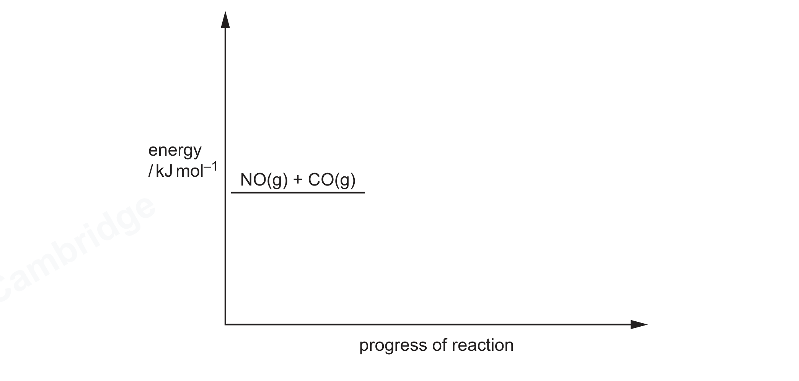

# ch05 Chemical energetics · 9701/22 Feb/March 2026

> 题卷 `originalpdf/9701_m26_qp_22.pdf` ｜ 答案 `originalpdf/9701_m26_ms_22.pdf`
> 本卷本章共 1 题 / 13 分：镜像 Q2 [13]（主章 ch12）

---

## Q2 [13]　⟨镜像 · 主章 ch12 Nitrogen and sulfur⟩

> 本题正本在 [`ch12-nitrogen-and-sulfur/9701_m26_22.md`](../ch12-nitrogen-and-sulfur/9701_m26_22.md)，此处为镜像。**不要在本文件里改它** —— 改正本，再跑 `python tools/mirror.py`。

Nitrogen monoxide, NO, is an atmospheric pollutant.

### (a) Figure 2.1 shows the dot-and-cross diagram of NO.

### (a)(i) [1] · ch3

NO has an unpaired electron. State the term for a molecule with an unpaired electron.

**答案** — (free) radical

### (a)(ii) [1] · ch3

In NO, the N and O atoms are bonded by a sigma (σ) and a pi (π) bond. Complete Figure 2.2 to show the pi bond in NO that is formed from orbital overlap.

**答案** — 在 N—O 键上下各画一瓣 p orbital lobe（哑铃形，一瓣在线上方、一瓣在线下方，代表
side-on overlap 形成的 π 轨道）

### (b) [4] · ch4 ch2

In the laboratory, NO is made in the reaction of copper metal with dilute nitric acid. The reaction is kept cold to prevent the oxidation of NO.

8HNO₃(aq) + 3Cu(s) → 3Cu(NO₃)₂(aq) + 4H₂O(l) + 2NO(g)

A student reacts 0.00393 mol Cu with excess dilute HNO₃(aq) at 5 °C and 101 kPa. Calculate the maximum volume, in cm³, of NO(g) that is produced under these conditions.

**答案**
- M1 moles of NO = 0.00393 × 2/3 = 0.00262
- M2 *p* = 101 000 (Pa)，*R* = 8.31，*T* = 278，*n* = 0.00262　OR　*p* = 101 (kPa)
- M3 use of *pV* = *nRT*　OR　*V* = *nRT* / *p*
- M4 volume = 5.99 × 10⁻⁵ × 10⁶ = **59.9 cm³**　OR　5.99 × 10⁻² × 10³

### (c)(i) [1] · ch12

State a natural process that creates atmospheric NO.

**答案** — lightning

### (c)(ii) [1] · ch12

Photochemical smog forms when NO reacts with unburned hydrocarbons. Identify the major component of photochemical smog.

**答案** — PAN / peroxyac(et)ylnitrate

### (c)(iii) [2] · ch12

NO has a catalytic role in the oxidation of atmospheric SO₂.

SO₂ + ½O₂ ⇌ SO₃

Show, using relevant equations, the catalytic role that NO has in this oxidation.

**答案**
- M1 first equation　NO + ½O₂ → NO₂
- M2 second equation　SO₂ + NO₂ → SO₃ + NO

### (d) Reaction 1 occurs during the catalytic removal of NO from car exhaust gases.

reaction 1　NO(g) + CO(g) ⇌ ½N₂(g) + CO₂(g)　　Δ*H* = –373 kJ mol⁻¹

The activation energy, *E*ₐ, of this reaction is 570 kJ mol⁻¹.

### (d)(i) [2] · ch5

Complete Figure 2.3 to sketch the energy profile for reaction 1. Show the enthalpy change, Δ*H*, and the activation energy, *E*ₐ.

**答案**
- reactants higher than labelled products AND hump in the middle
- reactants to top of hump = *E*ₐ OR (+)570 (kJ mol⁻¹)
- reactants to products = Δ*H* OR (–)373 (kJ mol⁻¹)

### (d)(ii) [1] · ch8

On your diagram in Figure 2.3, show how the addition of a catalyst affects reaction 1.

**答案** — diagram has lower-energy transition state(s)

---

**[Total: 13]**
