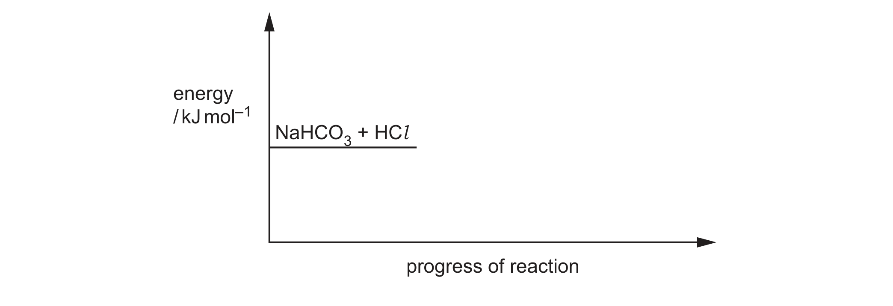

# ch05 Chemical energetics · 9701/22 May/June 2024

> 题卷 `originalpdf/9701_s24_qp_22.pdf` ｜ 答案 `originalpdf/9701_s24_ms_22.pdf`
> 本卷本章共 1 题 / 10 分：本章主管 Q2 [10]

---

## Q2 [10]

Separate samples of Na₂CO₃ and NaHCO₃ react with HCl(aq) to produce the same products, as
shown in Table 2.1.

**Table 2.1**

| reaction | equation | Δ*H* / kJ mol⁻¹ |
|---|---|---|
| 1 | Na₂CO₃ + 2HCl → 2NaCl + H₂O + CO₂ | Δ*H*₁ |
| 2 | NaHCO₃ + HCl → NaCl + H₂O + CO₂ | Δ*H*₂ = +27.2 |

### (a) [2]

Complete the reaction pathway diagram in Fig. 2.1 for reaction 2. Label the diagram to show the
enthalpy change, Δ*H*₂, and the activation energy, *E*A.

**答案** — 图中已给 reactants（NaHCO₃ + HCl）能级线。从该能级向右延伸一条虚线基准线；在基准线
右侧向上画一个 hump（先升后降的曲线）代表 transition state，降回到一条**高于** reactants 的水平线
并标注 products（NaCl + H₂O + CO₂）。再从虚线基准线画两条竖直箭头：一条到 hump 最高点标
*E*A，另一条到 products 能级标 Δ*H*₂（或标 (+)27.2）。

**判分** — All three correct (2 marks) or two correct (1 mark)：
- profile for endothermic reaction（含 'hump'）
- arrow representing *E*A
- arrow representing Δ*H*₂ OR (+)27.2

### (b) The value for Δ*H*₁ is determined by experiment using the following method.

- 50.0 cm³ of 2.00 mol dm⁻³ HCl(aq) is added to a polystyrene cup.
- The initial temperature of the acid is recorded as 19.6 °C.
- 0.0400 mol of Na₂CO₃ is added and the mixture is stirred.
- All the solid Na₂CO₃ disappears and a colourless solution is produced.

The maximum temperature recorded during the reaction is 26.2 °C.

### (b)(i) [1]

Describe one other observation that shows the reaction is complete.

**答案** — no more fizzing / effervescence stops

### (b)(ii) [3]

Calculate the value of Δ*H*₁ in kJ mol⁻¹. Assume the specific heat capacity of the reaction mixture
is the same as for water and no heat is lost to the surroundings. Show your working.

Δ*H*₁ = ..................... kJ mol⁻¹ [3]

**答案**
- M1 calculate *Q* from = 50 × 4.18 × (26.2 − 19.6) = 1379.(4)
- M2 use M1 to find energy change when 1 mol Na₂CO₃ / 2 mol HCl reacts：M1 ÷ 0.04 = 34485
- M3 express *Q* as Δ*H*₁ in kJ mol⁻¹ = −(value for M2) ÷ 1000 = **−34.5 kJ mol⁻¹**

Alternative method
- M1 evidence of use *Q* = *mc*Δ*T* = 50 × 4.18 / 1000 × (26.2 − 19.6) = 1.3794
- M2 use M1 to find energy change when 1 mol Na₂CO₃ / 2 mol HCl reacts：M1 ÷ 0.04 = 34.485
- M3 express *Q* as Δ*H*₁ in kJ mol⁻¹ = −(value for M2)（expressed in kJ）= **−34.5 kJ mol⁻¹**

### (b)(iii) [2]

Thermal decomposition occurs when NaHCO₃ is heated.

reaction 3　2NaHCO₃ → Na₂CO₃ + H₂O + CO₂

Calculate the enthalpy change for reaction 3, Δ*H*ᵣ, using the data in Table 2.1 and the value of
Δ*H*₁ calculated in (b)(ii). (If you were unable to calculate a value for Δ*H*₁ in (b)(ii), assume the
enthalpy change is −38.4 kJ mol⁻¹. This is **not** the correct value.)

Δ*H*ᵣ = ..................... kJ mol⁻¹ [2]

**答案** — Using answer from (b)(ii)：
- (=) 2Δ*H*₂ − (Δ*H*₁)
- (=) 2 × 27.2 − (答案(b)(ii))
- 2 × 27.2 − (−34.50) = **(+)88.9 kJ mol⁻¹**

**判分** — All three correct (2 marks) or two correct (1 mark)：
- (27.2) − (−34.5) OR (27.2) − (答案(b)(ii))
- 2 × 27.2 and 1 × 答案(b)(ii)
- calculate correctly their expression

用备用值 Δ*H*₁ = −38.4 kJ mol⁻¹ 时：Δ*H*ᵣ = (+)92.8 kJ mol⁻¹，同样给 2 分（ecf）

### (c) [2]

**Z** is a salt that contains a Period 4 element from Group 2. When **Z** is heated brown gas forms.
Identify the formula of **Z** and use it to write an equation for the reaction.

**答案** — Ca(NO₃)₂ → CaO + 2NO₂ + ½O₂

**判分**
- M1 correct formula for calcium nitrate: Ca(NO₃)₂
- M2 correct balanced equation

---

**[Total: 10]**
