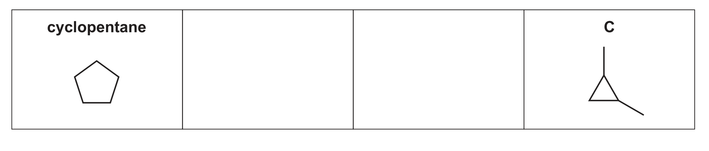
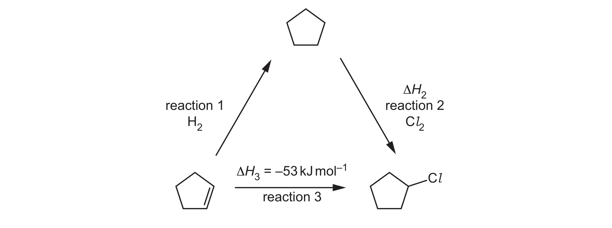
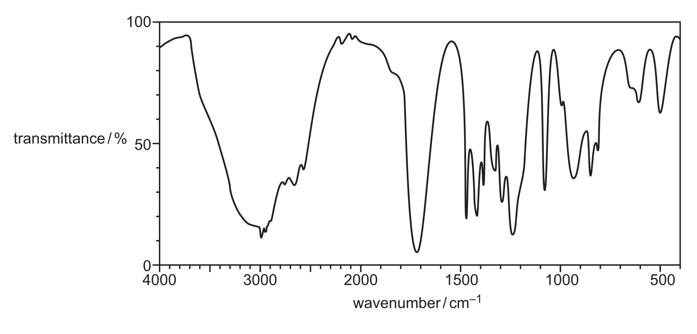

# ch05 Chemical energetics · 9701/21 Oct/Nov 2025

> 题卷 `originalpdf/9701_w25_qp_21.pdf` ｜ 答案 `originalpdf/9701_w25_ms_21.pdf`
> 本卷本章共 1 题 / 13 分：镜像 Q3 [13]（主章 ch14）
> 本卷与 9701/23 同卷（逐字一致，仅条形码与印刷码不同）

---

## Q3 [13]　⟨镜像 · 主章 ch14 Hydrocarbons⟩

> 本题正本在 [`ch14-hydrocarbons/9701_w25_21.md`](../ch14-hydrocarbons/9701_w25_21.md)，此处为镜像。**不要在本文件里改它** —— 改正本，再跑 `python tools/mirror.py`。

Cycloalkanes show similar chemical properties to alkanes but have the same empirical formula as
alkenes.

### (a) [1] · ch2

Define empirical formula.

**答案** — simplest / lowest (whole number / integer) ratio of atoms (of each element) in a
compound / molecule

### (b) [2] · ch13

Cyclopentane, C₅H₁₀, has four cyclic structural isomers. One of these isomers is C, shown in
Fig. 3.1. Complete Fig. 3.1 to show two other cyclic structural isomers of C₅H₁₀.

**答案** — Fig. 3.1 中已给出的 C 是 1,2-dimethylcyclopropane（cyclopropane 相邻两个碳各接一个 methyl）。C₅H₁₀ 除 cyclopentane 本身外共有四种环状异构体，本题只需再画出以下三种中的
任意两种：
- methylcyclobutane（cyclobutane 上一个碳接一个 methyl）
- 1,1-dimethylcyclopropane（cyclopropane 同一个碳上接两个 methyl）
- ethylcyclopropane（cyclopropane 上一个碳接一个 ethyl）

**判分** — two of the above structures

### (c) Cyclopentane reacts with Cl₂ in the presence of ultraviolet light to form C₅H₉Cl.

### (c)(i) [1] · ch14

The reaction is initiated by the bond fission of Cl₂. State the type of bond fission shown in the
initiation step.

**答案** — homolytic

### (c)(ii) [2] · ch14

Complete the equations to show the two propagation steps that follow the initiation step.

propagation 1　C₅H₁₀ + ……… → C₅H₉• + ………
propagation 2　C₅H₉• + ……… → ………

**答案**
- M1 C₅H₁₀ + Cl• → C₅H₉• + HCl
- M2 C₅H₉• + Cl₂ → C₅H₉Cl + Cl•

### (c)(iii) [1] · ch14

The final step is shown：C₅H₉• + Cl• → C₅H₉Cl. Give the name for this step in the reaction.

**答案** — termination

### (d) Fig. 3.2 shows a reaction cycle involving cyclopentane, cyclopentene and C₅H₉Cl.

### (d)(i) [1] · ch14

Identify a suitable reagent for reaction 3.

**答案** — HCl (g)

### (d)(ii) [2] · ch5

Use the data in Fig. 3.2 and in Table 3.1 to calculate the enthalpy change of reaction 2, Δ*H*₂.

Table 3.1

| compound | enthalpy change of combustion, Δ*H*c / kJ mol⁻¹ |
|---|---|
| cyclopentane | −3292 |
| cyclopentene | −3115 |
| H₂ | −286 |

（Fig. 3.2 另给出 reaction 3 的 Δ*H*₃ = −53 kJ mol⁻¹）

**答案**
- M1（reaction 1）：−3115 − 286 + 3292 = −109 (kJ mol⁻¹)
- M2　Δ*H*₂ = −53 − (−109) = (+)56 (kJ mol⁻¹)

Δ*H*₂ = **+56 kJ mol⁻¹**

### (e) Cyclopentene, C₅H₈, reacts with hot concentrated acidified KMnO₄ to form compound W,
C₅H₈O₄.

### (e)(i) [1] · ch14

Draw the structure of W.

**答案** — W 是 pentanedioic acid：HOOC–CH₂–CH₂–CH₂–COOH（cyclopentene 环上的
C=C 被 hot concentrated acidified KMnO₄ 氧化裂解，两端各生成一个 –COOH，环打开成
直链的 dicarboxylic acid）

### (e)(ii) [2] · ch22

The infrared spectrum of W is shown in Fig. 3.3. Identify two absorptions in the infrared spectrum
of W that would not be present in the infrared spectrum of cyclopentene. Write 1 or 2 on Fig. 3.3
against each of these two absorptions. Complete Table 3.2 to show which bond is responsible for
each absorption that you have identified in Fig. 3.3.

Table 3.2

| absorption | bond responsible |
|---|---|
| 1 | O—H |
| 2 | C=O |

**答案**
- M1 absorption labelled at approx. 3000 cm⁻¹ identified as O—H
- M2 absorption labelled at approx. 1720 cm⁻¹ identified as C=O

Table 3.3（参考表，题目已给出，不计分）

| bond | functional groups containing the bond | wavenumber / cm⁻¹ |
|---|---|---|
| C–O | hydroxy, ester | 1040–1300 |
| C=C | aromatic compound, alkene | 1500–1680 |
| C=O | amide | 1640–1690 |
| C=O | carbonyl, carboxyl | 1670–1740 |
| C=O | ester | 1710–1750 |
| C≡N | nitrile | 2200–2250 |
| C–H | alkane | 2850–2950 |
| N–H | amine, amide | 3300–3500 |
| O–H | carboxyl | 2500–3000 |
| O–H | hydroxy | 3200–3650 |

---

**[Total: 13]**
