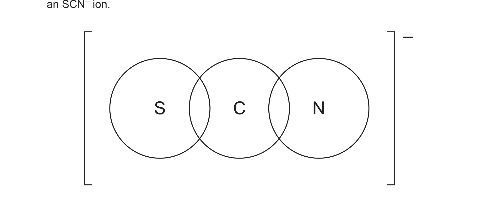

# ch07 Equilibria · 9701/22 May/June 2024

> 题卷 `originalpdf/9701_s24_qp_22.pdf` ｜ 答案 `originalpdf/9701_s24_ms_22.pdf`
> 本卷本章共 1 题 / 12 分：本章主管 Q3 [12]

---

## Q3 [12]

### (a) [2]

Describe what is meant by dynamic equilibrium.

**答案**
- M1 rates of forward and reverse / backward reactions are equal
- M2 no change in measurable properties OR concentration of reactants AND products remain
  constant

### (b)

Reaction 4 describes the reversible reaction between yellow Fe³⁺(aq) and colourless SCN⁻(aq)
to produce red FeSCN²⁺(aq).

reaction 4　Fe³⁺(aq) + SCN⁻(aq) ⇌ FeSCN²⁺(aq)
　　　　　　(yellow)　　(colourless)　　(red)

An equilibrium mixture contains Fe³⁺(aq), SCN⁻(aq) and FeSCN²⁺(aq). A few colourless crystals
of soluble KSCN(s) are added. The mixture is then left until it reaches equilibrium again. The
temperature of both equilibrium mixtures is the same.

### (b)(i) [3]

Deduce the changes that occur, if any, in the equilibrium mixture after KSCN(s) is added
compared to the original equilibrium mixture.

- change in appearance
- change in relative concentration of Fe³⁺(aq)
- change in value of the equilibrium constant, *K*c

**答案**
- change in appearance: (goes) darker red / more red
- change in relative concentration of Fe³⁺(aq): decreases
- change in value of *K*c: constant / none

### (b)(ii) [4]

The expression for the equilibrium constant, *K*c, for reaction 4 is shown.

*K*c = [FeSCN²⁺(aq)] / ([Fe³⁺(aq)] × [SCN⁻(aq)])

5.00 × 10⁻⁵ mol of Fe³⁺(aq) and 5.00 × 10⁻⁵ mol of SCN⁻(aq) are added together and allowed to
reach equilibrium. The total volume of the mixture is 25.0 cm³.

At equilibrium the concentration of FeSCN²⁺(aq) is 4.23 × 10⁻⁴ mol dm⁻³.

Calculate the equilibrium constant, *K*c, for reaction 4. Include the units in your
answer.

**答案**（Method 1，与 Method 2 等价，见 MS）
- M1 initial [Fe³⁺] = [SCN⁻] = 0.0020 mol dm⁻³
- M2 at equilibrium [Fe³⁺] = [SCN⁻] = (0.0020 – 0.000423)
- M3 use 0.000423 ÷ (0.0020 – 0.000423)² to calculate *K*c = 170(.089)
- M4 units = mol⁻¹ dm³ OR dm³ mol⁻¹

### (c) [1]

Determine the full electronic configuration of Fe³⁺.

**答案** — 1s² 2s² 2p⁶ 3s² 3p⁶ 3d⁵

### (d) [2]

SCN⁻(aq) is colourless.

Complete the dot-and-cross diagram in Figure 3.1 to show the arrangement of outer electrons in
an SCN⁻ ion.

**答案**
- M1 6 electrons between C and N AND 2 electrons between C and S
- M2 3 lone pairs around S AND none around C AND 1 lone pair around N

---

**[Total: 12]**
