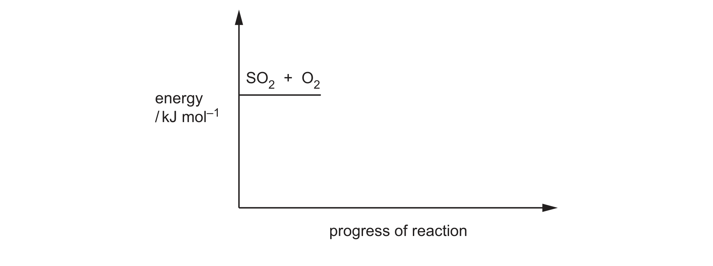

# ch07 Equilibria · 9701/23 May/June 2026

> 题卷 `originalpdf/9701_s26_qp_23.pdf` ｜ 答案 `originalpdf/9701_s26_ms_23.pdf`
> 本卷本章共 1 题 / 13 分：本章主管 Q3 [13]

---

## Q3 [13]　(兼 ch5)

The conditions used for the conversion of sulfur dioxide to sulfur trioxide in the Contact
process are carefully controlled.

reaction 1　2SO₂(g) + O₂(g) ⇌ 2SO₃(g)　　Δ*H* = –196 kJ mol⁻¹

### (a) [2] · ch5

Complete Figure 3.1 to show the reaction pathway diagram for reaction 1. Draw arrows to
represent the enthalpy change, Δ*H*, and activation energy, *E*ₐ.

**答案**
- correct exothermic shape profile (reactant SO₂ + O₂ line higher than product SO₃ line, hump
  in between)
- arrow labelled Δ*H* from reactant line to product line
- arrow labelled *E*ₐ from reactant line to the maximum on the hump

**判分**
- max 1：画成 endothermic profile 但 *E*ₐ 和/或 Δ*H* 标注正确
- Δ*H* 箭头须单向、方向正确；A *E*ₐ 画成双向箭头；BOD 竖直线；A 半箭头；A "方形"驼峰
- **I** 缺 products / product line 标注错误；**I** –Δ*H* 前的负号；BOD 位置与长度大致正确但线条
  画得不够工整

### (b) [2] · ch7

Define Le Chatelier's principle.

**答案**
- M1 (if a change in conditions occurs) the equilibrium shifts
- M2 to minimise the change (in conditions)

**判分** — M1 A equilibrium moves/equilibrium changes；M1 **I** there will be a 'change in the
system'；M2 minimise = oppose = counteract = resists = reverse

### (c) [3] · ch7 ch8

In industry, reaction 1 occurs at 400–450 °C and 110–200 kPa with a catalyst.

Complete Table 3.1 by using the terms 'increase', 'decrease' or 'no change'.

**Table 3.1**

| | use temperature greater than 450 °C | without a catalyst |
|---|---|---|
| effect on value of equilibrium constant, *K*ₚ | decreases | no change |
| effect on yield of product at equilibrium | decreases | no change |
| effect on rate of reaction | increases | decreases |

**判分** — All independent including *K*ₚ and yield marks

### (d)

A sealed tube that initially contains only 2.00 mol of SO₂(g) and 2.00 mol of O₂(g) is left to
reach equilibrium.

At equilibrium, 1.96 mol of SO₃(g) is present and the total pressure is 150 kPa.

reaction 1　2SO₂(g) + O₂(g) ⇌ 2SO₃(g)

### (d)(i) [3] · ch7

Complete Table 3.2.

**Table 3.2**

| | SO₂(g) | O₂(g) | SO₃(g) |
|---|---|---|---|
| amount initially / mol | 2.00 | 2.00 | 0 |
| amount at equilibrium / mol | M1 0.04(0) | M2 1.02 (= 2 – 0.98) | 1.96 |
| mole fraction at equilibrium | 0.01325 | 0.3377 | M3 0.649(007)（= 1.96 / 3.02） |

**判分** — 各格独立给分；若 M3 不是 0.649，看是否可从 M1 和/或 M2 得到 ecf；M3 A 0.649 / 0.65；
M3 A 1 – (0.01325 + 0.3377) = 0.649(05)

### (d)(ii) [3] · ch7

Table 3.3 shows the mole fractions at equilibrium of SO₂(g), O₂(g) and SO₃(g) under different
conditions.

**Table 3.3**

| | SO₂(g) | O₂(g) | SO₃(g) |
|---|---|---|---|
| mole fraction at equilibrium | 0.360 | 0.019 | 0.621 |

Calculate *K*ₚ at 200 kPa using the data from Table 3.3. Include units in your answer.

**答案**
- M1 correct expression for *K*ₚ using numerical values：
  *K*ₚ = (0.621 × 200)² / [(0.360 × 200)² × (0.019 × 200)]
- M2 correct value for *K*ₚ = 0.783(1) kPa⁻¹（OR 7.83(1) × 10⁻⁴ Pa⁻¹）
- M3 units = kPa⁻¹

**判分**
- M1 **I** use of [ ] for ( )
- M2 A ecf from M1 for transcription errors of mole fraction values；M2 A ecf from M1 for
  inverted expression（= 1.27(7)，此时 M3 单位相应改为 kPa）
- M3 A kPa⁻¹ if no expression / incorrect *K*ₚ expression；M3 A ecf for appropriate units based
  on incorrect expression for *K*ₚ；M3 A 'no unit' if calculation used only mole fraction with no
  reference to 200 kPa (= 156.6)；M3 A Pa⁻¹ if calculation is based on conversion of kPa to Pa
  (i.e. 7.83(1) × 10⁻⁴ Pa⁻¹)；**I** 1 / kPa；**I** *K*ₚ = (*pp*SO₃)² ÷ (*pp*SO₂)² × (*pp*O₂)（漏乘号）

---

**[Total: 13]**
