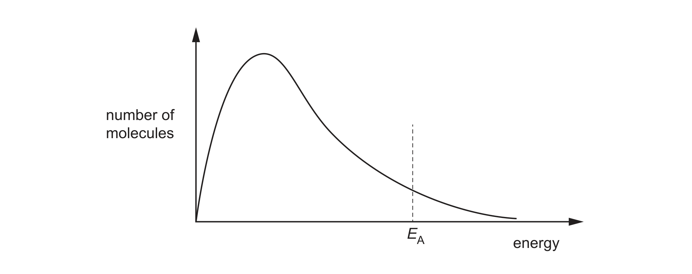
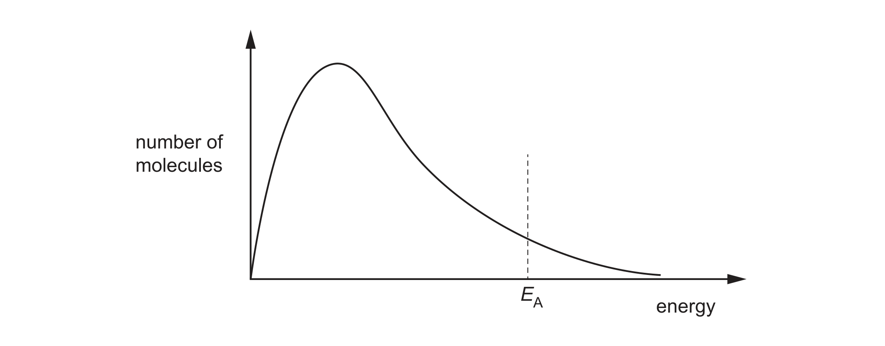
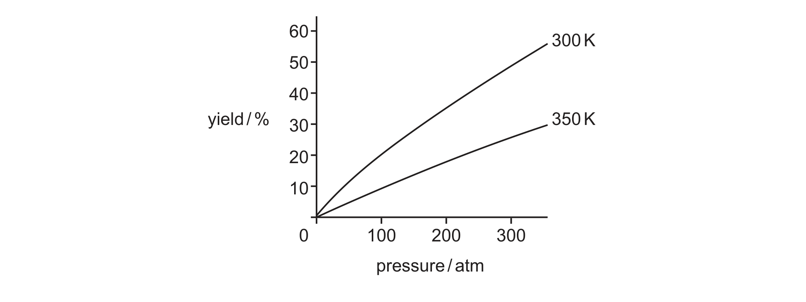

# ch08 Reaction kinetics · 9701/21 May/June 2025

> 题卷 `originalpdf/9701_s25_qp_21.pdf` ｜ 答案 `originalpdf/9701_s25_ms_21.pdf`
> 本卷本章共 1 题 / 10 分：本章主管 Q3 [10]

---

## Q3 [10]　(兼 ch7 Equilibria)

### (a) Hexene reacts with hydrogen gas to produce hexane.

reaction 1　C₆H₁₂(l) + H₂(g) → C₆H₁₄(l)

Fig. 3.1 shows the distribution of energies of H₂(g) molecules at temperature *T*.

### (a)(i) [2] · ch8

Sketch on Fig. 3.1 the shape of the curve for the same sample of H₂(g) molecules when
the temperature is increased.

**答案** — 图示题，要在 Fig. 3.1 上另加画一条新的 Boltzmann 分布曲线。MS 给出的范例是：
原曲线保持不动，新曲线整体右移、峰更低更宽，两条曲线只交叉一次。判分要点：

- 新曲线同样从原点出发
- 新曲线的峰值低于原曲线的峰值
- 新曲线的峰值位置在原曲线峰值的右侧（即更高能量处）
- 新曲线与原曲线只相交一次，且交点在原峰值的右侧

**判分** — 以上四点，任意答对两点给 1 分，四点全对给 2 分

### (a)(ii) [2] · ch8

Explain why increasing the temperature increases the rate of reaction 1.

**答案**
- M1 greater proportion of (H₂) molecules have energy greater than or equal to the
  activation energy / *E*A
- M2 increase in frequency of successful collisions (between H₂ and C₆H₁₂)

### (a)(iii) [1] · ch8

State the role of nickel when it is added to reaction 1.

**答案** — catalyst

### (a)(iv) [1] · ch8

Annotate Fig. 3.2 to show the effect of adding nickel to reaction 1 at temperature *T*.

**答案** — 图示题，在 Fig. 3.2 的能量轴上另标一个新的 *E*A，位置比原来的 *E*A
更靠左（曲线本身不需要重画）。

**判分** — annotation to show new *E*A (nickel / catalyst) further to the left than
original *E*A

### (b) [2] · ch7

Define Le Chatelier's principle.

**答案**
- M1 (if a change is made at a system is dynamic equilibrium) the equilibrium moves
- M2 to minimise the change in conditions

### (c) [2] · ch7

Reaction 2 shows the equilibrium reaction between X(g) and Y(g) to produce Z(g) in a sealed
container.

reaction 2　*a*X(g) + *b*Y(g) ⇌ *c*Z(g)

Fig. 3.3 shows the effect of changing pressure on the percentage yield of Z(g) at two different
temperatures, 300 K and 350 K.

Deduce **two** conclusions about reaction 2 using Fig. 3.3.

**答案**
- (forward) reaction is exothermic — 升温（300 K → 350 K）产率下降
- (*a* + *b*) > *c* — 加压使产率上升，说明正反应气体分子数减少

**判分** — 两条结论各占 1 分

---

**[Total: 10]**
