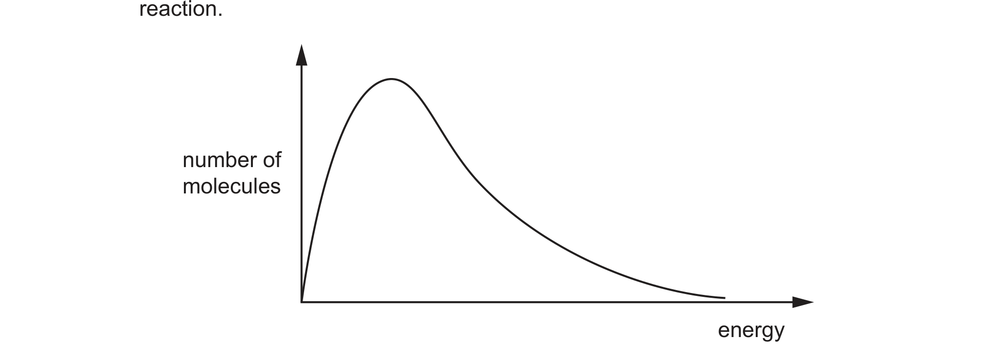
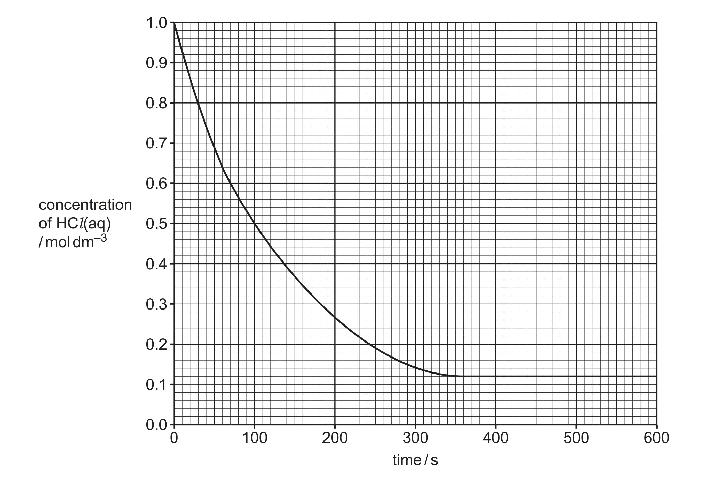

# ch08 Reaction kinetics · 9701/23 May/June 2025

> 题卷 `originalpdf/9701_s25_qp_23.pdf` ｜ 答案 `originalpdf/9701_s25_ms_23.pdf`
> 本卷本章共 2 题 / 18 分：本章主管 Q4 [11]；镜像 Q3 [7]（主章 ch14）

---

## Q3 [7]　⟨镜像 · 主章 ch14 Hydrocarbons⟩

> 本题正本在 [`ch14-hydrocarbons/9701_s25_23.md`](../ch14-hydrocarbons/9701_s25_23.md)，此处为镜像。**不要在本文件里改它** —— 改正本，再跑 `python tools/mirror.py`。

### (a) Different hydrocarbon mixtures produced from fractional distillation of crude oil have
different uses.

### (a)(i) [1] · ch14

State the compound that is heated with long-chain hydrocarbons to produce more useful smaller
alkanes and alkenes.

**答案** — Al₂O₃ / aluminium oxide

**判分** — 简报原稿把这一小问的官方答案栏标成"空"，但渲染 MS 第 8 页（`msp08`）后可见答案其实
是文字，不是图：catalytic cracking 用的催化剂是 aluminium oxide

### (a)(ii) [2] · ch12

Describe how photochemical smog is produced during the combustion of petrol in an internal
combustion engine.

**答案**
- unburned hydrocarbons
- react with NO / NO₂
- (to) produce PAN (– a component of photochemical smog)

**判分** — any 2 points = 1 mark，all 3 points = 2 marks

### (b) C₄H₈ reacts with an excess of H₂ to produce C₄H₁₀.

reaction 1　C₄H₈ + H₂ → C₄H₁₀

### (b)(i) [1] · ch14

Name a catalyst for reaction 1.

**答案** — nickel / platinum

### (b)(ii) [1] · ch8

Define activation energy, *E*A.

**答案** — minimum energy required for a collision to be effective

### (b)(iii) [2] · ch8

The Boltzmann distribution for the reaction mixture in reaction 1 is shown in Fig. 3.1. Use the
Boltzmann distribution to explain the effect of adding a catalyst on the rate of reaction.

**答案**
- M1 area under the curve with energy ⩾ *E*A using a catalyst is larger, so greater
  proportion of particles with sufficient energy to react
- M2 rate faster because higher frequency of successful collisions

---

**[Total: 7]**

---

## Q4 [11]

### (a) The reaction between Na₂S₂O₃(aq) and HCl(aq) is monitored at constant temperature.

Na₂S₂O₃ + 2HCl → 2NaCl + SO₂ + S + H₂O

Fig. 4.1 shows how the concentration of HCl(aq) varies with time.

### (a)(i) [2]

Use Fig. 4.1 to find the average rate of change of concentration of HCl(aq) in this reaction
between 0–100 seconds and between 400–500 seconds. Include units in your answers.

**答案**
- 0–100 seconds：(1.0 − 0.5) / 100 = 0.005 mol dm⁻³ s⁻¹
- 400–500 seconds：0 mol dm⁻³ s⁻¹（此时曲线已进入平台，浓度不再变化）

**判分** — check final graph for range of acceptable answers；±(1–0.5)/100 = ±0.005、0、
mol dm⁻³ s⁻¹ for both，三点中任意两点给 1 分，三点全对给 2 分

### (a)(ii) [1]

Use Fig. 4.1 to identify the limiting reagent. Explain your answer.

**答案** — Na₂S₂O₃, because reaction stops before all the HCl is used up

**判分** — 也接受 "Na₂S₂O₃ because there is still HCl remaining (when the reaction has stopped)"

### (a)(iii) [1]

Explain why the rate of reaction changes with time.

**答案** — the frequency of effective collisions decreases as concentration of HCl(aq) and / or
Na₂S₂O₃ decreases

### (a)(iv) [2]

The reaction between Na₂S₂O₃(aq) and HCl(aq) is repeated in a second experiment.
In this second experiment, 25.0 cm³ of 0.050 mol dm⁻³ Na₂S₂O₃(aq) reacts with 0.0020 mol
of HCl(aq). Calculate the number of sulfur atoms produced.

**答案**
- n(Na₂S₂O₃) = 25.0 / 1000 × 0.050 = 1.25 × 10⁻³ mol；由方程式 1 : 2 比例，0.0020 mol HCl
  只需 1.0 × 10⁻³ mol Na₂S₂O₃，故 HCl 是 limiting reagent
- M1 0.001(00) mol sulfur produced
- M2 M1 × 6.02 × 10²³ = 6.02 × 10²⁰

number of sulfur atoms produced = 6.02 × 10²⁰

**判分** — M1、M2 缺一不可

### (a)(v) [1]

Explain why the rate of reaction cannot be monitored accurately by measuring the
volume of SO₂(g) produced in this reaction.

**答案** — It reacts with water (to produce H₂SO₃)

### (b) Fig. 4.2 shows a possible arrangement of outer-shell electrons in one SO₂ molecule.

### (b)(i) [2]

Use Fig. 4.2 to predict the shape and bond angle of a molecule of SO₂.

**答案**
- shape：non-linear (bent / V-shaped)
- bond angle：116°–120° 区间内的角度（如 118°）

**判分** — M1 non-linear；M2 bond angle 需落在 116° ⩽ *x* < 120° 区间内

### (b)(ii) [2]

Use Table 4.1 to predict the strength of the dipole moment of SO₂, if any, compared to
that of H₂O. Explain your answer.

Table 4.1

| | H | O | S |
|---|---|---|---|
| electronegativity | 2.1 | 3.5 | 2.6 |

**答案** — SO₂ has a weaker dipole moment (than H₂O)，因为 electronegativity difference
在 H 和 O 之间（1.4）比在 S 和 O 之间（0.9）更大，即 S=O bond is less polar than H—O
（或说 stronger dipoles in S=O / SO₂ 相对更弱）

**判分** — M1 weaker dipole moment (in SO₂)；M2 electronegativity (difference) is larger
( / 1.4) for H and O than for S and O ( / 0.9)，或等价表述 "S=O bond is less polar than
H—O" / "stronger dipoles in S=O / SO₂"

---

**[Total: 11]**
