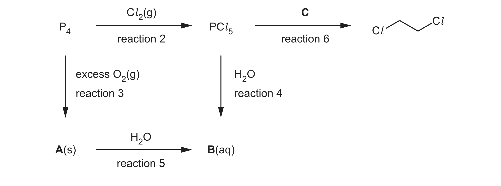
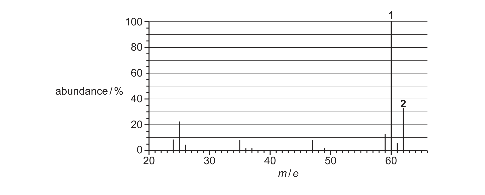

# ch09 The Periodic Table: chemical periodicity · 9701/22 Feb/March 2025

> 题卷 `originalpdf/9701_m25_qp_22.pdf` ｜ 答案 `originalpdf/9701_m25_ms_22.pdf`
> 本卷本章共 1 题 / 17 分：本章主管 Q1 [17]

---

## Q1 [17]　(兼 ch7 Equilibria)

### (a) Chlorine forms three different compounds with phosphorus. The most common compounds are PCl₃ and PCl₅.

### (a)(i) [2] · ch6

Complete Table 1.1.

| compound | oxidation number of P | oxidation number of Cl |
|---|---|---|
| PCl₃ | | |
| PCl₅ | | |

**答案**

| compound | oxidation number of P | oxidation number of Cl |
|---|---|---|
| PCl₃ | (+)3 / III | −1 / I |
| PCl₅ | (+)5 / V | −1 / I |

### (a)(ii) [2] · ch7

In a closed system, PCl₃ and PCl₅ exist in an equilibrium mixture as shown in reaction 1.

reaction 1　PCl₃(l) + Cl₂(g) ⇌ PCl₅(s)　Δ*H* = –124 kJ mol⁻¹

Deduce **two** conditions that favour the production of PCl₅ in reaction 1.

**答案**
1. high pressure
2. low temperature

### (a)(iii) [2] · ch2

The third compound of phosphorus and chlorine, **W**, has a relative molecular mass, *M*ᵣ,
between that of PCl₃ and PCl₅. The compound contains 69.6% by mass of chlorine. Determine
the molecular formula of **W**.

**答案**
- ratio of moles of P : Cl = 30.4/31.0 : 69.6/35.5 = 0.98 : 1.96 (= 1 : 2)
- molecular formula of **W** = P₂Cl₄

### (a)(iv) [2] · ch4

**W** is a liquid at room temperature and pressure. It reacts vigorously with water to form an
acidic solution. Suggest the structure and bonding in **W**. Explain your answer.

**答案**
- (structure =) simple / molecular, because (it has a) low melting point / weak intermolecular forces
- (bonding =) covalent, because (it is) hydrolysed

### (b) Fig. 1.1 shows a reaction scheme involving P₄ and Cl₂.

### (b)(i) [1] · ch9

Suggest what is observed in reaction 2.

**答案** — green colour (of the gas) disappears

### (b)(ii) [1] · ch3

Predict the shape of a molecule of PCl₅.

**答案** — trigonal bipyramid(al)

### (b)(iii) [1] · ch9

Write an equation for the formation of **A** in reaction 3.

**答案** — P₄ + 5O₂ → P₄O₁₀

### (b)(iv) [1] · ch9

Name **B**, which is formed in both reactions 4 and 5.

**答案** — phosphoric(V) acid

### (b)(v) [1] · ch13

Draw the structure of **C**, used in reaction 6.

**答案**（答案是图，见 MS 渲染页 `_img/9701_m25_22_msp05.png`）

**C** 是 ethane-1,2-diol，结构为 HO-CH₂-CH₂-OH（骨架式：左端 HO 接一个之字形双碳链，
右端接 OH）。反应 6 是 PCl₅ 把二醇的两个 –OH 都取代成 –Cl，生成 Fig. 1.1 中标出的
ClCH₂CH₂Cl。

### (c) 1,2-dichloroethane, ClCH₂CH₂Cl, reacts with NaOH to produce an unsaturated compound, C₂H₃Cl, as shown in reaction 7.

reaction 7　ClCH₂CH₂Cl + NaOH → C₂H₃Cl + H₂O + NaCl

### (c)(i) [1] · ch13

State what is meant by unsaturated.

**答案** — contains a (one or more) C=C / double / multiple bond(s)

### (c)(ii) [1] · ch15

State the conditions for reaction 7.

**答案** — ethanol (as solvent) **AND** heat

### (d) Compound **D** contains carbon, hydrogen and chlorine **only**. Fig. 1.2 shows the mass spectrum of **D**.

### (d)(i) [1] · ch22

Explain the relative abundance of peaks 1 and 2 in the mass spectrum in Fig. 1.2.

**答案** — (relative) abundance is 3:1 / 100:33, linked to the two isotopes of Cl (³⁵Cl and ³⁷Cl)

### (d)(ii) [1] · ch22

Suggest the structure of **D**.

**答案** — **D** is Cl—C≡C—H（chloroethyne，只有 C1、C2 两个碳，三键在 C1≡C2 之间，Cl 接在 C1 上、H 接在 C2 上）

---

**[Total: 17]**
