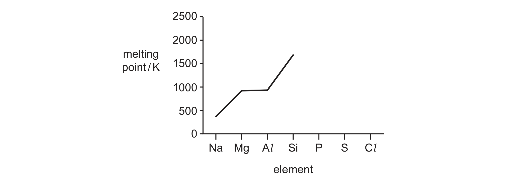

# ch09 The Periodic Table: chemical periodicity · 9701/22 May/June 2024

> 题卷 `originalpdf/9701_s24_qp_22.pdf` ｜ 答案 `originalpdf/9701_s24_ms_22.pdf`
> 本卷本章共 1 题 / 15 分：本章主管 Q1 [15]

---

## Q1 [15]　(兼 ch1 Atomic structure)

### (a) [2] · ch1

Complete Table 1.1 using relevant information from the Periodic Table.

| | nucleon number | proton number | number of electrons |
|---|---|---|---|
| Mg²⁺ | 24 | | |
| Al³⁺ | 27 | | |

**答案**

| | nucleon number | proton number | number of electrons |
|---|---|---|---|
| Mg²⁺ | 24 | 12 | 10 |
| Al³⁺ | 27 | 13 | 10 |

**判分** — 4 个空全对给 2 分；对 2 或 3 个给 1 分；对 0 或 1 个给 0 分

### (b) [3] · ch1

State and explain the difference in the ionic radius of Al³⁺ compared to Mg²⁺.

**答案**
- M1 it / Al³⁺ is smaller (compared to Mg²⁺)
- M2 greater nuclear attraction for remaining electrons
- M3 same shielding effect **AND** greater nuclear charge

### (c) [1] · ch3

Draw a labelled diagram to show the structure and bonding in sodium.

**答案**（答案是图，见 MS 渲染页 `_img/9701_s24_22_msp06.png`）

画出规则排列、至少 2×2 个圆圈，每个圆圈内标 "+"（代表 Na⁺ 离子），圆圈之间散布若干 "−"
（代表 delocalised electrons），并各引一条标注线分别标注 "positively charged ions" 和
"delocalised electrons"（sea of delocalised electrons 包围着正离子）。

### (d) Fig. 1.1 shows the variation in melting point of some Period 3 elements in their standard states at room temperature and pressure.

### (d)(i) [1] · ch9

Explain why Si has a high melting point.

**答案** — large amount of energy required to break bonds in (its) giant covalent structure

### (d)(ii) [2] · ch9

Complete Fig. 1.1 to show the variation in the melting points of the elements P, S and Cl.

**答案**（答案是图，见 MS 渲染页 `_img/9701_s24_22_msp07.png`）

紧接 Si 之后向下继续画折线到 P、S、Cl 三点：

- M1 三点（P、S、Cl）的熔点都必须明显低于 Mg 的熔点
- M2 三点相对高低顺序为 Cl < P < S（即 Si→P 大幅下降，P→S 略微上升，S→Cl 再次下降，Cl 最低）

### (e) Two Period 3 elements react with an excess of oxygen at room pressure.

### (e)(i) [2] · ch9

Complete Table 1.2.

| Period 3 element | state of oxide at room temperature and pressure | approximate pH of solution made when oxide is added to water |
|---|---|---|
| Na | | |
| S | | |

**答案**

| Period 3 element | state of oxide at room temperature and pressure | approximate pH of solution made when oxide is added to water |
|---|---|---|
| Na | solid | 10–14 |
| S | gas | 0–4 |

**判分** — 4 个空全对给 2 分；对 2 或 3 个给 1 分；对 0 或 1 个给 0 分

### (e)(ii) [1] · ch9

The solutions made in column 3 of Table 1.2 are mixed together. Name the type of reaction
that occurs.

**答案** — acid–base **OR** neutralisation

### (e)(iii) [1] · ch9

Write an equation to describe the reaction between P₄O₁₀ and an excess of water.

**答案** — P₄O₁₀ + 6H₂O → 4H₃PO₄

### (f) Aluminium hydroxide is amphoteric.

### (f)(i) [1] · ch9

Explain what is meant by amphoteric.

**答案** — reacts with both acids and bases **OR** shows both acidic and basic behaviour

### (f)(ii) [1] · ch9

Write an equation to describe the reaction that occurs when aluminium hydroxide, Al(OH)₃,
reacts with NaOH(aq).

**答案** — Al(OH)₃ + NaOH → NaAl(OH)₄

---

**[Total: 15]**
