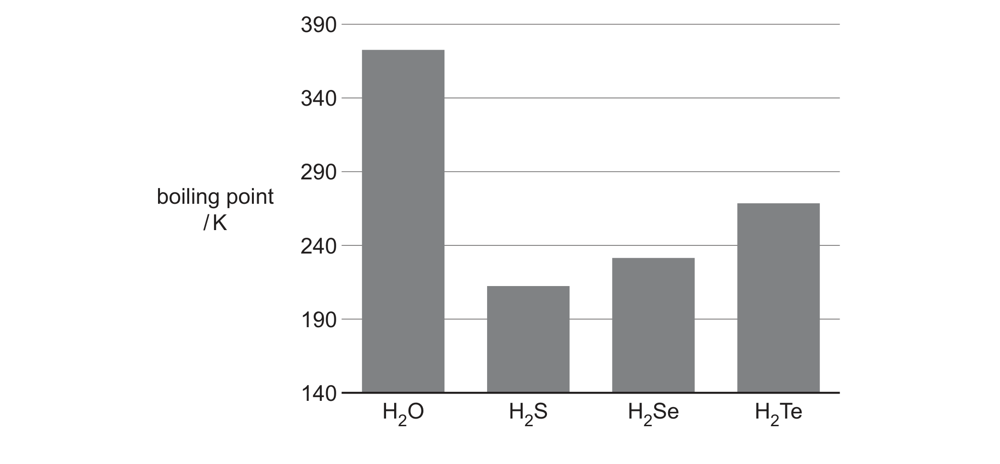

# ch09 The Periodic Table: chemical periodicity · 9701/22 Oct/Nov 2024

> 题卷 `originalpdf/9701_w24_qp_22.pdf` ｜ 答案 `originalpdf/9701_w24_ms_22.pdf`
> 本卷本章共 1 题 / 15 分：本章主管 Q2 [15]

---

## Q2 [15]

### (a) Oxygen is a Group 16 element.

### (a)(i) [2]

Write equations for the following reactions.
- sodium and oxygen
- sulfur and oxygen

**答案**
- 4Na + O₂ → 2Na₂O
- S + O₂ → SO₂

### (a)(ii) [1]

Draw a dot-and-cross diagram to show the species present in Al₂O₃. Draw outer electrons only.

**答案**（答案是图，见 MS 渲染页 `_img/9701_w24_22_msp06.png`）

画一个 Al³⁺（右上角标电荷 3+，不画电子）和一个 O²⁻（O 外层用 dot-and-cross 混合画满
4 对共 8 个电子，右上角标电荷 2−）。

### (a)(iii) [2]

The maximum oxidation state of the Period 3 elements in their oxides varies across the
period. State and explain the variation.

**答案**
- it increases
- as the number of valence electrons (which can be used in bonding / lost / shared / donated) increases

### (b) H₂O reacts with both inorganic and organic compounds.

### (b)(i) [2]

Complete Table 2.1 to give details of the reactions of some Period 3 oxides with H₂O.

| Period 3 oxide | product of reaction with H₂O | pH of solution formed |
|---|---|---|
| | Mg(OH)₂ | |
| P₄O₁₀ | | |

**答案**

| Period 3 oxide | product of reaction with H₂O | pH of solution formed |
|---|---|---|
| MgO | Mg(OH)₂ | 8 ⩽ pH ⩽ 12 |
| P₄O₁₀ | H₃PO₄ | 1 ⩽ pH ⩽ 4 |

### (b)(ii) [1]

Write an equation for the reaction of CH₃CN with H₂O in acidic conditions.

CH₃CN + ......H₂O + ......H⁺ → ...

**答案** — CH₃CN + 2H₂O + H⁺ → CH₃COOH + NH₄⁺

### (b)(iii) [2]

Draw the structures of the two alcohols formed in the reaction shown in equation 1.

equation 1　C₃H₆(g) + H₂O(g) --(H₃PO₄)--> C₃H₈O(g)

**答案**（答案是图，见 MS 渲染页 `_img/9701_w24_22_msp07.png`）

两种醇的结构：
- propan-2-ol：CH₃-CH(OH)-CH₃（羟基在 C2 上，即链中央那个碳）
- propan-1-ol：CH₃-CH₂-CH₂-OH（羟基在 C1 端）

### (b)(iv) [2]

Explain why alcohols are less acidic than water.

**答案**
- alkyl groups are electron donating / have a positive inductive effect
- (this) strengthens the O—H bond / makes H⁺ less likely to be donated

### (c) Fig. 2.1 shows the boiling points of H₂O and other Group 16 hydrides.

### (c)(i) [2]

Explain the trend in the boiling points of the Group 16 hydrides H₂S to H₂Te.

**答案**
- (molecules) H₂S to H₂Te have a greater number of electrons
- (giving) stronger instantaneous dipole–induced dipole / London dispersion forces
- **OR** more energy required to overcome the instantaneous dipole–induced dipole / London dispersion forces

### (c)(ii) [1]

Explain why the boiling point of H₂O is much higher than that of H₂S.

**答案** — (only) H₂O has hydrogen bonding **AND** hydrogen bonding is (much) stronger than the
other intermolecular forces

（同样接受：H₂O has hydrogen bonding **AND** because of the higher electronegativity of O
compared to S；或：stronger van der Waals' forces because (only) H₂O has hydrogen bonding）

---

**[Total: 15]**
