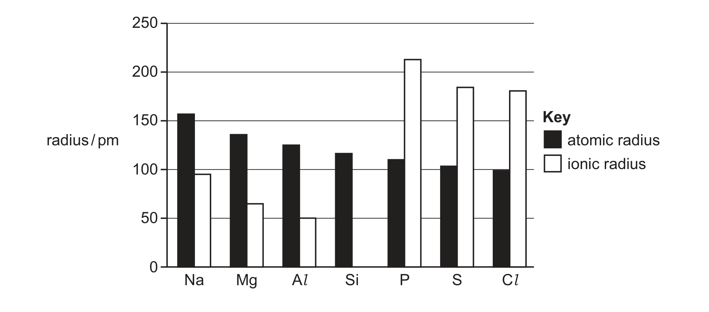

# ch09 The Periodic Table: chemical periodicity · 9701/21 Oct/Nov 2025

> 题卷 `originalpdf/9701_w25_qp_21.pdf` ｜ 答案 `originalpdf/9701_w25_ms_21.pdf`
> 本卷本章共 1 题 / 11 分：本章主管 Q2 [11]
> 本卷与 9701/23 同卷（逐字一致，仅条形码与印刷码不同）

---

## Q2 [11]

### (a) Fig. 2.1 shows the variation in atomic and ionic radii of the Period 3 elements Na to Cl. The ionic radius of Si is not shown.

### (a)(i) [2]

Explain the trend shown in the atomic radii of the Period 3 elements Na to Cl.

**答案**
- M1 nuclear charge increases (across the period) **AND** (there is) similar shielding
- M2 greater / stronger attraction to (the) nucleus

### (a)(ii) [2]

Explain why there is a large difference in the ionic radii of Al and P.

**答案**
- M1 Al loses (3) electrons / Al is 3+, and P gains (3) electrons / P is 3−
- M2 Al³⁺ has (one) fewer shell (than P³⁻)

### (b) Table 2.1 gives some information about some of the Period 3 oxides. Row B gives the pH of the solution that forms when the Period 3 oxide is added to water.

| formula of Period 3 oxide | Na₂O | MgO | Al₂O₃ | SiO₂ | P₄O₁₀ | SO₃ |
|---|---|---|---|---|---|---|
| A　oxidation number of Period 3 element | | | +3 | | | |
| B　pH of solution | | | — | — | | |

### (b)(i) [2]

Complete Table 2.1.

**答案**

| formula of Period 3 oxide | Na₂O | MgO | Al₂O₃ | SiO₂ | P₄O₁₀ | SO₃ |
|---|---|---|---|---|---|---|
| A　oxidation number of Period 3 element | (+)1 | (+)2 | +3 | (+)4 | (+)5 | (+)6 |
| B　pH of solution | 12–14 | 8–10 | — | — | 0–4 | 0–4 |

### (b)(ii) [1]

State why there is no data given in row B for Al₂O₃ and SiO₂.

**答案** — they are insoluble (in water)

### (c)(i) [1]

Write an equation for the reaction of Na₂O with dilute hydrochloric acid.

**答案** — Na₂O + 2HCl → 2NaCl + H₂O

### (c)(ii) [1]

Construct an equation for the reaction of Al₂O₃ with a base to form NaAlO₂.

**答案** — Al₂O₃ + 2NaOH → 2NaAlO₂ + H₂O

### (d) Group 2 nitrates decompose on heating to form oxides.

### (d)(i) [1]

State the trend in thermal stability of the Group 2 nitrates down the group.

**答案** — (thermal stability) increases (down the group)

### (d)(ii) [1]

Identify the other products of the thermal decomposition of Group 2 nitrates.

**答案** — NO₂ **AND** O₂

---

**[Total: 11]**
