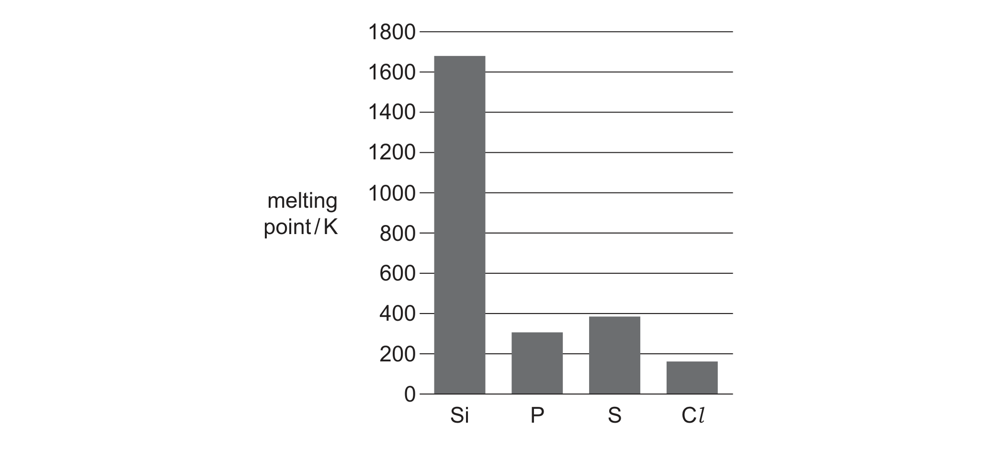

# ch09 The Periodic Table: chemical periodicity · 9701/22 Oct/Nov 2025

> 题卷 `originalpdf/9701_w25_qp_22.pdf` ｜ 答案 `originalpdf/9701_w25_ms_22.pdf`
> 本卷本章共 1 题 / 20 分：本章主管 Q2 [20]

---

## Q2 [20]

### (a)(i) [1]

Explain why the elements Na to Al are good electrical conductors.

**答案** — delocalised electrons move (through the structure / between layers)

### (a)(ii) [1]

Explain why the elements P, S and Cl do not conduct electricity.

**答案** — P / S / Cl have no charge carriers

（同样接受：(no ions and) no delocalised electrons；或：no mobile / moving ions）

### (b) [2]

Fig. 2.1 shows the variation in melting point of the Period 3 elements Si to Cl. The Period 3
elements Si to Cl are all non-metals. Explain why there is a large difference between the
melting point of Si and the melting points of P, S and Cl.

**答案**
- M1 Si has (lots of) strong covalent bonds broken (giant covalent structure)
- M2 P / S / Cl (only) has weak Van der Waals' forces broken (simple molecular structure)

### (c) [4]

Table 2.1 gives some information about some Period 3 chlorides. Row B refers to the pH of
the solution that forms when the Period 3 chloride is added to water. Complete Table 2.1.
You may use the following abbreviations: I = ionic, C = covalent, M = metallic;
G = giant, S = simple.

| formula of Period 3 chloride | NaCl | MgCl₂ | AlCl₃ | SiCl₄ | PCl₅ |
|---|---|---|---|---|---|
| A　oxidation number of element bonded to Cl | | | | | |
| B　pH of solution | | 6.5 | | | |
| C　bonding | | | ionic | | |
| D　structure | | | giant | | |

**答案**

| formula of Period 3 chloride | NaCl | MgCl₂ | AlCl₃ | SiCl₄ | PCl₅ |
|---|---|---|---|---|---|
| A　oxidation number of element bonded to Cl | +1 | +2 | +3 | +4 | +5 |
| B　pH of solution | 7 | 6.5 | 0–4 | 0–4 | 0–4 |
| C　bonding | I | I | I | C | C |
| D　structure | G | G | G | S | S |

### (d)(i) [1]

Write an equation for the formation of AlCl₃ from its elements.

**答案** — 2Al + 3Cl₂ → 2AlCl₃

### (d)(ii) [1]

Write an equation for the formation of H₃PO₄ from PCl₅.

**答案** — PCl₅ + 4H₂O → H₃PO₄ + 5HCl

### (e) S₂Cl₂(l) reacts with Cl₂(g) in a reversible reaction to form SCl₂(l). Under certain conditions, a dynamic equilibrium is established.

S₂Cl₂(l) + Cl₂(g) ⇌ 2SCl₂(l)　Δ*H* = –41 kJ mol⁻¹

### (e)(i) [1]

State what is meant by dynamic equilibrium.

**答案** — rate of forward and backward reaction are the same / equal **OR** (ratio of)
concentrations of reactants and products are constant

### (e)(ii) [1]

Identify the condition necessary to establish dynamic equilibrium.

**答案** — closed system

### (e)(iii) [4]

S₂Cl₂(l) is yellow and SCl₂(l) is red. State what is observed when the following changes are
made to an equilibrium mixture of S₂Cl₂(l) and SCl₂(l). Explain your answers.
- The equilibrium mixture is warmed gently.
- The overall pressure of the equilibrium mixture is increased.

**答案**
- 加热 (warmed gently)：observation = mixture / solution becomes more **yellow**；
  explanation = the forward reaction is exothermic, so the equilibrium shifts left (towards
  S₂Cl₂ + Cl₂) to absorb the additional heat / energy
- 增大压强 (pressure increased)：observation = mixture / solution becomes more **red**；
  explanation = there are fewer moles of gas on the right-hand side (S₂Cl₂(l) + Cl₂(g) 一侧
  有 1 mol 气体，2SCl₂(l) 一侧无气体)，所以增大压强使平衡右移

### (f) Aqueous MgCl₂ reacts with aqueous Na₂CO₃ to form a white precipitate. Upon heating, the white precipitate undergoes thermal decomposition.

### (f)(i) [2]

Construct an equation to show the reaction of aqueous MgCl₂ with aqueous Na₂CO₃. Use state
symbols in your equation.

**答案** — MgCl₂(aq) + Na₂CO₃(aq) → MgCO₃(s) + 2NaCl(aq)

**判分** — M1 化学式配平正确；M2 状态符号正确

### (f)(ii) [1]

Identify the products of the thermal decomposition of the white precipitate.

**答案** — MgO / magnesium oxide **AND** CO₂ / carbon dioxide

### (f)(iii) [1]

State the trend in thermal stability of the Group 2 carbonates down the group.

**答案** — (thermal stability) increases (down the group)

---

**[Total: 20]**
