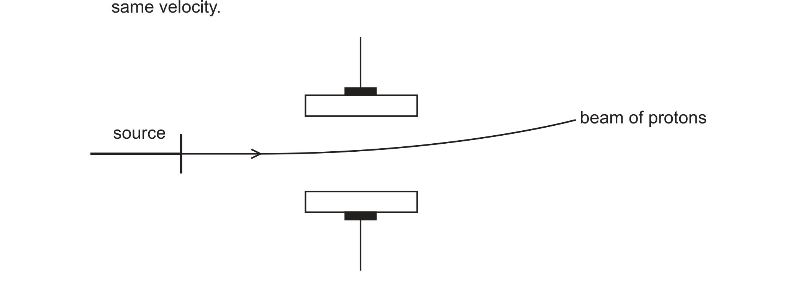

# ch10 Group 2 · 9701/22 Feb/March 2025

> 题卷 `originalpdf/9701_m25_qp_22.pdf` ｜ 答案 `originalpdf/9701_m25_ms_22.pdf`
> 本卷本章共 1 题 / 17 分：本章主管 Q2 [17]

---

## Q2 [17]　(兼 ch1 Atomic structure)

### (a) [2] · ch3

The Group 2 elements show metallic bonding.

Define metallic bonding.

**答案** — electrostatic attraction between positive metal ions / cations and delocalised
electrons

### (b) The Group 2 elements form stable 2+ cations.

### (b)(i) [2] · ch1

State and explain the variation in ionic radius of the Group 2 elements down the group.

**答案** — ionic radius increases / ions larger (down the group); extra shell (of electrons)

### (b)(ii) [2] · ch1

Table 2.1 shows successive ionisation energy values for beryllium, Be.

**Table 2.1**

| | 1st | 2nd | 3rd | 4th |
|---|---|---|---|---|
| ionisation energy / kJ mol⁻¹ | 900 | 1760 | 14 800 | 21 000 |

Use Table 2.1 to state and explain:
- the general trend in these values
- the significance of the large difference between the 2nd and 3rd ionisation energies.

**答案** — ionisation energies increase because less shielding / successive ionic radii are
smaller / greater attraction (of electron) to nucleus; (large difference between 2nd and 3rd IE)
because 3rd e⁻ coming from an inner shell / lower energy level

### (c) All the Group 2 elements except beryllium have more than one stable isotope.

### (c)(i) [2] · ch1

Beryllium exists as the single isotope $^{9}_{4}\text{Be}$.

Describe the distribution of mass within an atom of $^{9}_{4}\text{Be}$.

**答案** — most of the mass is in the nucleus; because protons and neutrons / nucleons are found
in the nucleus

### (c)(ii) [2] · ch1

Complete Table 2.2 to show the numbers of protons and neutrons in the isotopes of magnesium.

**Table 2.2**

| isotope | number of protons | number of neutrons |
|---|---|---|
| magnesium-24 | **12** | **12** |
| magnesium-25 | **12** | **13** |
| magnesium-26 | **12** | **14** |

（加粗数值为答案，原题表格空白待填）

### (c)(iii) [3] · ch1

Fig. 2.1 shows the behaviour of a beam of protons in an electric field.

Complete Fig. 2.1 to show the behaviour of separate beams of neutrons and electrons in the same
electric field. Label your diagram clearly. Assume that the beams of each particle are moving at
the same velocity.

**答案** — neutron beam：从同一 source 出发的水平直线；electron beam：从同一 source 出发、向下
弯曲的曲线，偏转幅度比 proton beam 更大

### (d)(i) [2] · ch10

State what is observed when dilute hydrochloric acid is added to separate samples of barium
oxide and barium carbonate.

**答案** — barium oxide：(white) solid disappears / dissolves；barium carbonate：effervescence
**AND** (white) solid disappears / dissolves

### (d)(ii) [1] · ch10

Write an equation for the reaction of strontium, Sr, with an excess of cold water.

**答案** — Sr + 2H₂O → Sr(OH)₂ + H₂

### (d)(iii) [1] · ch10

State the variation in solubility of the Group 2 sulfates down the group.

**答案** — decreases (down the group)

---

**[Total: 17]**
