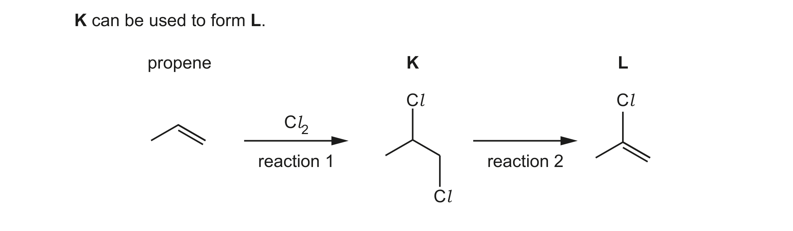
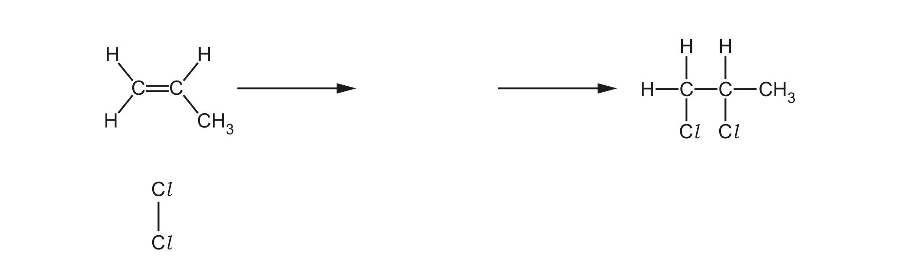

# ch11 Group 17 · 9701/22 Feb/March 2024

> 题卷 `originalpdf/9701_m24_qp_22.pdf` ｜ 答案 `originalpdf/9701_m24_ms_22.pdf`
> 本卷本章共 1 题 / 18 分：镜像 Q2 [18]（主章 ch9）

---

## Q2 [18]　⟨镜像 · 主章 ch9 The Periodic Table: chemical periodicity⟩

> 本题正本在 [`ch09-periodicity/9701_m24_22.md`](../ch09-periodicity/9701_m24_22.md)，此处为镜像。**不要在本文件里改它** —— 改正本，再跑 `python tools/mirror.py`。

### (a) [3] · ch9

Chlorine, Cl₂, reacts with many elements and compounds to form chlorides. Table 2.1 shows
information about some chlorides of Period 3 elements. Complete Table 2.1.

| | Na | Mg | Si |
|---|---|---|---|
| formula of chloride | | | |
| structure of chloride | giant | | |
| bonding of chloride | | | covalent |
| pH of solution formed on addition of chloride to water | | 6.2 | |

**答案**

| | Na | Mg | Si |
|---|---|---|---|
| formula of chloride | NaCl | MgCl₂ | SiCl₄ |
| structure of chloride | giant | giant | simple |
| bonding of chloride | ionic | ionic | covalent |
| pH of solution formed on addition of chloride to water | 7 | 6.2 | 1–4 |

### (b) When Cl₂ reacts with cold NaOH(aq), Cl₂ is both oxidised and reduced. The products are NaCl, water and **G**.

### (b)(i) [1] · ch11

State the type of redox reaction in which the same species is both oxidised and reduced.

**答案** — disproportionation

### (b)(ii) [1] · ch11

Identify **G**.

**答案** — NaClO / sodium chlorate(I)

### (b)(iii) [1] · ch11

Write an equation for the reaction between Cl₂ and **hot** NaOH(aq).

**答案** — 3Cl₂ + 6NaOH → NaClO₃ + 5NaCl + 3H₂O

### (b)(iv) [2] · ch11

Describe fully what is observed when AgNO₃(aq) is added to the aqueous solution of the
chloride of sodium, followed by dilute NH₃(aq).

**答案**
- white precipitate / solid (forms)
- dissolves (in dilute NH₃(aq))

### (c) An excess of Cl₂ reacts with phosphorus to form PCl₅.

### (c)(i) [2] · ch3

PCl₅ is a simple molecule in the gas phase. It also exists in a solid form as two ions, PCl₄⁺
and PCl₆⁻. Complete Table 2.2 to identify the shapes of each of these species.

| species | PCl₅ | PCl₄⁺ | PCl₆⁻ |
|---|---|---|---|
| shape | | tetrahedral | |

**答案**

| species | PCl₅ | PCl₄⁺ | PCl₆⁻ |
|---|---|---|---|
| shape | trigonal bipyramidal | tetrahedral | octahedral |

### (c)(ii) [2] · ch9

PCl₅ reacts with **J** to form H₃PO₄. Identify **J** and state the type of reaction.

**答案**
- **J** = H₂O / water
- type of reaction = hydrolysis

### (d) Cl₂ reacts readily with propene to form **K**, 1,2-dichloropropane. **K** can be used to form **L**.



### (d)(i) [4] · ch14

Complete Fig. 2.2 to show the mechanism for the reaction of Cl₂ with propene in reaction 1.
Include charges, dipoles, lone pairs of electrons and curly arrows, as appropriate.



**答案**（机理图，见 MS 渲染页 `_img/9701_m24_22_msp07.png`）

- 从丙烯 C1=C2 双键画一支弯箭头指向 Cl₂ 中带 δ+ 的 Cl 原子（即新键在 C1，端位 =CH₂ 碳上生成）
- Cl₂ 标出正确偶极（Cl^δ+—Cl^δ−），并从 Cl–Cl 键画一支弯箭头指向带 δ− 的 Cl 原子，使其以 Cl⁻ 离去
- 画出正确的碳正离子中间体：C1 已连上 Cl，C2 带正电荷（仲碳正离子），C3 仍为 CH₃ 支链
- 从 Cl⁻ 上的一对孤对电子画一支弯箭头指向 C2 的碳正离子（C⁺）成键，生成 1,2-dichloropropane

### (d)(ii) [1] · ch15

Identify the reagent and conditions for reaction 2.

**答案** — NaOH in ethanol **AND** heat

### (d)(iii) [1] · ch20

Draw **one** repeat unit of the addition polymer that forms from **L**.

**答案**（答案是图，见 MS 渲染页 `_img/9701_m24_22_msp07.png`）

**L** 是 2-chloroprop-1-ene，CH₂=C(Cl)(CH₃)（C1 为 =CH₂，C2 同时接 Cl 与 CH₃ 支链）。加成聚合的
重复单元用两端虚线表示主链延伸：

```
   Cl   H
   |    |
---C —— C---
   |    |
  H₃C   H
```

左边碳（来自单体 C2）同时接 Cl（上）和 CH₃（下），右边碳（来自单体 C1）上下各接一个 H。

---

**[Total: 18]**
