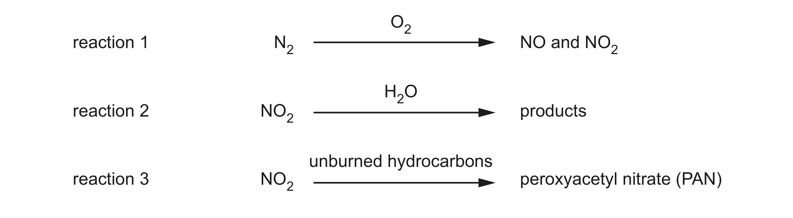
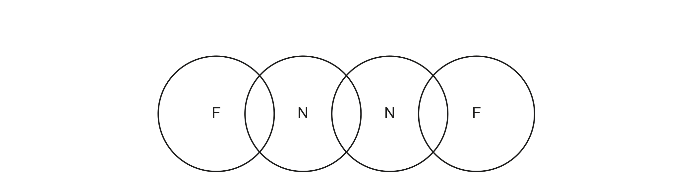

# ch12 Nitrogen and sulfur · 9701/22 Feb/March 2024

> 题卷 `originalpdf/9701_m24_qp_22.pdf` ｜ 答案 `originalpdf/9701_m24_ms_22.pdf`
> 本卷本章共 1 题 / 15 分：本章主管 Q3 [15]

---

## Q3 [15]

Nitrogen, N₂, is generally an unreactive molecule but it does react under certain conditions.

### (a) [2]

Give **two** reasons to explain the lack of reactivity of nitrogen.

**答案**
- strong triple bond / high triple bond enthalpy
- non-polar (molecule)

### (b) N₂ can react with oxygen in an internal combustion engine to form a mixture of NO and NO₂. Fig. 3.1 shows a reaction scheme involving N₂.

### (b)(i) [1]

Write an equation to show the formation of a mixture of NO and NO₂ in reaction 1.

**答案** — e.g. N₂ + 1½O₂ → NO + NO₂

### (b)(ii) [1]

Give the formulae of the products of reaction 2.

**答案** — HNO₂ and HNO₃

### (b)(iii) [1]

State **one** environmental consequence of reaction 3.

**答案** — photochemical smog

### (c) The Haber process involves the reaction of N₂ and H₂ to form ammonia, NH₃. A catalyst is used, which allows the process to be carried out at a lower temperature and pressure.

N₂(g) + 3H₂(g) ⇌ 2NH₃(g)　　Δ*H* = –92 kJ mol⁻¹

### (c)(i) [2]

Use the information in (c) to complete Table 3.1.

**Table 3.1**

| compound | enthalpy change of formation, Δ*H*f / kJ mol⁻¹ |
|---|---|
| N₂ | **0** |
| H₂ | **0** |
| NH₃ | **–46** |

**答案** — 0 for both Δ*H*f of N₂ and H₂；–46 for Δ*H*f of NH₃

### (c)(ii) [1]

Explain how the presence of a catalyst affects the reaction.

**答案** — increases rate by providing a different mechanism with a lower activation energy

### (c)(iii) [2]

State and explain the effect, if any, on the **rate** of the Haber process as the pressure is lowered.

**答案**
- rate is lowered
- lower frequency of successful collisions / number of successful collisions per unit time

### (d) The N₂F₂ molecule has a double covalent bond between its nitrogen atoms. This consists of a σ and a π bond.

### (d)(i) [2]

Complete Fig. 3.2 to show the dot-and-cross diagram for N₂F₂. Show outer electrons only.

**答案** — 每个 N–F 之间画一对 bonding electrons；两个 N 原子之间的双键画两对 bonding
electrons（一对 σ、一对 π）；每个 F 补齐 3 对 lone pairs

**判分** — 分两个 marking point：一分 correct bonding pairs，一分 lone pairs

### (d)(ii) [1]

Deduce the hybridisation of the N atoms in N₂F₂.

**答案** — sp²

### (d)(iii) [2]

Draw a diagram of the π bond between the N atoms in N₂F₂ and describe how it forms.

**答案**
- M1 shows the π orbital（画两瓣哑铃形轨道，一瓣在 σ 键上方、一瓣在下方，代表 side-on 重叠后
  的 π 轨道）
- M2 refers to overlap of (two) 2p orbitals side-on / above and below the plane

---

**[Total: 15]**
