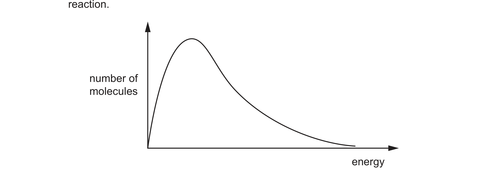

# ch12 Nitrogen and sulfur · 9701/23 May/June 2025

> 题卷 `originalpdf/9701_s25_qp_23.pdf` ｜ 答案 `originalpdf/9701_s25_ms_23.pdf`
> 本卷本章共 1 题 / 7 分：镜像 Q3 [7]（主章 ch14）

---

## Q3 [7]　⟨镜像 · 主章 ch14 Hydrocarbons⟩

> 本题正本在 [`ch14-hydrocarbons/9701_s25_23.md`](../ch14-hydrocarbons/9701_s25_23.md)，此处为镜像。**不要在本文件里改它** —— 改正本，再跑 `python tools/mirror.py`。

### (a) Different hydrocarbon mixtures produced from fractional distillation of crude oil have
different uses.

### (a)(i) [1] · ch14

State the compound that is heated with long-chain hydrocarbons to produce more useful smaller
alkanes and alkenes.

**答案** — Al₂O₃ / aluminium oxide

**判分** — 简报原稿把这一小问的官方答案栏标成"空"，但渲染 MS 第 8 页（`msp08`）后可见答案其实
是文字，不是图：catalytic cracking 用的催化剂是 aluminium oxide

### (a)(ii) [2] · ch12

Describe how photochemical smog is produced during the combustion of petrol in an internal
combustion engine.

**答案**
- unburned hydrocarbons
- react with NO / NO₂
- (to) produce PAN (– a component of photochemical smog)

**判分** — any 2 points = 1 mark，all 3 points = 2 marks

### (b) C₄H₈ reacts with an excess of H₂ to produce C₄H₁₀.

reaction 1　C₄H₈ + H₂ → C₄H₁₀

### (b)(i) [1] · ch14

Name a catalyst for reaction 1.

**答案** — nickel / platinum

### (b)(ii) [1] · ch8

Define activation energy, *E*A.

**答案** — minimum energy required for a collision to be effective

### (b)(iii) [2] · ch8

The Boltzmann distribution for the reaction mixture in reaction 1 is shown in Fig. 3.1. Use the
Boltzmann distribution to explain the effect of adding a catalyst on the rate of reaction.

**答案**
- M1 area under the curve with energy ⩾ *E*A using a catalyst is larger, so greater
  proportion of particles with sufficient energy to react
- M2 rate faster because higher frequency of successful collisions

---

**[Total: 7]**

---
