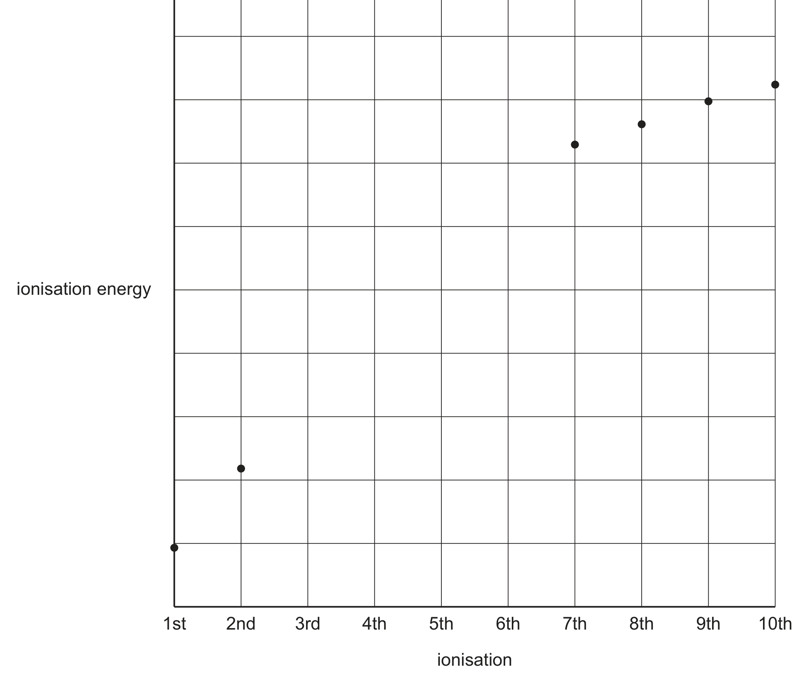

# ch12 Nitrogen and sulfur · 9701/22 Oct/Nov 2024

> 题卷 `originalpdf/9701_w24_qp_22.pdf` ｜ 答案 `originalpdf/9701_w24_ms_22.pdf`
> 本卷本章共 1 题 / 19 分：本章主管 Q3 [19]

---

## Q3 [19]

Nitrogen and phosphorus are elements in Group 15 of the Periodic Table.

### (a) Nitrogen is found in inorganic compounds such as nitrogen oxides (NOₓ), nitrates and nitric acid.

### (a)(i) [2]

Identify **one** natural and **one** man-made occurrence of nitrogen oxides in the atmosphere.

**答案**
- natural = lightning
- man-made = internal combustion engines

### (a)(ii) [1]

Write an equation to describe the role of NO₂ in the direct formation of acid rain.

**答案** — 2NO₂ + H₂O → HNO₂ + HNO₃　OR　4NO₂ + O₂ + 2H₂O → 4HNO₃

### (a)(iii) [1]

Peroxyacetyl nitrate, PAN, is a component of photochemical smog. Describe how PAN forms from NO₂.

**答案** — It / NO₂ reacts with (unburned) hydrocarbons / VOCs

**判分** — ALLOW reaction of unburned hydrocarbons / VOCs in presence of NO₂

### (a)(iv) [1]

Nitric acid reacts with basic oxides to form nitrates. Write an equation for the reaction of nitric acid with calcium oxide.

**答案** — 2HNO₃ + CaO → Ca(NO₃)₂ + H₂O

### (a)(v) [1]

Describe what is seen when solid calcium nitrate is heated strongly.

**答案** — brown fumes given off

### (b) A common test for nitrates is the reaction with NaOH and Al. Equation 1 shows the reaction.

equation 1　3NO₃⁻ + 8Al + 5OH⁻ + 18H₂O → 3NH₃ + 8[Al(OH)₄]⁻

### (b)(i) [1]

Deduce the oxidation state of nitrogen in NO₃⁻.

**答案** — (+)5 / V

### (b)(ii) [1]

Identify the species that is oxidised in equation 1.

**答案** — aluminium / Al

### (b)(iii) [1]

NH₃ is a basic gas. Describe how NH₃ is able to act as a base.

**答案** — (NH₃ is an) H⁺ acceptor

### (b)(iv) [1]

Suggest the shape of the [Al(OH)₄]⁻ ion.

**答案** — tetrahedral

### (c) Fig. 3.1 shows a sketch of some of the ionisation energies of phosphorus, P.

### (c)(i) [1]

Construct an equation to represent the third ionisation energy of P.

**答案** — P²⁺(g) → P³⁺(g) + e⁻

### (c)(ii) [2]

Complete the graph in Fig. 3.1 to show the third to sixth ionisation energies of P.

**答案**
- general increase
- increase in IE between IE5 and IE6 is noticeably the largest increase between the IEs shown

### (d) [2]

Complete Table 3.1 to show the properties of nitrogen and phosphorus in their standard states.

**Table 3.1**

| | nitrogen | phosphorus |
|---|---|---|
| state and appearance of standard state | colourless gas | white solid |
| electrical conductivity | **poor** | poor |
| type of bonding | **covalent** | **covalent** |
| type of structure | simple | **simple** |

### (e) [1]

A form of solid nitrogen has a lattice structure similar to solid iodine. Identify the type of lattice structure of solid nitrogen.

**答案** — simple molecular (lattice structure)

### (f) At very high temperatures, phosphorus can form P₂ molecules. P₂ contains a triple bond, P≡P.

### (f)(i) [2]

Describe the formation of the P≡P bond in terms of orbital overlap.

**答案**
- M1 one sigma / σ bond AND head-on (overlap of) p / sp (orbitals)
- M2 two pi / π bond(s) AND side-on (overlap of / involving) p (orbitals)

### (f)(ii) [1]

The bond energy of P≡P is 485 kJ mol⁻¹. The bond energy of N≡N is 944 kJ mol⁻¹. Compare the reactivity of P₂ and N₂. Explain your answer.

**答案** — P≡P is much weaker so P₂ is more reactive (than N₂)

---

**[Total: 19]**
