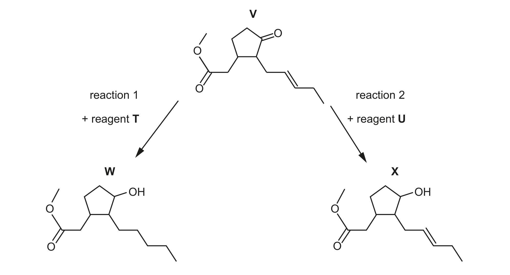
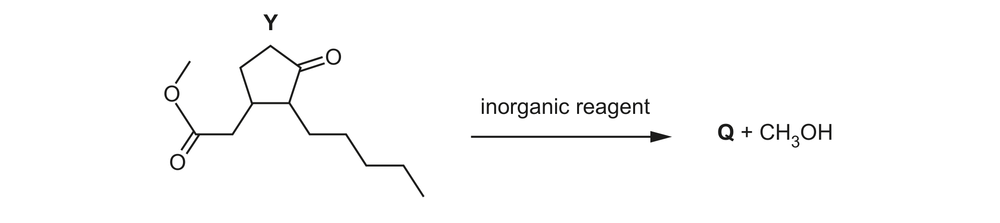
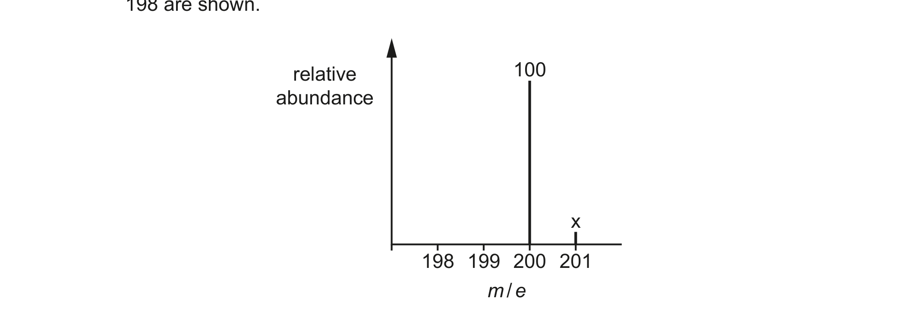

# ch13 An introduction to AS Level organic chemistry · 9701/21 May/June 2024

> 题卷 `originalpdf/9701_s24_qp_21.pdf` ｜ 答案 `originalpdf/9701_s24_ms_21.pdf`
> 本卷本章共 1 题 / 14 分：本章主管 Q6 [14]

---

## Q6 [14]

### (a) V shows stereoisomerism.

### (a)(i) [1]

Explain what is meant by stereoisomerism.

**答案** — (molecules with the) same structural formula (and same molecular formula) with
different arrangement of atoms / groups in space

### (a)(ii) [2]

Deduce the number of stereoisomers of V. Explain your reasoning.

**答案**
- M1 number of stereoisomers = 8
- M2 reasoning: 2 chiral centres AND 1 C=C (producing a cis-and trans or geometrical pair)

### (a)(iii) [1]

Deduce the molecular formula of V.

**答案** — C₁₃H₂₀O₃

### (a)(iv) [1]

Name all the functional groups present in V.

**答案** — ester AND carbonyl / ketone AND C=C (bond) / alkene

### (b) Fig. 6.2 shows two reactions involving V.

### (b)(i) [1]

Identify the role of reagent T for each functional group that reacts in reaction 1.

**答案** — reducing agent for C=O AND C=C

### (b)(ii) [1]

Suggest the identity of reagent U in reaction 2.

**答案** — sodium borohydride / NaBH₄

### (c) Both functional groups in one molecule of Y react with an inorganic reagent to form one molecule of Q and one molecule of methanol, CH₃OH, as shown in Fig. 6.3.

### (c)(i) [2]

Part of the mass spectrum for Q is shown in Fig. 6.4. Only peaks with *m*/*e* greater than 198
are shown.

Calculate the relative abundance, *x*, of the peak at *m*/*e* = 201. Show your working.

**答案**
- M1 deduce n = 12 (from Y − 1C (in methanol))
- M2 (100 × x) ÷ (1.1 × 100) = 12 (so) x = 13.2

### (c)(ii) [1]

Q contains only hydroxyl functional groups. Complete Table 6.1 to show the observations that
occur when 2,4-dinitrophenylhydrazine (2,4-DNPH reagent) is added to separate samples of Y and Q.

**Table 6.1**

| | observation on addition of 2,4-DNPH reagent |
|---|---|
| Y | orange precipitate |
| Q | no precipitate |

**判分** — both correct for one mark

### (c)(iii) [2]

Under certain conditions, 0.0020 mol of Q reacts with an excess of sodium to produce a total of
44.8 cm³ of gas at s.t.p. Calculate the number of hydroxyl groups present in a molecule of Q.
Show your working.

**答案**
- ROH + Na → RONa + ½H₂
- (0.002 mol Q produced 0.002 mol H₂ gas so) 2 OH groups

**判分**
- M1 answer indicates that OH group(s) in Q react with Na to produce the H₂ in the ratio
  1 mol OH : ½ mol H₂
- M2 uses data to show 2 OH groups

### (c)(iv) [2]

Use Table 6.2 to describe and explain two differences between the infrared spectrum of Y and Q
in the region above 1500 cm⁻¹.

**Table 6.2**

| bond | functional groups containing the bond | characteristic infrared absorption range (in wavenumbers) / cm⁻¹ |
|---|---|---|
| C–O | hydroxy, ester | 1040–1300 |
| C=C | aromatic compound, alkene | 1500–1680 |
| C=O | amide | 1640–1690 |
| C=O | carbonyl, carboxyl | 1670–1740 |
| C=O | ester | 1710–1750 |
| C≡N | nitrile | 2200–2250 |
| C–H | alkane | 2850–2950 |
| N–H | amine, amide | 3300–3500 |
| O–H | carboxyl | 2500–3000 |
| O–H | hydroxy | 3200–3650 |

**答案**
- M1 Y will have absorption / peak / trough between 1670–1740 due to C=O (Q will not)
- M2 Q will have absorption / peak / trough between 3200–3600 due to O–H (Y will not)

---

**[Total: 14]**
