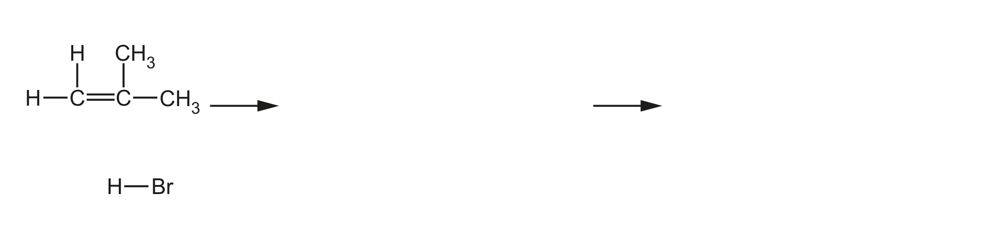

# ch14 Hydrocarbons · 9701/21 May/June 2024

> 题卷 `originalpdf/9701_s24_qp_21.pdf` ｜ 答案 `originalpdf/9701_s24_ms_21.pdf`
> 本卷本章共 1 题 / 9 分：镜像 Q5 [9]（主章 ch3）

---

## Q5 [9]　⟨镜像 · 主章 ch3 Chemical bonding⟩

> 本题正本在 [`ch03-chemical-bonding/9701_s24_21.md`](../ch03-chemical-bonding/9701_s24_21.md)，此处为镜像。**不要在本文件里改它** —— 改正本，再跑 `python tools/mirror.py`。

Hydrocarbon molecules contain covalent bonds.

### (a) [1] · ch3

Define covalent bond.

**答案** — (electrostatic) attraction between nuclei of two atoms and shared pair of electrons

### (b) A C=C bond in an alkene is made from a σ bond and a π bond.

### (b)(i) [1] · ch3

Identify the hybridisation of the carbon atoms in a C=C bond in an alkene.

**答案** — sp²

### (b)(ii) [2] · ch3

Draw labelled diagrams to show, in terms of orbital overlap, how the σ and π bonds are made in a
C=C bond.

**答案**（答案本身是图，去看 MS 渲染页 `_img/9701_s24_21_msp10.png`）
- σ bond：两个 sp² 轨道沿键轴方向**头对头（direct/end-on）重叠**，重叠区域画在两个原子核连线
  正中间，呈纺锤/橄榄球形。
- π bond：两个碳各自未参与杂化的 p 轨道（每个 p 轨道是上下两瓣的哑铃形），**侧向（sideways）
  重叠**——上瓣与上瓣、下瓣与下瓣分别重叠，在 C=C 键轴上下各形成一个电子云叶瓣，标注
  "p (orbitals)" 及 "sideways overlap"。

### (c) In electrophilic reactions involving alkenes the π bond of C=C is broken.

### (c)(i) [1] · ch3

Suggest one difference between σ and π bonds that explains why the π bond is broken in
electrophilic addition reactions involving alkenes.

**答案** — **EITHER** (pair of) electrons in π bond are further away from the nuclei so weaker
attraction　**OR** (pair of) electrons in σ bond are closer to the two nuclei so stronger attraction

### (c)(ii) [4] · ch14

Complete Figure 5.1 to show the mechanism for the electrophilic addition of hydrogen bromide to
2-methylpropene to produce the major organic product. Include charges, dipoles, lone pairs of
electrons and curly arrows, as appropriate.

**答案**（机理三步：2-methylpropene + HBr → 叔碳正离子中间体 + Br⁻ → 2-bromo-2-methylpropane）
- M1 curly arrow：从 C=C 双键指向 H–Br 的 H
- M2：H–Br 上标出正确 dipole（Hᵟ⁺—Brᵟ⁻），并有 curly arrow 从 H–Br 键指向 Br
- M3：画出正确的（叔碳）carbocation intermediate，**AND** 最终产物为 2-bromo-2-methylpropane
- M4：curly arrow 从 Br⁻ 的 lone pair 指向中间体的 C⁺（C 上标 +ve 或 δ+ 电荷）

**判分** — 中间体必须是三级碳正离子（(CH₃)₃C⁺），因为 2-methylpropene 加成遵循 Markovnikov 规则。

---

**[Total: 9]**
