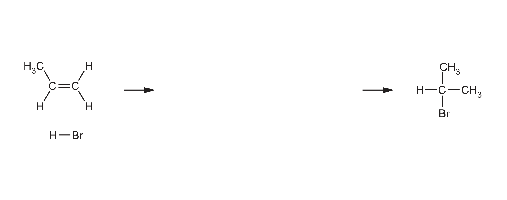
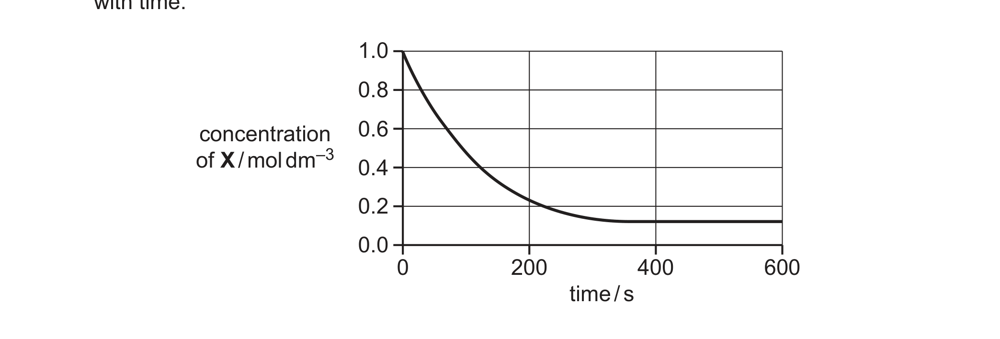
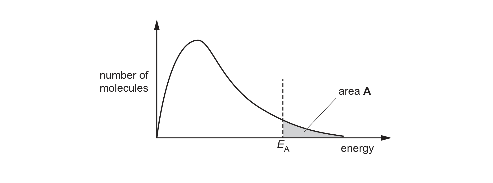

# ch14 Hydrocarbons · 9701/22 May/June 2025

> 题卷 `originalpdf/9701_s25_qp_22.pdf` ｜ 答案 `originalpdf/9701_s25_ms_22.pdf`
> 本卷本章共 1 题 / 16 分：本章主管 Q3 [16]

---

## Q3 [16]

### (a) C₃H₆ reacts with HBr(g) in an addition reaction.

### (a)(i) [1]

Define addition reaction.

**答案** — two (or more) reactants / molecules react to make (only) one product

### (a)(ii) [4]

Complete Fig. 3.1 to show the mechanism for the addition reaction between C₃H₆ and HBr to
produce 2-bromopropane. Include charges, dipoles, lone pairs of electrons and curly arrows, as
appropriate.

**答案** — propene（CH₃–CH=CH₂，按 IUPAC 编号 C1 是末端 =CH₂，C2 是 =CH–，C3 是 CH₃）与
HBr 的 electrophilic addition：
- curly arrow 从 C1=C2 双键指向 Hδ+—Brδ− 的 H 原子，C1 与该 H 成键
- 另一条 curly arrow 从 Hδ+—Brδ− 键指向 Brδ−，使该键异裂生成 Br⁻（图上必须标出 δ+ / δ−）
- 生成的 intermediate 是 secondary carbocation CH₃–C⁺H–CH₃（正电荷在 C2 上）
- 第三条 curly arrow 从 Br⁻ 的 lone pair 指向 C2 的 C⁺，生成 CH₃–CHBr–CH₃（2-bromopropane）

**判分**
- M1 curly arrow from = of C=C to H (of HBr)
- M2 curly arrow from bond of Hδ⁺—Brδ⁻ to Brδ⁻（dipole is essential）
- M3 correct intermediate
- M4 curly arrow from lone pair of Br⁻ to C⁺ of intermediate drawn

### (a)(iii) [2]

Explain why the major product of this reaction is 2-bromopropane rather than 1-bromopropane.

**答案**
- M1 2-bromopropane is made from the more stable intermediate / carbocation
- M2 (due to positive) inductive effect of more alkyl groups (attached to the C⁺ / central carbon
  atom)
  OR (due to) greater (positive) inductive effect of 2 methyl groups (rather than 1 ethyl group)

**判分** — C2 上的碳正离子（secondary，两个 methyl 提供 inductive effect）比 C1 上的碳正离子
（primary，只有一个 ethyl 提供 inductive effect）更稳定，故经过 secondary intermediate 生成的
2-bromopropane 是 major product

### (b) H₂(g) and nickel are added to alkene X. Fig. 3.2 shows how the concentration of X changes
with time.

### (b)(i) [1]

Use Fig. 3.2 to identify the limiting reagent in this reaction. Explain your answer.

**答案** — H₂ / hydrogen AND some X / alkene left(over) / remains (at the end of this reaction)

### (b)(ii) [1]

Use Fig. 3.2 to describe how the gradient changes as the reaction proceeds. State what this shows
about the rate during this reaction.

**答案** — as the gradient decreases the rate decreases
OR rate decreases until the reaction stops when gradient = 0

**判分** — 必须把 gradient 的变化和 rate 的意义关联起来才给分，只描述其中一项不够

### (c) Hydrocarbon Y contains two C=C groups. There are no other functional groups present. Y
reacts with an excess of H₂(g) to produce hexane, C₆H₁₄.

Table 3.1

| bond | bond energy / kJ mol⁻¹ |
|---|---|
| C−C | 350 |
| C=C | 610 |
| C≡C | 840 |
| H−H | 436 |
| C−H | 410 |

Use Table 3.1 to calculate the enthalpy change per mole of C₆H₁₄ produced in this reaction. [2]

**答案**

method 1 — breaking all bonds in the molecules
- (2 × 610) + (2 × 436) + (10 × 410) + (3 × 350) − (14 × 410) − (5 × 350)
- energy involved when all bonds are broken = (7242)
- energy involved when all bonds are made = (7490)
- energy to break bonds − energy to make bonds = (7242 − 7490) = −248

method 2 — ignore any bonds that do not change from reactants to products
- (2 × 610) + (2 × 436) − (4 × 410) − (2 × 350)
- energy involved when all bonds are broken = (2092)
- energy involved when all bonds are made = (2340)
- energy to break bonds − energy to make bonds = (2092 − 2340) = −248

enthalpy change = **−248 kJ mol⁻¹**

### (d) Hydrocarbon Y reacts with H₂(g). Fig. 3.3 shows the distribution of energies of H₂(g) at
temperature T. Area A represents the number of molecules with energy greater than or equal to
the activation energy, *E*A, at temperature T.

### (d)(i) [1]

Annotate Fig. 3.3 to show the effect of adding nickel to Y and H₂(g) at temperature T.

**答案** — 在原来的 *E*A 左侧另标一个更小的 *E*A（曲线本身不需要重画，催化剂只降低
activation energy，不改变温度 / 曲线形状）

### (d)(ii) [2]

Area B (not labelled on Fig. 3.3) represents the number of molecules with energy greater than or
equal to the activation energy when nickel is added at temperature T. State the difference, if any,
between areas A and B. Explain the significance of your answer on the rate of hydrogenation of Y.
Give your answer in terms of collisions.

**答案**
- M1 it / (area) B larger AND rate (reaction / hydrogenation) increases
  OR (area) B identified by shading or labelling on Fig 3.3 AND rate (reaction / hydrogenation)
  increases in prose
- M2 increase in the frequency of effective / successful collisions
  OR increase in rate of effective / successful collisions

### (e) Alkene Z contains two C=C bonds. Z reacts with an excess of hot concentrated acidified
KMnO₄ to produce only CH₃COCH₃, HOOCCH₂COOH, CO₂ and H₂O. [2]

Suggest the structure of Z.

**答案** — Z 的结构是 H₂C=CH–CH₂–CH=C(CH₃)₂
- M1 H₂C=C…（分子一端）OR …C=C(CH₃)₂（分子另一端）OR …C=CH–CH₂–CH=C…（分子中间）
- M2 correct structure

**判分** — 用 hot concentrated acidified KMnO₄ 氧化裂解两个 C=C：末端 H₂C= 那一端（无取代基）
被完全氧化成 CO₂ + H₂O；中间 –CH=CH–CH₂– 片段两端各生成一个 –COOH，即
propanedioic acid HOOCCH₂COOH；另一端 =C(CH₃)₂（双取代、无 H）氧化为 ketone
propanone CH₃COCH₃

---

**[Total: 16]**
