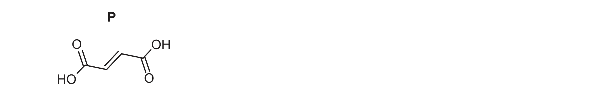
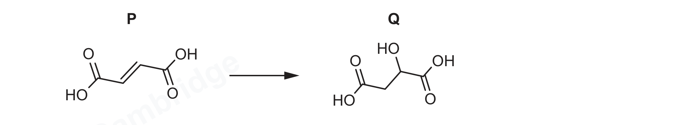
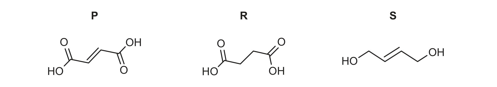
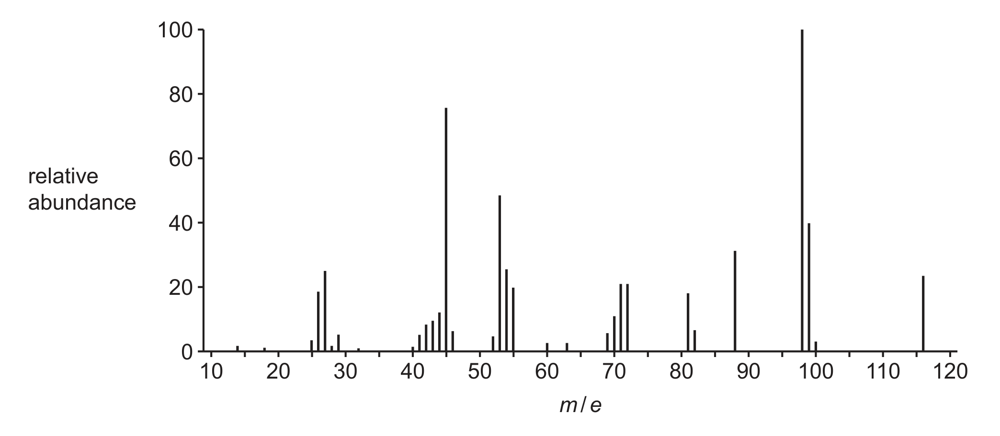

# ch14 Hydrocarbons · 9701/22 May/June 2026

> 题卷 `originalpdf/9701_s26_qp_22.pdf` ｜ 答案 `originalpdf/9701_s26_ms_22.pdf`
> 本卷本章共 2 题 / 22 分：本章主管 Q5 [9]；镜像 Q6 [13]（主章 ch13）

---

## Q5 [9]

Hexane, CH₃(CH₂)₄CH₃, reacts with Cl₂(g) in the presence of ultraviolet light to produce different
organic products, including those shown in Table 5.1.

Table 5.1

| structure of product | systematic name of product |
|---|---|
| CH₃(CH₂)₅Cl | **1-chlorohexane** |
| CH₃(CH₂)₃CHClCH₃ | **2-chlorohexane** |
| CH₃(CH₂)₃CHClCH₂Cl | 1,2-dichlorohexane |
| CH₃(CH₂)₁₀CH₃ | dodecane |
| CH₃(CH₂)₃CH(CH₃)CH(CH₃)(CH₂)₃CH₃ | 5,6-dimethyldecane |

### (a) [2]

Complete Table 5.1.

**判分** — 后三行（1,2-dichlorohexane / dodecane / 5,6-dimethyldecane）题目已给出，只有前两行的
名称需要填空；Max 1（只给 1 分）：alkane 词干统一写错但 1-chloro / 2-chloro 的想法正确；Max 1：
写成 6-chlorohexane 和 5-chlorohexane（编号方向反了，没取最小定位号）；Max 1：拼写错误但两处一致，
如 1-chlorhexane / 2-chlorhexane，或 1-clorohexane / 2-clorohexane，或 chloro-1-hexane /
chloro-2-hexane；A 漏连字符（missing hyphen）不扣分

### (b)

The mechanism for the reaction of hexane with Cl₂(g) involves three stages:

stage 1 initiation　stage 2 propagation　stage 3 termination

In stage 1 and 2, free radicals are produced.

### (b)(i) [1]

Describe what is meant by free radical.

**答案** — (species) with one or more unpaired electrons

**判分** — BOD "species with (an) unpaired electron(s)"；I lone / single / free / odd number of
electrons (in valence shell)；I 只写具体数字个未成对电子（除了 1 个）；BOD "species with one or
two unpaired electrons"；R "it is an unpaired electron"；species 可以是 atom、ion、particle、
molecule、substance、element、compound 中任一个，都算 BOD

### (b)(ii) [1]

Name the type of bond breaking that occurs to produce the free radical Cl• from Cl₂.

**答案** — homolytic (fission)

**判分** — BOD homolytical；A homolysis；I covalent；I photolytic

### (b)(iii) [2]

Suggest a reaction sequence of two propagation reactions that result in CH₃(CH₂)₄CH₃ forming
CH₃(CH₂)₃CHClCH₃.

**答案**
- propagation reaction 1　CH₃(CH₂)₄CH₃ + Cl• → CH₃(CH₂)₃•CHCH₃ + HCl
- propagation reaction 2　CH₃(CH₂)₃•CHCH₃ + Cl₂ → CH₃(CH₂)₃CHClCH₃ + Cl•

自由基生成在 C2（第二个碳，secondary carbon），对应最终产物 2-chlorohexane。

**判分** — 两分独立给分；自由基带不带 • 都接受；M1 若把自由基写成不带位置信息的通式
•C₆H₁₃ 或 CH₃(CH₂)₅• 不给（I）；• 的位置写错也不给（I position of the dot）；BOD 接受
CH₃(CH₂)₃CH₃CH• 或 CH₃(CH₂)₃CCH₃H• 这类原子顺序写乱但意思对的自由基；M2 可以对 M1 里错误的
alkyl 结构做 ecf（即使方程式配平不上也给）；M2 若写通式自由基 •C₆H₁₃ / CH₃(CH₂)₅• 同样不给；
M2 若把自由基当成阴 / 阳离子处理，ecf 不给分

### (b)(iv) [2]

Suggest a reaction sequence of one propagation reaction followed by a termination reaction that
results in CH₃(CH₂)₄CH₃ forming CH₃(CH₂)₁₀CH₃.

**答案**
- propagation reaction　CH₃(CH₂)₄CH₃ + Cl• → CH₃(CH₂)₄•CH₂ + HCl
- termination reaction　CH₃(CH₂)₄•CH₂ + CH₃(CH₂)₄•CH₂ → CH₃(CH₂)₁₀CH₃
  （或写成 2CH₃(CH₂)₄•CH₂ → CH₃(CH₂)₁₀CH₃）

自由基生成在 C1（末端碳，primary carbon）；termination 是两个 primary hexyl radical 直接偶联，
把两条 C₆ 链在各自的自由基碳上对接成 C₁₂ 的 dodecane。

**判分** — 两分独立给分；自由基带不带 • 都接受；M1 也接受写成 CH₃(CH₂)₅•（等价的六碳自由基
写法）；M1 若写通式 •C₆H₁₃ 不给（I）；• 位置写错不给；M2 若写通式 •C₆H₁₃ 或 CH₃(CH₂)₅•
同样不给；M2 若把自由基当阴 / 阳离子处理，ecf 不给分

### (c) [1]

The proportion of each product varies depending on the type of free radical intermediate that is
produced.

Table 5.2

| | primary free radical | secondary free radical | tertiary free radical |
|---|---|---|---|
| free radical | •C(CH₃)H₂ | •C(CH₃)₂H | •C(CH₃)₃ |

（表格下方画了一条从左到右的箭头，标注 "increased stability of radical"）

Use Table 5.2 to suggest which factor determines the increased stability of free radicals from
primary to secondary to tertiary.

**答案** — number of alkyl / methyl groups

**判分** — A "number of C atoms bonded to the central carbon / branches / R groups"；BOD "number of
alkyl groups bonded to the carbocation"；I "number of C atoms bonded to the carbocation"；
I "number of C atoms"；I "number of ethyl / propyl groups"；I "number of hydrogens"；
I inductive effect；I 直接写 "tertiary > secondary > primary stability"；I 只写 "carbocation
stability"

---

**[Total: 9]**

## Q6 [13]　⟨镜像 · 主章 ch13 An introduction to AS Level organic chemistry⟩

> 本题正本在 [`ch13-organic-intro/9701_s26_22.md`](../ch13-organic-intro/9701_s26_22.md)，此处为镜像。**不要在本文件里改它** —— 改正本，再跑 `python tools/mirror.py`。

### (a) Figure 6.1 shows the structure of compound P.

### (a)(i) [1] · ch13

Draw the structure of the stereoisomer of P.

**答案** — P（Fig. 6.1）为 trans (E) but-2-enedioic acid；答案画出其 cis (Z) 立体异构体，即两个
COOH 在 C=C 同侧。

**判分** — A 任何明确无歧义的 cis / Z 结构；I connectivity 画错；I 画成 trans 结构

### (a)(ii) [2] · ch13

Explain why P shows stereoisomerism.

**答案**
- M1 limited / restricted / lack of / no rotation about the pi bond / π bond of C=C
- M2 (two) different groups attached to each C of the C=C / each end of the C=C

**判分**
- M1：A limited / restricted / lack of / no rotation about the C=C；C=C 全篇只需点名一次；
  BOD C−C double bond；**I** double bond（分子里另有一个 C=O，笼统说 double bond 不给）；
  **I** movement；rotate = twist = spin；**R** "(compound) P has a chiral carbon"
- M2：each = both；A different atoms / functional groups / H and COOH / species；
  **I** each side (of the C=C)；**R** different compounds / molecules

### (b) P reacts to produce compound Q.

### (b)(i) [2] · ch14

Identify the reagent and conditions required to convert P to Q.

**答案**
- M1 steam / H₂O (g)
- M2 H₃PO₄ (catalyst) / phosphoric(V) acid (catalyst)

**判分**
- M1 A water 且随后给出温度 ≥100 °C（温度写在 conditions 行也算）
- M2 A H₃PO₄ (catalyst) / phosphoric(V) acid (catalyst) / sulfuric acid (catalyst) /
  H₂SO₄ (catalyst) 写在 reagent 行；A orthophosphoric acid / phosphoric acid / sulfuric acid；
  **I** heat under reflux / heat alone；**I** pressure；**I** state symbols

### (b)(ii) [2] · ch13

Complete Figure 6.3 to show the pair of stereoisomers of Q.

**答案** — Q 是 P 加水后的产物（malic acid，2-hydroxybutanedioic acid），手性碳上接
COOH（竖直向上）、H（竖直向下）、OH 与 CH₂COOH（一前一后，用楔形/虚楔表示）：
- isomer 1：COOH 竖直向上，H 竖直向下；OH 用粗楔形键（指向读者）画在左下方，
  CH₂COOH 用虚楔形键（指向纸面后方）画在右下方
- isomer 2（isomer 1 的 enantiomer）：COOH 竖直向上，H 竖直向下；CH₂COOH 用虚楔形键
  画在左下方，OH 用粗楔形键画在右下方——即把 OH 和 CH₂COOH 的前后位置互换

**判分**
- COOH = CO₂H；A C₂H₃O₂
- M1 中心碳周围 4 个基团（COOH / H / OH / CH₂COOH）全部正确，方向不拘（写在 isomer 2 上也算）
- M2 是 M1 结构的 enantiomer（不要求画成严格镜像）；**R** 平面内的键画成互相相对方向；
  **I** 与手性碳无关的键形状；**I** 键角；**I** connectivity

### (c) An unlabelled sample contains one of compounds P, R or S.

The mass spectrum of the sample is shown in Figure 6.5.

### (c)(i) [2] · ch22

Identify the one peak on Figure 6.5 which confirms that the sample is P. Explain your reasoning.

**答案**
- M1 (molecular ion peak at) 116
- M2 has the same (116) molecular mass (as P)

**判分**
- M1 A 指认出图上要说的那个峰；A 最右边的峰 / m/e 值最大的峰；**I** 只泛泛说
  "110–120 之间有一个峰" 而不定量；**I** 把 99 认成 HOOCCH=CHCO⁺；**I** 把 71 认成
  C₃H₃O₂⁺；**R** 除 99、71 外的其他峰
- M2 需结合 Fig. 6.4 顶部结构给出 P 的 Mr = 116 的依据；**I** AMU；
  M⁺ ion peak = molecular ion peak = M peak；molecular mass = Mᵣ = RFM = molar mass；
  A "The molecular mass (of P) is 116"（除非前后矛盾均给分）；**R** relative atomic mass / Aᵣ

### (c)(ii) [2] · ch22

Suggest the structural formulae of the fragments responsible for the peaks at *m*/*e* = 45 and
*m*/*e* = 99.

**答案**
- structural formula of fragment at *m*/*e* = 45 — COOH⁺
- structural formula of fragment at *m*/*e* = 99 — HOOCCHCHCO⁺ / HOOCCH=CHCO⁺

**判分** — 两个结构都写对但完全不带电荷（无 + / 无 − / 无 dot，或电荷符号缺失）最多给 1 分；
BOD 用短线代表键，如 –COOH⁺；A CO₂H⁺ / CHO₂⁺；**I** C₄H₃O₃

### (c)(iii) [2] · ch14 ch18

Suggest one reagent that is used to distinguish between samples of R and S. Include appropriate
observations.

**答案**（任选一组）
- M1 Br₂(aq) / bromine water　　M2 orange / brown to colourless in S (not R)
- 或　M1 Na₂CO₃ / sodium carbonate / NaHCO₃ / sodium hydrogencarbonate　　M2 fizzing /
  effervescence in R (not S)

**判分**
- **R** 大小写只扣一次，如 KMNO₄
- M2 的现象必须对应 M1 试剂的明确指认，例：M1 Br₂ → M2 decolourises S ✓；
  M1 K₂Cr₂O₇ / Cr₂O₇²⁻（不加酸）→ M2 (orange) to green ✓；M1 Na₂CO₃ → M2 bubbles in R ✓ 等
- M2 **I** 直接说 alkene for S / carboxylic acid for R，但 A alcohol for S
- M1 A bromine / Br₂；A aqueous iodine / aqueous I₂ / iodine water（不能只写 iodine）；
  **R** iodoform
- M2 A decolourises；A yellow to colourless；**R** red；A bubbles；**I** limewater (turns milky)
- **同样给 2 分的其他试剂**（MS 续页 Alternatives）：
  - acidified potassium dichromate / H⁺ AND K₂Cr₂O₇（BOD H⁺ / Cr₂O₇²⁻）
    → (orange) to green with S (not R)
  - potassium permanganate / KMnO₄（BOD potassium manganate / MnO₄⁻）
    → decolorises / (purple) to colourless (solution) / brown ppt with S (not R)；
    A green solution formed if alkaline KMnO₄ used
  - 加入 named alcohol + (conc) sulfuric acid（或 named alcohol AND catalyst）
    → sweet smell with R (not S)
  - 加入 named carboxylic acid + (conc) sulfuric acid（或 named carboxylic acid AND catalyst）
    → sweet smell with S (and not R)
  - named acid-base indicator → appropriate colour change with R (and not S)
  - A Mg / magnesium → A faster bubbles with R（需要比较）

---

**[Total: 13]**
