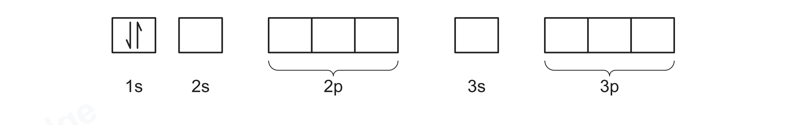
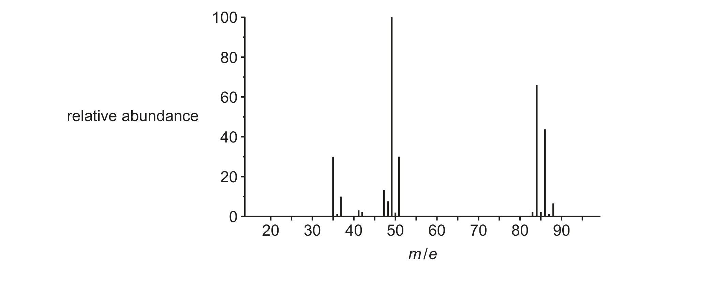

# ch14 Hydrocarbons · 9701/23 May/June 2026

> 题卷 `originalpdf/9701_s26_qp_23.pdf` ｜ 答案 `originalpdf/9701_s26_ms_23.pdf`
> 本卷本章共 1 题 / 12 分：本章主管 Q5 [12]

---

## Q5 [12]

Propane, CH₃CH₂CH₃, reacts with Cl₂(g) in the presence of ultraviolet light to produce different
organic products, including those shown in Table 5.1.

Table 5.1

| structure of product | systematic name of product |
|---|---|
| CH₃(CH₂)₂Cl | 1-chloropropane |
| CH₃CHClCH₃ | 2-chloropropane |
| (CH₃)₂CHCH(CH₃)₂ | 2,3-dimethylbutane |
| **CH₃(CH₂)₄CH₃** | hexane |
| **CH₃(CH₂)₂CH(CH₃)₂** | 2-methylpentane |

### (a)(i) [2]

Complete Table 5.1.

**判分** — 前三行题目已给出（作为例子），只有 hexane 和 2-methylpentane 这两行的结构需要填空；
A 任何无歧义的结构式都接受

*异常记录*：官方 MS 把已给例子那一行（第三行）的名称印成了 "2,4-dimethylbutane"，但题卷本身
印的是 "2,3-dimethylbutane"（(CH₃)₂CHCH(CH₃)₂ 唯一化学上成立的 IUPAC 名——"2,4-" 在只有 4 个
碳的 butane 骨架上根本不成立）。这一行是题目给定、本身不计分的例子，此处按题卷、也是化学上正确
的 "2,3-dimethylbutane" 誊抄，并在此注明 MS 的印刷错误，不影响该小问 2 分的评分（分数只看
hexane / 2-methylpentane 两行结构对不对）。

### (a)(ii) [1]

Name the mechanism for the reaction of propane and Cl₂(g) in the presence of ultraviolet light.

**答案** — free-radical substitution

### (b)

The mechanism for this reaction involves three stages:

stage 1 initiation　stage 2 propagation　stage 3 termination

During the initiation reaction, a chlorine free radical is produced.

### (b)(i) [1]

Complete Figure 5.1 to describe the arrangement of electrons in a chlorine free radical.

**答案** — 图中 1s 方框题目已给出一对配对箭头（↑↓，代表 1s² 已满）。需要补齐的是：2s 画一对
配对箭头 (↑↓)；2p 三个方框各画一对配对箭头 (↑↓)(↑↓)(↑↓)，代表 2p⁶ 全满；3s 画一对配对箭头
(↑↓)；3p 三个方框中两个画配对箭头 (↑↓)(↑↓)，最后一个只画单支箭头 (↑)，代表 3p⁵——这个未配对
的电子正是 Cl• 这个 free radical 的来源。完整排布是 1s²2s²2p⁶3s²3p⁵。

**判分** — A 3p 里"两对配对 + 一个单电子"的任何排列方式（三个方框里哪一个是单电子都行）；
A 用双头箭头（↕）表示配对电子

### (b)(ii) [2]

Suggest a reaction sequence of two propagation reactions that result in CH₃CH₂CH₃ forming
CH₃CH₂CH₂Cl.

**答案**
- propagation reaction 1　CH₃CH₂CH₃ + Cl• → •CH₂CH₂CH₃ + HCl
- propagation reaction 2　•CH₂CH₂CH₃ + Cl₂ → CH₃CH₂CH₂Cl + Cl•

自由基生成在 C1（末端碳，primary carbon），对应最终产物 1-chloropropane。

**判分** — M1 若把自由基写成不带位置信息的通式 •C₃H₇ 不给（I）；M1 若写成 CH₃•CHCH₃（自由基
长在 C2，会生成 2-chloropropane 而不是题目要求的 1-chloropropane）不给（R）；• 的位置写错，或
完全不写 • 都不给（I position of the dot / I absence of the dot）；M2 A 把自由基写成通式 •C₃H₇
或 CH₃•CHCH₃ 也给分

### (b)(iii) [2]

Suggest a reaction sequence of one propagation reaction followed by a termination reaction that
results in CH₃CH₂CH₃ forming (CH₃)₂CHCH(CH₃)₂.

**答案**
- propagation reaction 3　CH₃CH₂CH₃ + Cl• → CH₃•CHCH₃ + HCl
- termination reaction　2CH₃•CHCH₃ → (CH₃)₂CHCH(CH₃)₂

自由基生成在 C2（中间碳，secondary carbon）；termination 是两个 secondary propyl radical 直接
偶联，把两条 C₃ 链在各自的自由基碳上对接成 C₆ 的 2,3-dimethylbutane，即 (CH₃)₂CHCH(CH₃)₂。

**判分** — 自由基带不带 • 都接受；(CH₃)₂CH• 与 CH₃•CHCH₃ 是同一个自由基的两种等价写法；
M1 也接受把 CH₃CHCH₃ 简写成 C₃H₇（省略 •）；M1 若写成末端的 •CH₂CH₂CH₃（primary 自由基）
不给（R，因为这样 termination 对不上题目要求的产物）；• 的位置写错不给（I position of the
dot）；M2 若写通式 •C₃H₇ 不给（I）；M2 若写成 •CH₂CH₂CH₃ 同样不给（R）

### (c) Compound A has the molecular formula CH₂Cl₂. Figure 5.2 shows the mass spectrum of A.

### (c)(i) [2]

Explain the difference in relative abundance of the peaks at m/e = 35 and m/e = 37.

**答案**
- M1 two Cl isotopes
- M2 ³⁵Cl is 3 times more abundant than ³⁷Cl

**判分** — M1 A "(2) different Cl isotopes"；M1 BOD "peaks are the isotopes of Cl"；也接受把
两条一起写成 "75% ³⁵Cl and 25% ³⁷Cl"（两分全给）或 "³⁵Cl : ³⁷Cl is 3 : 1"（两分全给）；只写
"³⁵Cl is more abundant than ³⁷Cl" 而没有 3 倍 / 75 : 25 这个定量关系，只能拿 1 分

### (c)(ii) [2]

Complete Table 5.2.

Table 5.2

| m/e value of peak | molecular formula of species responsible for peak |
|---|---|
| 84 | (CH₂³⁵Cl₂)⁺ |
| 86 | (CH₂³⁵Cl³⁷Cl)⁺ |
| 88 | (CH₂³⁷Cl₂)⁺ |

**判分** — 84 行 BOD 也接受写成 (C³⁷Cl³⁵Cl)⁺（省略了 H₂，但质量数刚好也是 84——少 2 个 H 的
质量与多一个 ³⁷Cl 换掉一个 ³⁵Cl 的质量差相同，纯属数字巧合）；86 行同理 BOD 也接受写成
(C³⁷Cl₂)⁺（质量数同样是 86）；max 1：若三行都写成不带电荷、带负电荷，或写成自由基（• 的形式）
而其余全对，三行整体最多给 1 分；I 缺方括号；I 多写了 •；I 正电荷位置写错

---

**[Total: 12]**
