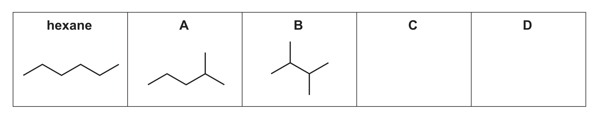
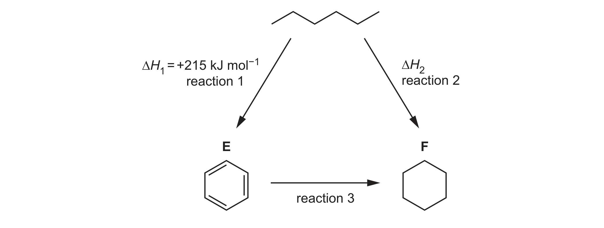
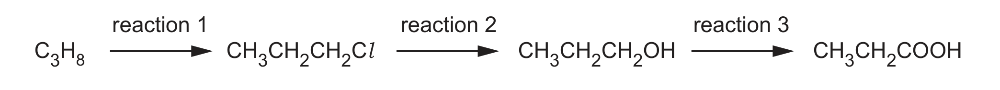
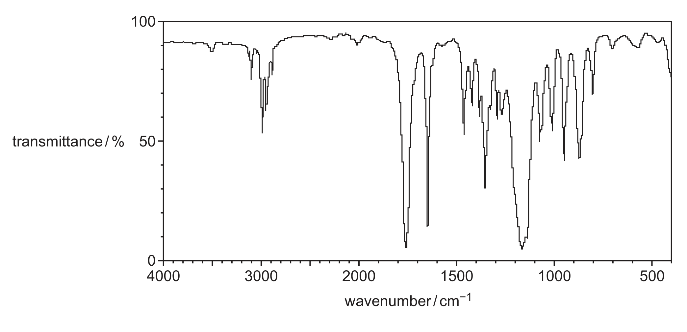

# ch14 Hydrocarbons · 9701/22 Oct/Nov 2025

> 题卷 `originalpdf/9701_w25_qp_22.pdf` ｜ 答案 `originalpdf/9701_w25_ms_22.pdf`
> 本卷本章共 2 题 / 30 分：本章主管 Q3 [14]；镜像 Q4 [16]（主章 ch21）

---

## Q3 [14]

The alkanes are a homologous series of organic molecules. Alkanes are generally unreactive and
are commonly used as fuels.

### (a) [2] · ch13

Define homologous series.

**答案**
- M1 (family of molecules / compounds / series with) same general formula
  OR (family of molecules where) molecular formula differs (only) by (units of) CH₂(n)
- M2 similar chemical properties / reactions

### (b) [2] · ch14

Give two reasons to explain the general unreactivity of alkanes.

**答案**
- M1 strong C—H (bonds)
- M2 non-polar (C—H / molecule / bonds)

### (c) [1] · ch14

Alkanes with low relative molecular mass, *M*ᵣ, are more useful than those found in heavier crude
oil fractions. Name the process that is used to obtain alkanes with low *M*ᵣ from heavier crude oil
fractions.

**答案** — cracking

### (d) Hexane, C₆H₁₄, has four structural isomers. Fig. 3.1 shows hexane and two of its structural
isomers.

### (d)(i) [2] · ch13

Complete Fig. 3.1 by drawing structures for C and D, the other two structural isomers of hexane.

**答案** — Fig. 3.1 中已给出 hexane（直链）、A（2-methylpentane，支链在离端点第 2 个碳）、
B（2,3-dimethylbutane，两个 methyl 分别在相邻的第 2、3 个碳上）。还需再画出：
- C = 3-methylpentane：CH₃CH₂CH(CH₃)CH₂CH₃（methyl 支链在链正中间的第 3 个碳）
- D = 2,2-dimethylbutane：CH₃CH₂C(CH₃)₂CH₃（两个 methyl 都接在同一个碳，即第 2 个碳，
  上，形成 quaternary carbon）

### (d)(ii) [3] · ch3

A, B and hexane have different boiling points. Arrange A, B and hexane in order of increasing
boiling point. Explain your answer.

lowest ……… < ……… < ……… highest

**答案** — lowest **B** < **A** < **hexane** highest
- M1 B < A < hexane
- M2 hexane / unbranched has stronger / more IMFs
- M3 hexane / unbranched requires most / more energy

**判分** — B（2,3-dimethylbutane，2 个支链）比 A（2-methylpentane，1 个支链）分子更紧凑、
表面接触面积更小，instantaneous dipole–induced dipole 作用力更弱，沸点最低；hexane 完全
是直链，分子间接触面积最大、IMF 最强、沸点最高

### (e) Hexane can be converted into compounds E and F at high temperature and pressure. Fig. 3.2
shows the reaction scheme involving hexane, E and F.

（reaction 1：hexane → E，Δ*H*₁ = +215 kJ mol⁻¹；reaction 2：E → F，Δ*H*₂ 待求；
reaction 3：hexane → F，直接反应）

### (e)(i) [1] · ch14

Identify a suitable reagent for reaction 3.

**答案** — H₂ ((g)) OR hydrogen (gas)

### (e)(ii) [2] · ch5

Use the data in Fig. 3.2 and in Table 3.1 to calculate the enthalpy change of reaction 2, Δ*H*₂.

Table 3.1

| compound | enthalpy change of formation, Δ*H*f / kJ mol⁻¹ |
|---|---|
| E | −156 |
| F | +48 |

**答案**
- M1 +215 + (−156) − (+48) =
- M2 +11 kJ mol⁻¹

Δ*H*₂ = **+11 kJ mol⁻¹**

### (e)(iii) [1] · ch14

Write an equation for the complete combustion of hexane.

**答案** — C₆H₁₄ + 9½O₂ → 6CO₂ + 7H₂O

---

**[Total: 14]**

## Q4 [16]　⟨镜像 · 主章 ch21 Organic synthesis⟩

> 本题正本在 [`ch21-organic-synthesis/9701_w25_22.md`](../ch21-organic-synthesis/9701_w25_22.md)，此处为镜像。**不要在本文件里改它** —— 改正本，再跑 `python tools/mirror.py`。

Figure 4.1 shows how propane, C₃H₈, can be converted to propanoic acid, CH₃CH₂COOH.

### (a)(i) [1] · ch13 ch21

Reaction 1 in Figure 4.1 takes place in the presence of sunlight.

C₃H₈ + Cl₂ → CH₃CH₂CH₂Cl + HCl

The reaction takes place via initiation, propagation and termination steps. Name the mechanism
shown by reaction 1.

**答案** — free-radical substitution

### (a)(ii) [3] · ch14

Complete the mechanism for reaction 1. Construct equations to describe the steps of the
mechanism.

initiation：Cl₂ → 2Cl•

**答案**
- propagation 1 — C₃H₈ + Cl• → CH₃CH₂CH₂• + HCl（OR C₃H₈ + Cl• → C₃H₇• + HCl）
- propagation 2 — CH₃CH₂CH₂• + Cl₂ → CH₃CH₂CH₂Cl + Cl•（OR C₃H₇• + Cl₂ → C₃H₇Cl + Cl• 等）
- termination — CH₃CH₂CH₂• + Cl• → CH₃CH₂CH₂Cl（OR C₃H₇• + Cl• → CH₃CH₂CH₂Cl）

### (a)(iii) [1] · ch13

Reaction 1 is initiated by the bond fission of Cl₂. State the type of bond fission shown in the
initiation step.

**答案** — homolytic

### (a)(iv) [1] · ch13 ch21

Compound Q is a by-product of reaction 1：CH₃–CHCl–CH₂Cl。Name Q.

**答案** — 1,2-dichloropropane

### (a)(v) [2] · ch13

The molecular formula of Q is C₃H₆Cl₂. Identify the types of structural isomerism and
stereoisomerism that a molecule with molecular formula C₃H₆Cl₂ can show.

**答案**
- type of structural isomerism — positional
- type of stereoisomerism — optical

### (b) [1] · ch15 ch21

State the reagent and solvent required for reaction 2.

**答案** — sodium hydroxide **AND** water

### (c)(i) [1] · ch16

Reaction 3 takes place when CH₃CH₂CH₂OH is heated under reflux with acidified potassium
dichromate(VI) solution. State the colour change that takes place in the reaction mixture.

**答案** — orange to green

### (c)(ii) [1] · ch16 ch21

Construct an equation to represent reaction 3. Use [O] to represent an atom of oxygen from the
oxidising agent.

**答案** — CH₃CH₂CH₂OH + 2[O] → CH₃CH₂COOH + H₂O

### (d)(i) [1] · ch13 ch21

CH₃CH₂COOH reacts with an unsaturated alcohol R to form unsaturated ester S. State the type of
reaction that forms S.

**答案** — condensation

### (d)(ii) [3] · ch22

The infrared spectrum of S is shown in Figure 4.2.

Three absorptions in the infrared spectrum in Figure 4.2 confirm that S is an ester and is
unsaturated. Write 1, 2 or 3 on Figure 4.2 against each of these three absorptions. Complete
Table 4.1 to show which bond is responsible for each absorption that you have identified in
Figure 4.2.

**Table 4.1**

| absorption | 1 | 2 | 3 |
|---|---|---|---|
| bond responsible | C=O | C=C | C–O |

**Table 4.2**

| bond | functional groups containing the bond | characteristic IR absorption range / cm⁻¹ |
|---|---|---|
| C–O | hydroxy, ester | 1040–1300 |
| C=C | aromatic compound, alkene | 1500–1680 |
| C=O | amide | 1640–1690 |
| | carbonyl, carboxyl | 1670–1740 |
| | ester | 1710–1750 |
| C≡N | nitrile | 2200–2250 |
| C–H | alkane | 2850–2950 |
| N–H | amine, amide | 3300–3500 |
| O–H | carboxyl | 2500–3000 |
| | hydroxy | 3200–3650 |

**答案**
- absorption 1，约 1750 cm⁻¹ → C=O
- absorption 2，约 1650 cm⁻¹ → C=C
- absorption 3，约 1170 cm⁻¹ → C—O

### (d)(iii) [1] · ch22

The mass spectrum of S shows the following peaks. Use Table 4.3 to calculate the number of
carbon atoms in S.

**Table 4.3**

| peak | relative abundance |
|---|---|
| M⁺ | 4.7 |
| [M+1]⁺ | 0.31 |

**答案** — (0.31 / 4.7) × (100 / 1.1) = 6 个碳原子

---

**[Total: 16]**
