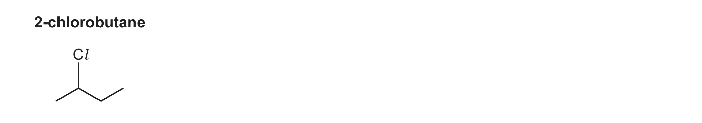
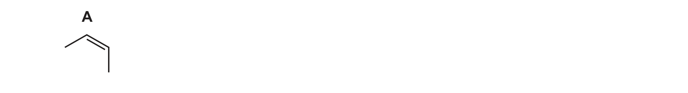
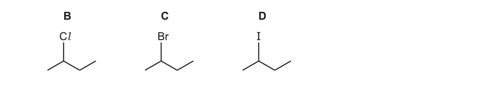
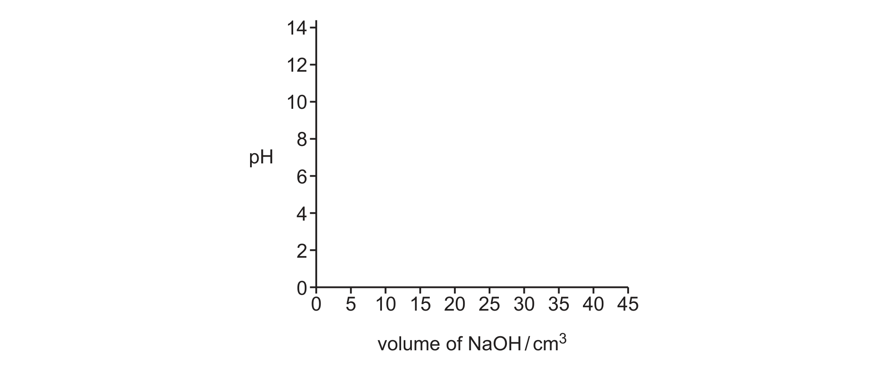
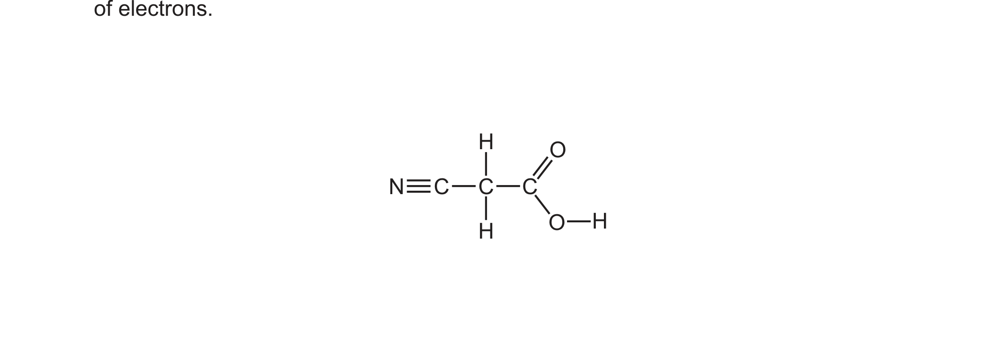
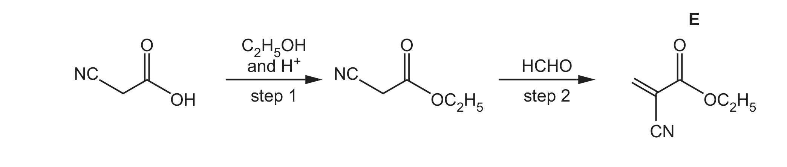
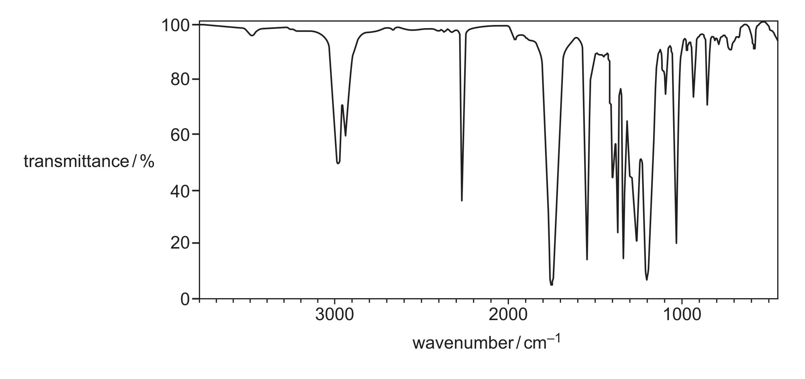

# ch15 Halogen compounds · 9701/22 Feb/March 2026

> 题卷 `originalpdf/9701_m26_qp_22.pdf` ｜ 答案 `originalpdf/9701_m26_ms_22.pdf`
> 本卷本章共 2 题 / 33 分：本章主管 Q3 [14]；镜像 Q4 [19]（主章 ch7）

---

## Q3 [14]　(兼 ch14 Alkenes)

Secondary halogenoalkanes are important building blocks in organic chemistry.
2-chlorobutane is an example of a secondary halogenoalkane.



### (a) [1] · ch15

Explain why 2-chlorobutane is classified as a secondary halogenoalkane.

**答案** — (organic molecule where) carbon (of C—Hal) is bonded to two other C atoms

### (b) 2-chlorobutane can be formed by the electrophilic addition of HCl to different isomers of C₄H₈. Compound A is one of these isomers.



（A 是 *cis*-but-2-ene / (Z)-but-2-ene——从 QP 图上双键两侧的顺式画法可确认）

### (b)(i) [1] · ch14

Draw a structural isomer of A that can also form 2-chlorobutane when it reacts with HCl.

**答案** — but-1-ene（CH₂=CH-CH₂-CH₃；与 HCl 按 Markovnikov 加成，H 加到端位 C1，Cl 加到 C2，
同样生成 2-chlorobutane）

### (b)(ii) [2] · ch13

Draw and give the systematic name of the geometrical isomer of A.

**答案**

- M1 画出 *trans* 构型的 but-2-ene 结构（两个 CH₃ 在 C=C 两侧呈反式排列）
- M2 systematic name：*trans*-but-2-ene

### (b)(iii) [2] · ch13

State and explain the origin of geometrical isomerism in alkenes.

**答案**

- M1 (two) different groups attached to **each** carbon of C=C
- M2 restricted / lack of / no rotation about double / C=C / pi / π bond

### (c) Butane, C₄H₁₀, reacts with Cl₂ in the presence of ultraviolet light to form 2-chlorobutane, which has molecular formula C₄H₉Cl.

C₄H₁₀ + Cl₂ → C₄H₉Cl + HCl

### (c)(i) [1] · ch14

Name the mechanism of this reaction.

**答案** — (free-)radical substitution

### (c)(ii) [2] · ch14

Complete the reaction scheme given to show the formation of 2-chlorobutane. You may use
molecular formulas in your answer.

initiation　　　Cl₂ → 2Cl•

**答案**

- M1 propagation　　Cl• + C₄H₁₀ → C₄H₉• + HCl
- propagation（已给）　　C₄H₉• + Cl₂ → C₄H₉Cl + Cl•
- M2 termination　　C₄H₉• + Cl• → C₄H₉Cl

### (d) [2] · ch15

The rates of hydrolysis of three secondary halogenoalkanes, B, C and D, are compared.



Each halogenoalkane is dissolved in ethanol and reacted with AgNO₃(aq). Identify the order of
the rates of hydrolysis of compounds B, C and D. Explain your answer.

**答案**

- M1 fastest　D > C > B　slowest（B = Cl，C = Br，D = I）
- M2 carbon—halogen gets weaker down the group (so breaks faster)

### (e) [3] · ch16

The organic product of hydrolysis of each of B, C and D is butan-2-ol. Complete Table 3.1 to
give details of some typical chemical reactions of butan-2-ol.

Table 3.1

| reagent and conditions | observation with butan-2-ol | organic product(s) |
|---|---|---|
| acidified K₂Cr₂O₇ | (orange solution) turns green | butanone：CH₃CH₂COCH₃ |
| Na(s) | effervescence | sodium butan-2-olate：CH₃CH₂CH(ONa)CH₃ |
| alkaline I₂(aq) | yellow precipitate | CH₃CH₂COO⁻（propanoate ion，以 sodium propanoate 形式存在） and CHI₃ |

**判分**

- M1 acidified K₂Cr₂O₇ 一行：(orange solution) turns green
- M2 Na(s) 一行：organic product = sodium butan-2-olate
- M3 alkaline I₂(aq) 一行：reagent = alkaline I₂(aq)（iodoform test，butan-2-ol 含
  CH₃–CH(OH)– 结构，碳链在羰基处断裂，缩短一个碳生成 propanoate）

---

**[Total: 14]**

## Q4 [19]　⟨镜像 · 主章 ch7 Equilibria⟩

> 本题正本在 [`ch07-equilibria/9701_m26_22.md`](../ch07-equilibria/9701_m26_22.md)，此处为镜像。**不要在本文件里改它** —— 改正本，再跑 `python tools/mirror.py`。

Cyanoethanoic acid, CH₂(CN)COOH, is a weak organic acid.

### (a)

At room temperature, CH₂(CN)COOH undergoes an acid–base reaction with NaOH(aq).

### (a)(i) [1] · ch7

Define weak acid.

**答案** — (proton donor that) partially dissociates (in aqueous solution)

### (a)(ii) [3] · ch7

Sketch the pH titration curve on Figure 4.1 for the reaction of:
- 25.00 cm³ of 0.10 mol dm⁻³ CH₂(CN)COOH(aq) and
- 0.10 mol dm⁻³ NaOH(aq), added to excess.



**答案**
- M1 weak acid curve starts pH 1.7（不需计算）
- M2 vertical section at 25 cm³
- M3 strong alkali curve ends at pH 13

### (a)(iii) [1] · ch7

Write the overall ionic equation for the neutralisation of CH₂(CN)COOH(aq) by NaOH(aq) in
4(a)(ii). Include state symbols.

**答案** — H⁺(aq) + OH⁻(aq) → H₂O(l)

### (a)(iv) [1] · ch19

Suggest the formula of the organic product when CH₂(CN)COOH(aq) is heated under reflux with
NaOH(aq).

**答案** — CH₂(COO)₂Na₂ OR CH₂(COONa)₂

### (b) [3] · ch3

CH₂(CN)COOH is very soluble in water because it can form hydrogen bonds with water.

Complete Figure 4.2 to show one hydrogen bond between a molecule of CH₂(CN)COOH and a molecule
of H₂O. Label the hydrogen bond clearly, and show any relevant partial charges and lone pairs of
electrons.



**答案**
- M1 clearly distinct / labelled H bond
- M2 from lone pair on any oxygen to H atom attached to O
- M3 with three correct successive partial charges across two molecules

### (c)

Figure 4.3 shows a synthesis of CH₂(CN)COOH.


### (c)(i) [2] · ch15

The reaction mechanism of the synthesis in Figure 4.3 has a single step.

Complete Figure 4.3 to show this mechanism. Include lone pairs, charges, dipoles and curly
arrows as appropriate.

**答案**
- M1 curly arrow from lone pair on C of CN⁻ to (δ+)C of C–Cl
- M2 correct dipole of δ⁺C—Clδ⁻ AND curly arrow from bond to Cl

### (c)(ii) [1] · ch15

Identify the nucleophile in Figure 4.3.

**答案** — CN⁻ / cyanide

### (c)(iii) [1] · ch15

Identify the mechanism of the reaction in Figure 4.3.

**答案** — nucleophilic substitution / S<sub>N</sub>2

### (d)

Figure 4.4 describes a sequence of reactions, starting with CH₂(CN)COOH, to form E.



### (d)(i) [1] · ch18

Identify the type of reaction that occurs in step 1.

**答案** — condensation

### (d)(ii) [1] · ch13

Name HCHO, the reactant used in step 2.

**答案** — methanal

### (d)(iii) [1] · ch13

Deduce the molecular formula of E.

**答案** — C₆H₇NO₂

### (d)(iv) [1] · ch20

E can be polymerised to form F. Draw the structure of one repeat unit of polymer F.

**答案** — repeat unit：–CH₂–C(CN)(COOC₂H₅)–　（左侧碳接两个 H；右侧碳接 CN 与 COOC₂H₅，重复单元
两端各留一个悬空键，对应 addition polymerisation of E, CH₂=C(CN)COOC₂H₅）

```tikz
\usepackage{chemfig}
\begin{document}
$\Big[$\chemfig{-C(-[2]H)(-[6]H)-C(-[2]COOC_2H_5)(-[6]CN)-}$\Big]_{n}$
\end{document}
```

### (d)(v) [2] · ch22

Figure 4.5 shows the infrared spectrum of E.



**Table 4.1**

| bond | functional groups containing the bond | characteristic infrared absorption range (in wavenumbers) / cm⁻¹ |
|---|---|---|
| C–O | hydroxy, ester | 1040–1300 |
| C=C | aromatic compound, alkene | 1500–1680 |
| C=O | amide | 1640–1690 |
| C=O | carbonyl, carboxyl | 1670–1740 |
| C=O | ester | 1710–1750 |
| C≡N | nitrile | 2200–2250 |
| C–H | alkane | 2850–2950 |
| N–H | amine, amide | 3300–3500 |
| O–H | carboxyl | 2500–3000 |
| O–H | hydroxy | 3200–3650 |

Using the information given in Table 4.1, identify with a cross (⨉) on Figure 4.5 an absorption
that can be used to monitor the progress of the polymerisation of E to form F. Explain your
answer with reference to the relevant bond.

**答案**
- ⨉ on absorption at ~1550 cm⁻¹
- bond: C=C
- (peak / C=C / bond) disappears (during / after polymerisation)

---

**[Total: 19]**
