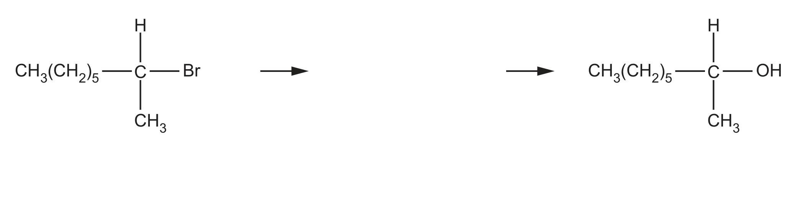
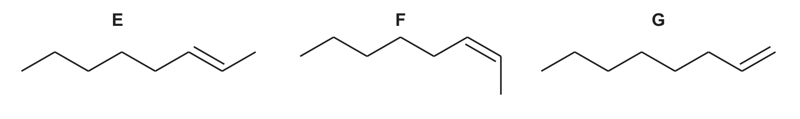

# ch15 Halogen compounds · 9701/22 May/June 2024

> 题卷 `originalpdf/9701_s24_qp_22.pdf` ｜ 答案 `originalpdf/9701_s24_ms_22.pdf`
> 本卷本章共 1 题 / 15 分：本章主管 Q4 [15]

---

## Q4 [15]

CH₃(CH₂)₅CHBrCH₃ exists as a pair of stereoisomers.

### (a) [2]

Draw the three-dimensional structures of the **two** stereoisomers of CH₃(CH₂)₅CHBrCH₃.
R can be used to represent CH₃(CH₂)₅.

**答案** — CH₃(CH₂)₅CHBrCH₃（2-bromooctane）在 C2（连 Br 的手性碳）处形成一对对映异构体
（enantiomers）。中心碳连接四个不同基团——H、Br、CH₃、R (= CH₃(CH₂)₅)，用四面体透视图（楔形/虚线表示
立体方向）画出：

- M1 正确画出左边答案作为其中一个 enantiomer 的 3d structure
- M2 正确画出另一个 enantiomer（与 M1 互为镜像）的 3d structure

### (b) [3]

A sample of CH₃(CH₂)₅CHBrCH₃ reacts with NaOH to make CH₃(CH₂)₅CH(OH)CH₃ in an
SN1 mechanism.

Complete Fig. 4.1 to show the mechanism for the reaction of CH₃(CH₂)₅CHBrCH₃ and NaOH.
Include charges, dipoles, lone pairs of electrons and curly arrows, as appropriate.

**答案**（SN1 机理，两步）

- **第一步（heterolytic fission，rate-determining）**：C–Br 键标出偶极 δ+C—Brδ−；
  curly arrow 从 C–Br 键指向 Br（或稍微超出 Br），Br 带着成键电子对离去，生成 carbocation
  intermediate CH₃(CH₂)₅C⁺(H)(CH₃)（R 可代表 –(CH₂)₅CH₃）
- **第二步（nucleophilic attack）**：nucleophile OH⁻ 上的 lone pair 发出 curly arrow 指向
  carbocation 的 C⁺，生成 C–OH 键，得到产物 CH₃(CH₂)₅CH(OH)CH₃ + Br⁻（与 Na⁺ 结合即 NaBr）

**判分**

- M1 correct dipole (C—Br) AND curly arrow from bond of C—Br to Br（或稍微超出 Br）
- M2 correct intermediate（ALLOW R 代表 –(CH₂)₅CH₃）
- M3 curly arrow from lone pair on OH⁻ 指向 intermediate 的 C（或 C–OH 键生成的合适位置）
- 若画成 SN2 机理：只有当机理显示 OH⁻/NaOH 直接进攻 reactant、且不含独立存在的碳正离子
  中间体时，才按 SN2 判分——M1 同上；**NOT** M2；M3 curly arrow from lone pair on :OH⁻
  指向 reactant 上对应的 C

### (c) [3]

Separate samples of CH₃(CH₂)₅CHBrCH₃, CH₃(CH₂)₅CH(OH)CH₃ and CH₃(CH₂)₅CH=CH₂ are tested with
different reagents.

Complete Table 4.1. If no reaction occurs, write × in the relevant box.

> QP 与官方 MS 原文均印成 `CH₃(CH₂)₅CHCH₂`（缺 "="）。已用 `crop.py` 渲染 QP 第 10 页原页核对，
> 文字层本身就没有 "=" 字符——这是官方排版遗漏，不是本抽取器的上下标误还原。按上下文（与 Br₂(l) 反应会
> 褪色）应理解为 CH₃(CH₂)₅CH=CH₂（oct-1-ene）。

Table 4.1

| reagent added | observation with CH₃(CH₂)₅CHBrCH₃ (2-bromooctane) | observation with CH₃(CH₂)₅CH(OH)CH₃ (octan-2-ol) | observation with CH₃(CH₂)₅CH=CH₂ |
|---|---|---|---|
| Br₂(l) in the dark | × | *(原表灰底，无需作答)* | orange / brown to colourless |
| PCl₅(s) | *(原表灰底，无需作答)* | steamy fumes | × |
| AgNO₃(aq) | cream precipitate OR off white precipitate | × | *(原表灰底，无需作答)* |

**判分** — 6 项全对 = 3 分；4 或 5 项对 = 2 分；2 或 3 项对 = 1 分；0 或 1 项对 = 0 分

### (d) CH₃(CH₂)₅CHBrCH₃ is heated with D to produce three different molecules, E, F and G.

### (d)(i) [1]

Name the type of reaction.

**答案** — elimination

### (d)(ii) [1]

Identify D and the conditions used.

**答案** — NaOH / sodium hydroxide in ethanol

### (e)(i) [2]

Both σ and π bonds are present in a molecule of E as a result of different types of
hybridisation in the carbon atoms.

Complete Table 4.2 to show the number of carbon atoms with each type of hybridisation in a
molecule of E.

Table 4.2

| | sp hybridised | sp² hybridised | sp³ hybridised |
|---|---|---|---|
| E | 0 | 2 | 6 |

**判分** — 3 项全对 = 2 分；2 项对 = 1 分；0 或 1 项对 = 0 分

### (e)(ii) [3]

Describe the essential feature of an unbranched hydrocarbon that causes its molecules to show
stereoisomerism. Explain how this feature leads to stereoisomerism.

**答案**

- M1 presence of a π bond
- M2 limited rotation of C=C bond
- M3（三选一）
  - two different groups on each / both double bonded carbon atoms，或
  - two different atoms on each / both double bonded carbon atom，或
  - one H / atom and one alkyl group on each / both double bonded carbon atom

---

**[Total: 15]**
