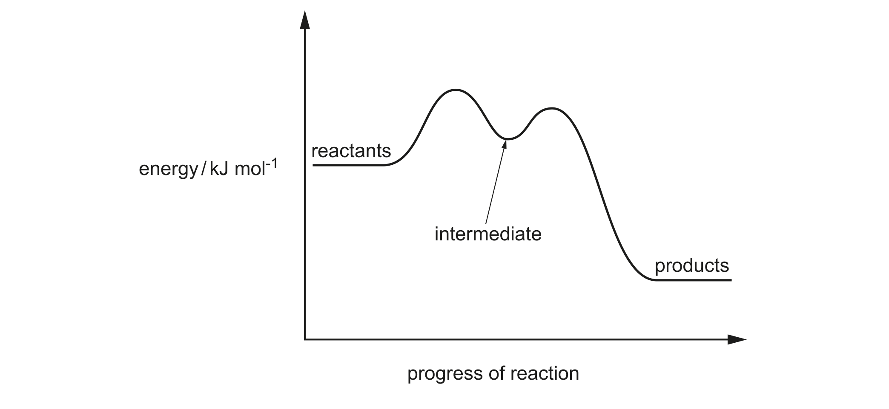
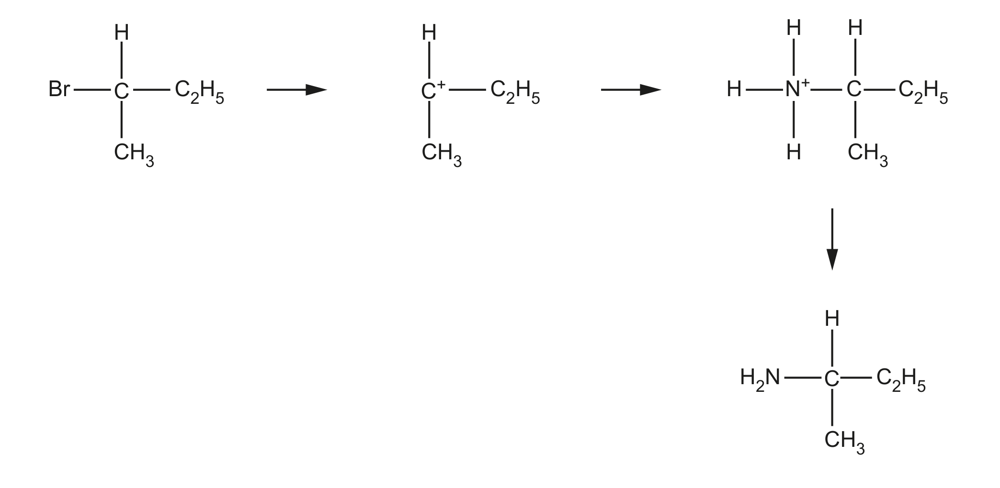
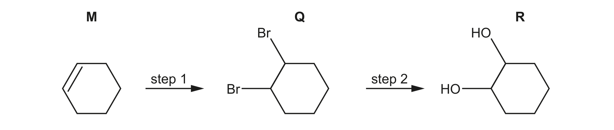
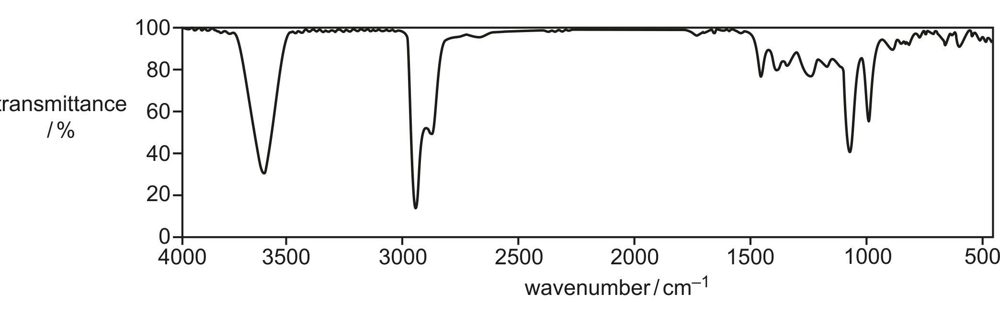
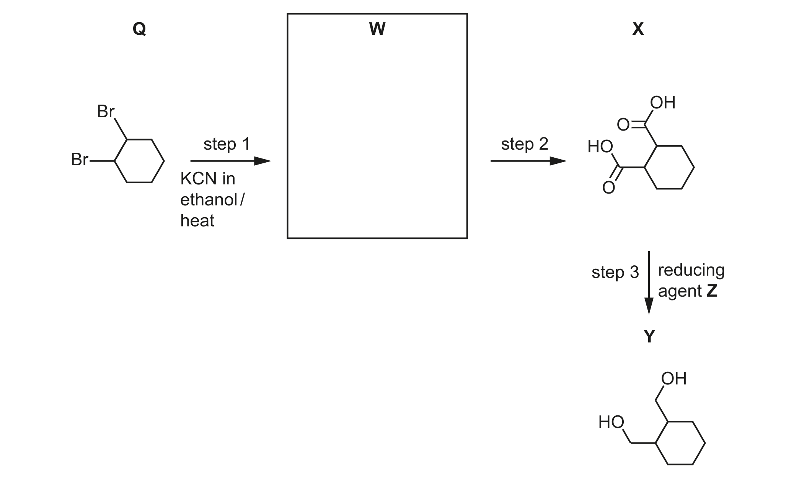

# ch15 Halogen compounds · 9701/23 May/June 2024

> 题卷 `originalpdf/9701_s24_qp_23.pdf` ｜ 答案 `originalpdf/9701_s24_ms_23.pdf`
> 本卷本章共 2 题 / 26 分：镜像 Q4 [16]（主章 ch3）、Q5 [10]（主章 ch21）

---

## Q4 [16]　⟨镜像 · 主章 ch3 Chemical bonding⟩

> 本题正本在 [`ch03-chemical-bonding/9701_s24_23.md`](../ch03-chemical-bonding/9701_s24_23.md)，此处为镜像。**不要在本文件里改它** —— 改正本，再跑 `python tools/mirror.py`。

### (a) [2] · ch3

NH₃(g) reacts with HCl(g) to produce NH₄Cl(s): NH₃(g) + HCl(g) → NH₄Cl(s)

Draw a diagram to show the ionic, covalent and coordinate bonding present in a formula unit of
NH₄Cl.

**答案** — 中心 N 通过 4 条 N—H 键连接 4 个 H（其中 3 条为普通 covalent bond，1 条画成箭头
——由 N 指向该 H，表示 coordinate/dative bond，来自 N 提供的孤对电子），整个 NH₄⁺ 用方括号
框起并标 "+"；方括号外单独写一个 Cl⁻，两者以 ionic bond 结合（NH₄⁺ 与 Cl⁻ 之间无共用电子，
靠静电吸引）。
- M1：（ionic bond between）NH₄⁺ **AND** Cl⁻　**AND** 4 条 N—H covalent bond（或 4 对共用电子对）
- M2：其中 1 条 N—H 为 coordinate bond——用箭头表示方向正确，或只用同一种电子符号画出该 1 对
  成键电子

### (b) An exothermic reaction occurs when NH₄⁺(aq) is added to OH⁻(aq).

### (b)(i) [1] · ch12

Identify the type of reaction.

**答案** — acid–base reaction

### (b)(ii) [1] · ch12

Construct an ionic equation for the reaction of NH₄⁺ and OH⁻.

**答案** — NH₄⁺ + OH⁻ → NH₃ + H₂O

### (c) Substitution reactions of NH₃ and OH⁻ with halogenoalkanes both involve a lone pair of electrons.

### (c)(i) [1] · ch15

Name the role of NH₃ and OH⁻ in these reactions.

**答案** — nucleophile

### (c)(ii) [1] · ch15

Suggest which species, NH₃ or OH⁻, is more reactive during these reactions. Explain your answer.

**答案** — OH⁻（more reactive because）negatively charged species more attracted to halogenoalkane
and/or Cᵟ⁺ and/or intermediate and/or C⁺
　**OR** NH₃（more reactive because）N electrons less tightly held
　**OR** N is more able to donate (lp) electrons (to make the covalent bond)
　**OR** N is less electronegative

**判分** — 选 OH⁻ 或 NH₃ 皆可给分，只要解释逻辑自洽（ORA）。

### (d) [2] · ch5

When 2-bromo-2-methylpropane reacts with OH⁻, two mechanisms, SN1 and SN2, both
occur. The SN2 mechanism has a slower rate.

Figure 4.1 shows the reaction pathway diagram for the SN1 mechanism（reactants → 两个驼峰
经过 intermediate → products）。

Sketch a graph on Figure 4.1 to show the reaction pathway for the SN2 mechanism.

**答案** — 在同一坐标系里加画**单峰**曲线：起点（reactants）能量与终点（products）能量都跟
SN1 曲线一致，但中间**只有一个高峰、没有中间体谷底**，且这个高峰（transition state /
activation energy）明显高于 SN1 图中两个驼峰的能量（因为 SN2 反应更慢）。
- M1：起止能量与原曲线一致 **AND** 单峰（single hump）
- M2：新画曲线的 transition state / activation energy 高于原 SN1 图中两个 transition state
  的能量

### (e)(i) [3] · ch15

Complete Figure 4.2 to show the mechanism for the SN1 reaction that occurs when CH₃CHBrC₂H₅
reacts with NH₃ to produce CH₃CH(NH₂)C₂H₅. Include charges, dipoles, lone pairs of electrons and
curly arrows, as appropriate.

**答案**（三步机理：CH₃CHBrC₂H₅ → 二级碳正离子中间体 + Br⁻ → 经 NH₃ 进攻生成
CH₃CH(NH₃⁺)C₂H₅ → 失去 H⁺ 生成 CH₃CH(NH₂)C₂H₅）
- M1：2-bromobutane 的 C—Br 键上标正确 dipole，并有 curly arrow 从该键指向 Br
- M2：NH₃ 的 lone pair 上有 curly arrow 指向中间体的 C⁺
- M3：curly arrow 表示其中一条 N—H 键断裂、箭头指向 N（即该 H⁺ 被 later 转移走，得到中性胺
  产物）

### (e)(ii) [1] · ch19

Identify the inorganic product that forms in the reaction in Figure 4.2.

**答案** — NH₄Br / ammonium bromide

### (e)(iii) [1] · ch19

Give the systematic name for the organic product CH₃CH(NH₂)C₂H₅.

**答案** — butan-2-amine **OR** butyl-2-amine

### (f)(i) [1] · ch15

Complete Table 4.1 by drawing the structural formula of the intermediate that is formed when
2-bromo-2-methylpropane reacts in an SN1 reaction.

**Table 4.1**

| | 2-bromobutane | 2-bromo-2-methylpropane |
|---|---|---|
| structural formula of intermediate in SN1 reaction | C⁺ 连接 H、C₂H₅、CH₃（二级碳正离子） | （需自行画出） |

**答案** — 官方 mark scheme 该格实际留空（无印刷图样），按题目逻辑类推：2-bromo-2-methylpropane
是 (CH₃)₃CBr，失去 Br⁻ 后得到的中间体应画成 **C⁺ 上连接三个 CH₃ 基团**（三级碳正离子），
与左栏 2-bromobutane 那格的画法风格一致（C⁺ 居中，三条键分别标 CH₃、CH₃、CH₃）。

### (f)(ii) [2] · ch15

Identify the halogenoalkane in Table 4.1 that has the greater tendency to react using the
SN1 mechanism. Explain your answer.

**答案**
- M1 2-bromo-2-methylpropane **AND** more stable carbocation / C⁺
- M2 alkyl groups have an inductive effect (of alkyl groups) **AND** 2-bromo-2-methylpropane has
  more / most alkyl groups attached (to C⁺) / carbocation contains more alkyl groups

---

**[Total: 16]**

## Q5 [10]　⟨镜像 · 主章 ch21 Organic synthesis⟩

> 本题正本在 [`ch21-organic-synthesis/9701_s24_23.md`](../ch21-organic-synthesis/9701_s24_23.md)，此处为镜像。**不要在本文件里改它** —— 改正本，再跑 `python tools/mirror.py`。

### (a) [1] · ch14 ch21

M reacts to form R by the addition of one reagent, as shown in Figure 5.1.

Identify the reagent and conditions for this reaction.

**答案** — cold dilute KMnO₄ OR cold dilute potassium manganate(VII)

### (b)(i) [2] · ch14 ch15 ch21

R is also made from M by two steps, as shown in Figure 5.2.

Identify the reagents and conditions for steps 1 and 2 in Figure 5.2.

**答案**
- step 1 — Br₂ (in the dark)
- step 2 — NaOH(aq) + heat

### (b)(ii) [1] · ch13 ch21

Name the mechanism for step 1 in Figure 5.2.

**答案** — electrophilic addition

### (c) [2] · ch22

The infrared spectrum of R is shown in Figure 5.3.

**Table 5.1**

| bond | functional groups containing the bond | characteristic IR absorption range / cm⁻¹ |
|---|---|---|
| C–O | hydroxy, ester | 1040–1300 |
| C=C | aromatic compound, alkene | 1500–1680 |
| C=O | amide | 1640–1690 |
| | carbonyl, carboxyl | 1670–1740 |
| | ester | 1710–1750 |
| C≡N | nitrile | 2200–2250 |
| C–H | alkane | 2850–2950 |
| N–H | amine, amide | 3300–3500 |
| O–H | carboxyl | 2500–3000 |
| | hydroxy | 3200–3650 |

Use the absorptions in the region above 1500 cm⁻¹ in Table 5.1 when answering this question.
- Add F to Figure 5.3 to identify the peak that is present in an infrared spectrum of both Q and
  R. Identify the bond that corresponds to the absorption for F.
- Add G to Figure 5.3 to identify the peak that is **not** present in an infrared spectrum of Q.
  Identify the bond that corresponds to the absorption for G.

**答案**
- F：peak shown around 2850–2950 cm⁻¹，对应 C—H
- G：peak shown around 3200–3600 cm⁻¹，对应 O—H (in hydroxy(l) / alcohol)

### (d)(i) [1] · ch15 ch21

Y is made from Q in a three-step reaction, as shown in Figure 5.4.

Draw the structure of W in the box in Figure 5.4.

**答案** — W = cyclohexane-1,2-dicarbonitrile（cyclohexane 1,2 位上 Q 的两个 Br 都被 KCN 取代成 –CN）

### (d)(ii) [1] · ch19 ch21

In step 2, W is heated with HCl(aq) to produce X and an inorganic product. Identify the formula
of the inorganic product.

**答案** — NH₄Cl

### (d)(iii) [1] · ch18 ch21

In step 3, X reacts with reducing agent Z to produce Y. Complete the equation for the reaction of
X with Z. Use a molecular formula to represent the organic product. Use [H] to represent one atom
of hydrogen from Z.

…… C₈H₁₂O₄ + ……[H] →

**答案** — C₈H₁₂O₄ + 8[H] → C₈H₁₆O₂ + 2H₂O

### (d)(iv) [1] · ch18 ch21

Identify Z.

**答案** — LiAlH₄

---

**[Total: 10]**
