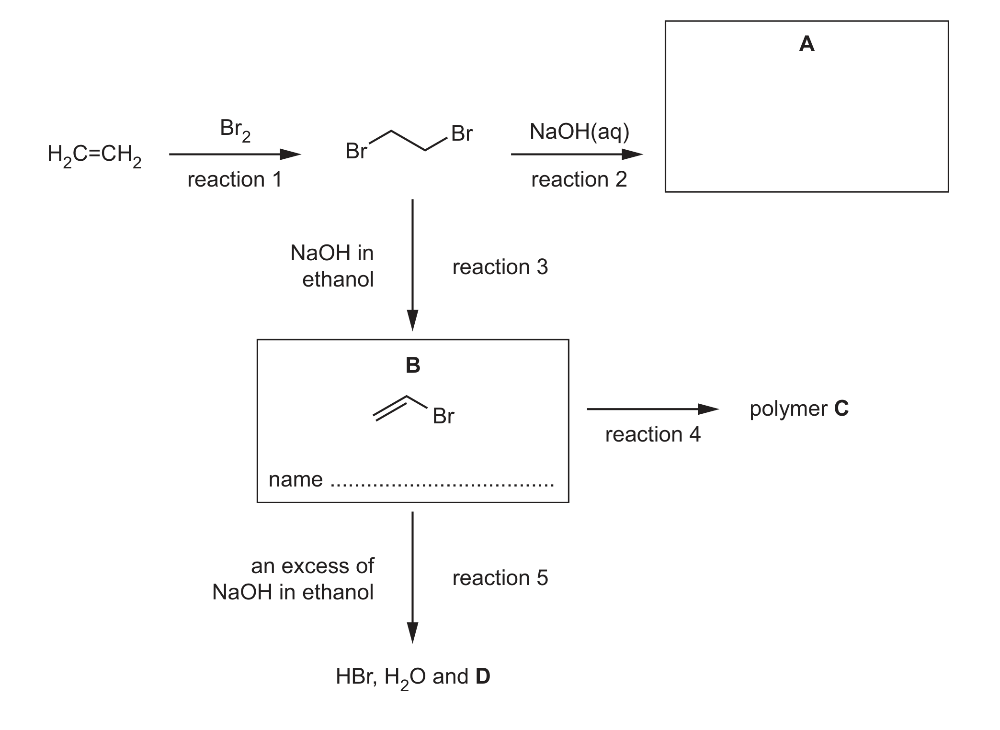
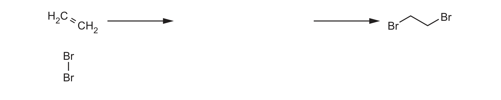
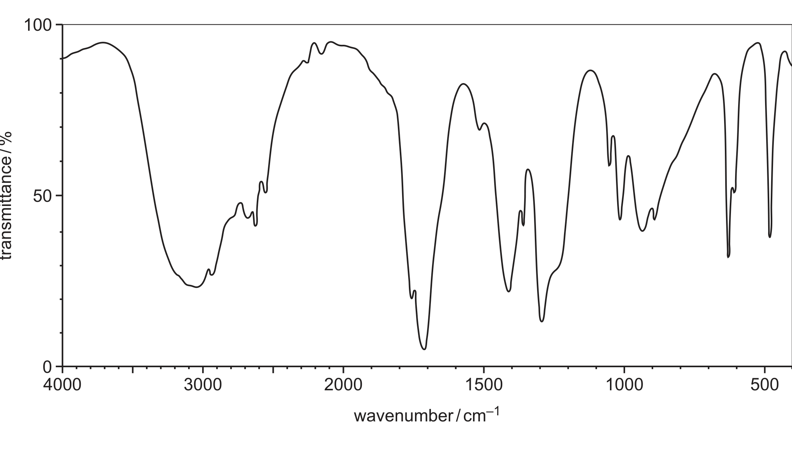

# ch15 Halogen compounds · 9701/22 Oct/Nov 2024

> 题卷 `originalpdf/9701_w24_qp_22.pdf` ｜ 答案 `originalpdf/9701_w24_ms_22.pdf`
> 本卷本章共 1 题 / 17 分：本章主管 Q4 [17]

---

## Q4 [17]　(兼 ch20 Polymerisation)

Bromoalkanes are used widely in industry, although there is increasing concern about their
environmental impact.

Fig. 4.1 shows a reaction scheme involving 1,2-dibromoethane.

### (a) [3] · ch14

Complete Fig. 4.2 to show the mechanism for the formation of 1,2-dibromoethane in reaction 1.
Include charges, dipoles, lone pairs of electrons and curly arrows as appropriate.

**答案**（electrophilic addition 机理，两步）

- **第一步**：Br₂ 上标出偶极 Brδ+—Brδ−；curly arrow① 从 H₂C=CH₂ 的 C=C π 键指向 Brδ+；curly arrow②
  从 Br–Br 键指向另一个 Br，使其带着成键电子对离去，形成 carbocation intermediate
  ⁺CH₂–CH₂Br（+ Br⁻）
- **第二步**：nucleophile Br⁻ 上的 lone pair 发出 curly arrow 指向 carbocation 的 C⁺，生成
  C–Br 键，得到产物 BrCH₂CH₂Br

**判分**（5 个得分点，累计给分）

- pt 1 dipole on Br₂
- pt 2 curly arrow from C=C bond to a Brδ+
- pt 3 curly arrow from Br–Br bond to the other Br
- pt 4 correct intermediate
- pt 5 curly arrow from lone pair on Br⁻ to C⁺
- 5 点 = 3 分。4 点 = 2 分。3 点 = 2 分。2 点 = 1 分。1 点 = 0 分。

### (b) [1] · ch5

The enthalpy change of reaction 1, Δ*H*ᵣ = –90.0 kJ mol⁻¹.

The enthalpy change of formation of ethene, Δ*H*f = +52.2 kJ mol⁻¹.

Calculate the enthalpy change of formation of 1,2-dibromoethane.

**答案** — 由 Hess 定律：Δ*H*ᵣ = Δ*H*f(products) − Δ*H*f(reactants)；Br₂(l) 是单质标准态，
Δ*H*f(Br₂) = 0

Δ*H*f(BrCH₂CH₂Br) = Δ*H*ᵣ + Δ*H*f(C₂H₄) = (−90.0) + (+52.2) = **−37.8 kJ mol⁻¹**

### (c)(i) [2] · ch15

Complete Fig. 4.1 to draw the structure of compound A and name compound B.

**答案**

- **A** = HOCH₂CH₂OH（ethane-1,2-diol，reaction 2 是 BrCH₂CH₂Br 与 NaOH(aq) 的 nucleophilic
  substitution / alkaline hydrolysis，两个 C–Br 都被 OH 取代）
- **B** = bromoethene（reaction 3 是 NaOH in ethanol 对 BrCH₂CH₂Br 的消除，脱去一分子 HBr）

### (c)(ii) [1] · ch20

Draw the structure of one repeat unit of polymer C in the box.

**答案** — poly(bromoethene) 的重复单元：–CH₂–CHBr–（两端各留一根伸出的键表示链的延续）

### (c)(iii) [1] · ch15

In reaction 5, compound B reacts with an excess of NaOH dissolved in ethanol. The products are
HBr, H₂O and an unsaturated hydrocarbon D. Suggest the identity of D.

**答案** — C₂H₂（ethyne）——bromoethene（CH₂=CHBr）在过量 NaOH/ethanol 下再消去一分子 HBr，
C=C 进一步变成 C≡C

### (d) Compound E is the only isomer of 1,2-dibromoethane. Alkaline hydrolysis of E gives compound F.

- **E** = CH₃CHBr₂（1,1-dibromoethane）
- **F** = CH₃CHO（ethanal）——E 的两个 Br 同时被 OH 取代生成 gem-diol CH₃CH(OH)₂，不稳定，
  自发脱水成 aldehyde F

### (d)(i) [1] · ch13

Identify the type of isomerism shown by E and 1,2-dibromoethane.

**答案** — structural / positional

### (d)(ii) [1] · ch13

Name the homologous series that F belongs to.

**答案** — aldehyde

### (d)(iii) [3] · ch17

Complete Table 4.1 to state what is observed when F reacts with the reagents listed.

Table 4.1

| reagent | observation with F |
|---|---|
| 2,4-dinitrophenylhydrazine (2,4-DNPH reagent) | red / orange / yellow ppt |
| Tollens' reagent | silver mirror OR grey ppt OR black ppt |
| alkaline I₂(aq) | yellow ppt |

### (e) Compound F reacts with reagent G to form compound H.

The infrared spectrum of H is shown in Fig. 4.3.

Table 4.2

| bond | functional groups containing the bond | characteristic infrared absorption range (in wavenumbers) / cm⁻¹ |
|---|---|---|
| C–O | hydroxy, ester | 1040–1300 |
| C=C | aromatic compound, alkene | 1500–1680 |
| C=O | amide | 1640–1690 |
| C=O | carbonyl, carboxyl | 1670–1740 |
| C=O | ester | 1710–1750 |
| C≡N | nitrile | 2200–2250 |
| C–H | alkane | 2850–2950 |
| N–H | amine, amide | 3300–3500 |
| O–H | carboxyl | 2500–3000 |
| O–H | hydroxy | 3200–3600 |

H also shows a molecular ion peak at *m*/*e* = 60 in its mass spectrum.

### (e)(i) [3] · ch22

Use the information in (e), Fig. 4.3 and Table 4.2 to deduce the structure of H. Explain your
answer fully.

**答案** — H = CH₃COOH（ethanoic acid）

- M1 identify H = CH₃COOH
- M2 (broad) absorption within the range 3600–2500 cm⁻¹，对应 carboxyl O–H (bond)
- M3（pt1+pt2 或 pt1+pt3 任选其一组合）
  - pt 1 absorption within the range 1670–1750 cm⁻¹，对应 C=O (bond)
  - pt 2 absorption within the range 1040–1300 cm⁻¹，对应 C–O (bond)
  - pt 3 (M⁺ at *m*/*e* = 60，所以) molecular mass / *M*ᵣ = 60

**判分** — O-H (bond) 与 OH bond 等效计分

### (e)(ii) [1] · ch18

Suggest the role of reagent G.

**答案** — oxidising agent（把 aldehyde F 氧化成 carboxylic acid H）

---

**[Total: 17]**
