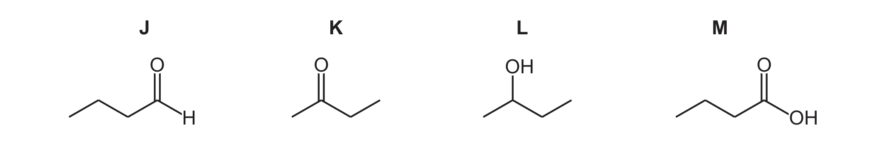
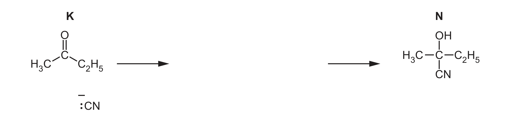

# ch16 Hydroxy compounds · 9701/22 Feb/March 2025

> 题卷 `originalpdf/9701_m25_qp_22.pdf` ｜ 答案 `originalpdf/9701_m25_ms_22.pdf`
> 本卷本章共 1 题 / 11 分：镜像 Q4 [11]（主章 ch17）

---

## Q4 [11]　⟨镜像 · 主章 ch17 Carbonyl compounds⟩

> 本题正本在 [`ch17-carbonyl-compounds/9701_m25_22.md`](../ch17-carbonyl-compounds/9701_m25_22.md)，此处为镜像。**不要在本文件里改它** —— 改正本，再跑 `python tools/mirror.py`。

Fig. 4.1 shows compounds J to M, each of which contains four carbon atoms: J = butanal,
K = butan-2-one, L = butan-2-ol, M = butanoic acid.

### (a) [5] · ch16 ch17 ch18

Table 4.1 gives details of tests on J to M. In each test, only two compounds give a positive
result. Complete Table 4.1.

| reagent | observation of positive result | compounds that give a positive result |
|---|---|---|
| acidified K₂Cr₂O₇(aq) | *(空)* | J and L |
| alkaline I₂(aq) | yellow precipitate | *(空)* |
| *(空)* | orange precipitate | J and K |
| Na(s) | *(空)* | *(空)* |

**答案** — 完整表格：

| reagent | observation of positive result | compounds that give a positive result |
|---|---|---|
| acidified K₂Cr₂O₇(aq) | (solution) turns (from orange to) green | J and L |
| alkaline I₂(aq) | yellow precipitate (forms) | K and L |
| 2,4-dinitrophenylhydrazine / 2,4-DNPH | orange precipitate (forms) | J and K |
| Na(s) | effervescence | L and M |

**判分** — 5 个空各 1 分：K₂Cr₂O₇ 一行的 observation、I₂ 一行的 compounds、reagent 一行填
2,4-DNPH、Na(s) 一行的 observation 与 compounds

### (b) K reacts with HCN in the presence of a KCN catalyst, forming N.

### (b)(i) [4] · ch17

Complete Fig. 4.2 to show the mechanism for this reaction. Include charges, dipoles, lone pairs
of electrons and curly arrows, as appropriate.

**答案**（nucleophilic addition of HCN 到 butan-2-one 的羰基碳，生成 N =
2-hydroxy-2-methylbutanenitrile）
- M1 curly arrow from lone pair on :CN⁻ to C(δ+)
- M2 curly arrow from C=O to O(δ–) **AND** correct dipole
- M3 correct intermediate
- M4 curly arrow from lone pair on O:⁻ to H⁺

### (b)(ii) [1] · ch17 ch19

Identify the class of compound of which N is a member.

**答案** — hydroxynitrile

### (b)(iii) [1] · ch13

N has a chiral centre. Explain what is meant by a chiral centre.

**答案** — atom / carbon with four different atoms / (functional) groups attached / bonded

---

**[Total: 11]**
