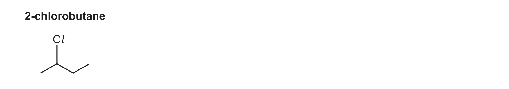
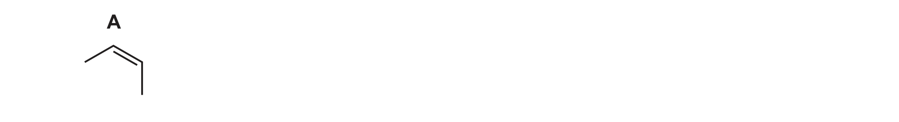
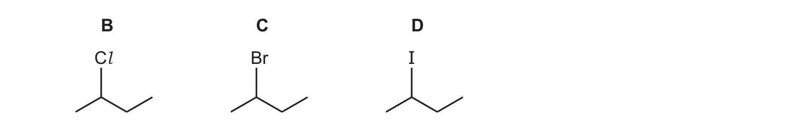

# ch16 Hydroxy compounds · 9701/22 Feb/March 2026

> 题卷 `originalpdf/9701_m26_qp_22.pdf` ｜ 答案 `originalpdf/9701_m26_ms_22.pdf`
> 本卷本章共 1 题 / 14 分：镜像 Q3 [14]（主章 ch15）

---

## Q3 [14]　⟨镜像 · 主章 ch15 Halogen compounds⟩

> 本题正本在 [`ch15-halogen-compounds/9701_m26_22.md`](../ch15-halogen-compounds/9701_m26_22.md)，此处为镜像。**不要在本文件里改它** —— 改正本，再跑 `python tools/mirror.py`。

Secondary halogenoalkanes are important building blocks in organic chemistry.
2-chlorobutane is an example of a secondary halogenoalkane.

### (a) [1] · ch15

Explain why 2-chlorobutane is classified as a secondary halogenoalkane.

**答案** — (organic molecule where) carbon (of C—Hal) is bonded to two other C atoms

### (b) 2-chlorobutane can be formed by the electrophilic addition of HCl to different isomers of C₄H₈. Compound A is one of these isomers.

（A 是 *cis*-but-2-ene / (Z)-but-2-ene——从 QP 图上双键两侧的顺式画法可确认）

### (b)(i) [1] · ch14

Draw a structural isomer of A that can also form 2-chlorobutane when it reacts with HCl.

**答案** — but-1-ene（CH₂=CH-CH₂-CH₃；与 HCl 按 Markovnikov 加成，H 加到端位 C1，Cl 加到 C2，
同样生成 2-chlorobutane）

### (b)(ii) [2] · ch13

Draw and give the systematic name of the geometrical isomer of A.

**答案**

- M1 画出 *trans* 构型的 but-2-ene 结构（两个 CH₃ 在 C=C 两侧呈反式排列）
- M2 systematic name：*trans*-but-2-ene

### (b)(iii) [2] · ch13

State and explain the origin of geometrical isomerism in alkenes.

**答案**

- M1 (two) different groups attached to **each** carbon of C=C
- M2 restricted / lack of / no rotation about double / C=C / pi / π bond

### (c) Butane, C₄H₁₀, reacts with Cl₂ in the presence of ultraviolet light to form 2-chlorobutane, which has molecular formula C₄H₉Cl.

C₄H₁₀ + Cl₂ → C₄H₉Cl + HCl

### (c)(i) [1] · ch14

Name the mechanism of this reaction.

**答案** — (free-)radical substitution

### (c)(ii) [2] · ch14

Complete the reaction scheme given to show the formation of 2-chlorobutane. You may use
molecular formulas in your answer.

initiation　　　Cl₂ → 2Cl•

**答案**

- M1 propagation　　Cl• + C₄H₁₀ → C₄H₉• + HCl
- propagation（已给）　　C₄H₉• + Cl₂ → C₄H₉Cl + Cl•
- M2 termination　　C₄H₉• + Cl• → C₄H₉Cl

### (d) [2] · ch15

The rates of hydrolysis of three secondary halogenoalkanes, B, C and D, are compared.

Each halogenoalkane is dissolved in ethanol and reacted with AgNO₃(aq). Identify the order of
the rates of hydrolysis of compounds B, C and D. Explain your answer.

**答案**

- M1 fastest　D > C > B　slowest（B = Cl，C = Br，D = I）
- M2 carbon—halogen gets weaker down the group (so breaks faster)

### (e) [3] · ch16

The organic product of hydrolysis of each of B, C and D is butan-2-ol. Complete Table 3.1 to
give details of some typical chemical reactions of butan-2-ol.

Table 3.1

| reagent and conditions | observation with butan-2-ol | organic product(s) |
|---|---|---|
| acidified K₂Cr₂O₇ | (orange solution) turns green | butanone：CH₃CH₂COCH₃ |
| Na(s) | effervescence | sodium butan-2-olate：CH₃CH₂CH(ONa)CH₃ |
| alkaline I₂(aq) | yellow precipitate | CH₃CH₂COO⁻（propanoate ion，以 sodium propanoate 形式存在） and CHI₃ |

**判分**

- M1 acidified K₂Cr₂O₇ 一行：(orange solution) turns green
- M2 Na(s) 一行：organic product = sodium butan-2-olate
- M3 alkaline I₂(aq) 一行：reagent = alkaline I₂(aq)（iodoform test，butan-2-ol 含
  CH₃–CH(OH)– 结构，碳链在羰基处断裂，缩短一个碳生成 propanoate）

---

**[Total: 14]**
