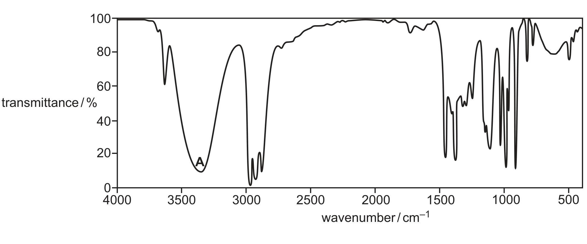
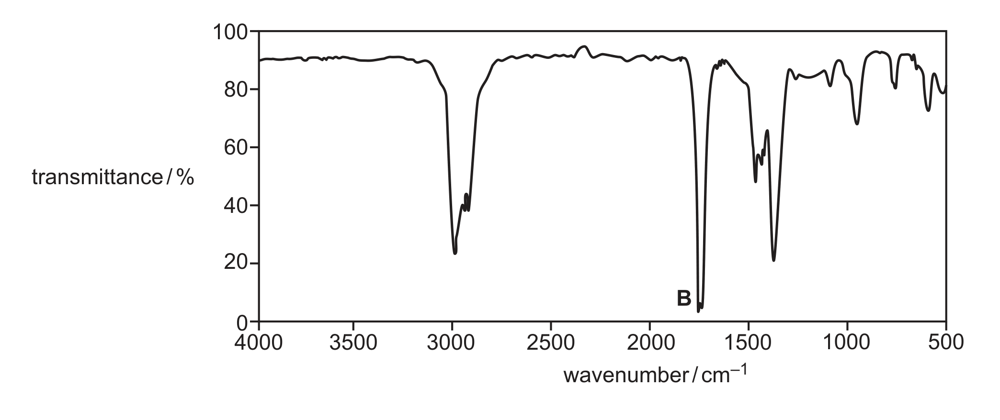
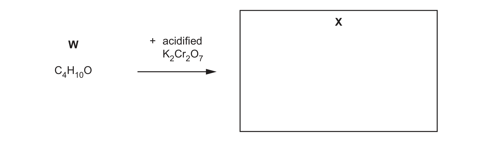

# ch16 Hydroxy compounds · 9701/22 May/June 2024

> 题卷 `originalpdf/9701_s24_qp_22.pdf` ｜ 答案 `originalpdf/9701_s24_ms_22.pdf`
> 本卷本章共 1 题 / 8 分：镜像 Q5 [8]（主章 ch22）

---

## Q5 [8]　⟨镜像 · 主章 ch22 Analytical techniques⟩

> 本题正本在 [`ch22-analytical-techniques/9701_s24_22.md`](../ch22-analytical-techniques/9701_s24_22.md)，此处为镜像。**不要在本文件里改它** —— 改正本，再跑 `python tools/mirror.py`。

> **注 · 本题没有官方 mark scheme。** `originalpdf/9701_s24_ms_22.pdf` 只有 13 页、
> 页脚印着 `Page 13 of 13`、正文止于 4(e)(ii)，**Q5 一段根本不存在**。已从 PapaCambridge
> 直链重新下载核对，得到逐字节相同的文件 → 不是下载坏了，是**官方源本身就缺这一段**。
> 所以下面的 `**答案**` 是对着 QP 推出来的，化学已逐条核过，但**不是 MS 原文**，
> 判分细节（A / R / ecf 的具体口径）无从对账，背的时候心里有数。

Compound W has molecular formula C₄H₁₀O. It contains only one functional group.

### (a) Table 5.1 shows the two peaks with the greatest *m*/*e* values in the mass spectrum of W.

| *m*/*e* | relative abundance |
|---|---|
| 74 | 50 |
| 75 | *x* |

### (a)(i) [1] · ch22

Calculate the relative abundance, *x*, of the peak at *m*/*e* = 75 using the information from
Table 5.1.

**答案** — 4 = (100 × *x*) / (1.1 × 50)，解得 *x* = **2.2**
（number of carbon atoms = (100 × M+1 峰 abundance) / (1.1 × M 峰 abundance)，W 含 4 个碳，反解 *x*）

### (a)(ii) [2] · ch22

The mass spectrum of W also shows peaks at *m*/*e* = 29 and *m*/*e* = 59.
Suggest the molecular formulae of these fragments.

**答案** — *m*/*e* = 29：**C₂H₅⁺**；*m*/*e* = 59：**C₃H₇O⁺**

### (b) A sample of W, C₄H₁₀O, is heated under reflux with an excess of acidified K₂Cr₂O₇ until there is no further reaction. Only one organic product, X, is present in the mixture at the end of the reaction.

Fig. 5.1 shows the infrared spectrum of W.

Fig. 5.2 shows the infrared spectrum of X.

Table 5.2

| bond | functional groups containing the bond | characteristic infrared absorption range (in wavenumbers) / cm⁻¹ |
|---|---|---|
| C–O | hydroxy, ester | 1040–1300 |
| C=C | aromatic compound, alkene | 1500–1680 |
| C=O | amide | 1640–1690 |
| C=O | carbonyl, carboxyl | 1670–1740 |
| C=O | ester | 1710–1750 |
| C≡N | nitrile | 2200–2250 |
| C–H | alkane | 2850–2950 |
| N–H | amine, amide | 3300–3500 |
| O–H | carboxyl | 2500–3000 |
| O–H | hydroxy | 3200–3650 |

### (b)(i) [1] · ch22

Absorption A is shown in Fig. 5.1. Absorption B is shown in Fig. 5.2.
Complete Table 5.3 using the information given in Fig. 5.1, Fig. 5.2 and Table 5.2.

Table 5.3（答案）

| absorption | bond | functional group containing the bond |
|---|---|---|
| A | O–H | hydroxy(l) / alcohol |
| B | C=O | carbonyl |

**判分** — 需 A、B 两行全对才给这 1 分

### (b)(ii) [1] · ch22

Use the information in (a) and (b)(i) to draw the structure of X in the box in Fig. 5.3.

**答案** — X = CH₃CH₂COCH₃（butan-2-one）

### (c) Y is a structural isomer of W. Both W and Y produce colourless bubbles when sodium is added to them. Y does not react when heated with acidified K₂Cr₂O₇. Y does not react when warmed with alkaline I₂(aq).

### (c)(i) [1] · ch16

Name the functional group present in Y.

**答案** — hydroxyl

### (c)(ii) [1] · ch16

Complete the equation to describe the reaction of W or Y with sodium.

**答案** — (1)C₄H₁₀O + (1)Na → C₄H₉ONa + ½H₂

### (c)(iii) [1] · ch16 ch13

Draw the structure of Y.

**答案** — Y = (CH₃)₃COH（2-methylpropan-2-ol，tert-butanol）

---

**[Total: 8]**
