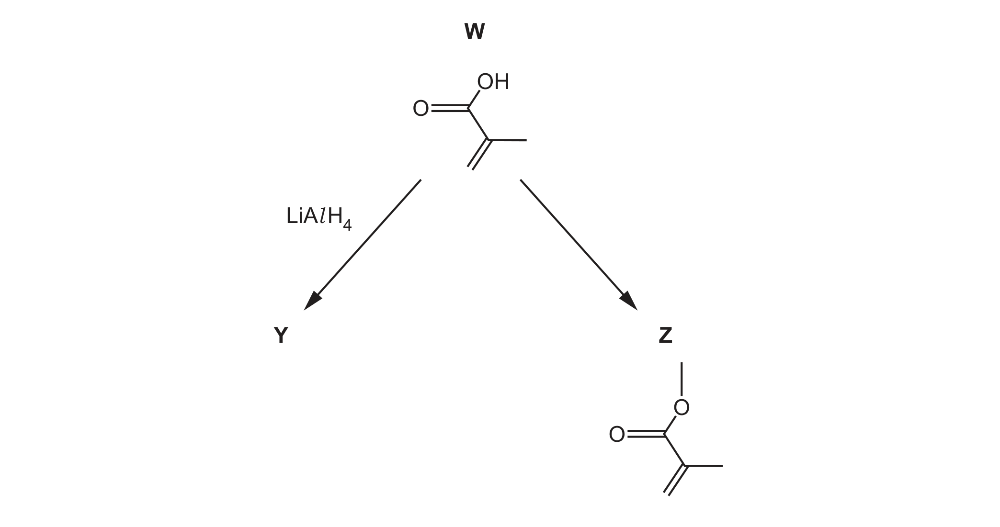
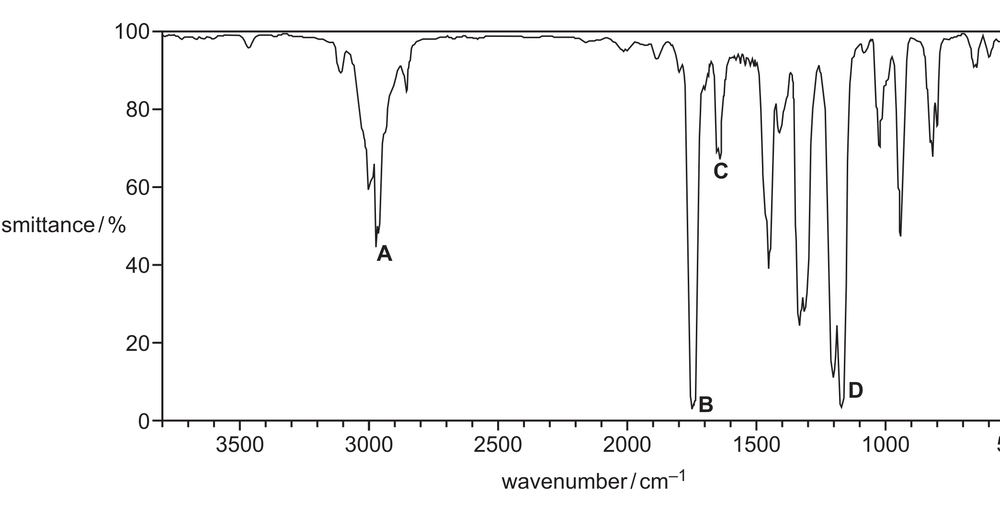

# ch16 Hydroxy compounds · 9701/23 May/June 2025

> 题卷 `originalpdf/9701_s25_qp_23.pdf` ｜ 答案 `originalpdf/9701_s25_ms_23.pdf`
> 本卷本章共 1 题 / 14 分：本章主管 Q5 [14]

---

## Q5 [14]　(兼 ch17 Carbonyl compounds)

### (a) W is a colourless liquid.

W = CH₂=C(CH₃)COOH（2-methylprop-2-enoic acid / methacrylic acid）。

### (a)(i) [1] · ch2

Deduce the empirical formula of W.

**答案** — C₂H₃O

### (a)(ii) [4] · ch18 ch14

Two different reagents are each added to separate samples of W as shown in Table 5.1. Complete Table 5.1.

**Table 5.1**

| reagent and conditions | observation when reagent is added to W | structural formula of organic product |
|---|---|---|
| solid Na | fizz / bubbles etc **OR** solid Na disappears / dissolves | CH₂=C(CH₃)CO₂Na **OR** CH₂=C(CH₃)CO₂⁻Na⁺ |
| Br₂ in the absence of ultraviolet light | brown to colourless / decolourise | CH₂BrCBr(CH₃)CO₂H |

Na(s) 与 W 的 carboxyl 反应放出 H₂；Br₂ 在暗处（无 UV）对 C=C 做 electrophilic addition，不是 free-radical substitution。

### (b) Fig. 5.2 shows two reactions of W to produce organic compounds Y and Z.

W 经 LiAlH₄ 还原 COOH→CH₂OH 得 Y（C=C 不受影响）；W 与 methanol / 浓 H₂SO₄ 发生酯化得 Z = CH₂=C(CH₃)COOCH₃（methyl 2-methylprop-2-enoate，methyl methacrylate）。

### (b)(i) [2] · ch3

Deduce the number of sigma (σ) bonds and pi (π) bonds present in Z.

**答案** — number of σ bonds = 14；number of π bonds = 2

### (b)(ii) [1] · ch16

W reacts with LiAlH₄ to produce Y. Draw the structure of Y.

**答案** — Y = CH₂=C(CH₃)CH₂OH（2-methylprop-2-en-1-ol）

### (b)(iii) [1] · ch16

Identify the role of LiAlH₄ when it reacts with W.

**答案** — reducing agent

### (b)(iv) [1] · ch16

Suggest the reagent and conditions required when W is converted into Z.

**答案** — methanol / CH₃OH **AND** conc(entrated) (sulfuric) acid（catalyst）

### (b)(v) [2] · ch22

Fig. 5.3 shows the structure of Z. Fig. 5.4 is the infrared spectrum of Z. Identify the bond and functional group responsible for each of the absorptions labelled A, B, C and D in Fig. 5.4.

**Table 5.2**（题目给出的参考表，抄录不截图）

| bond | functional groups containing the bond | characteristic infrared absorption range (cm⁻¹) |
|---|---|---|
| C–O | hydroxy, ester | 1040–1300 |
| C=C | aromatic compound, alkene | 1500–1680 |
| C=O | amide | 1640–1690 |
| | carbonyl, carboxyl | 1670–1740 |
| | ester | 1710–1750 |
| C≡N | nitrile | 2200–2250 |
| C–H | alkane | 2850–2950 |
| N–H | amine, amide | 3300–3500 |
| O–H | carboxyl | 2500–3000 |
| | hydroxy | 3200–3650 |

**答案**

- A — C–H, alkane
- B — C=O, ester
- C — C=C, alkene
- D — C–O, ester

**判分** — 2 个对 = 1 分，全部 4 个对 = 2 分

### (b)(vi) [1] · ch20

Z is used to produce addition polymer Q. Draw the repeat unit of polymer Q.

**答案** — Q 是 poly(methyl methacrylate)（PMMA）的重复单元：

主链 –[CH₂–C(CH₃)(CO₂CH₃)]ₙ–，即以两端各留一个断键的 CH₂–C(CH₃) 为主链，C(CH₃) 上再接 –CO₂CH₃ 支链。

### (c) [1] · ch14

Poly(ethene) is an addition polymer made from ethene. Explain why ethene reacts with electrophiles but poly(ethene) does not.

**答案** — ethene 的 π bond 是一个（高）electron density 区域（位于 C–C（σ）bond 的上方和下方）；poly(ethene) 分子中 C–C 全为 single bond，没有这样的富电子 π 区域可供 electrophile 进攻。

---

**[Total: 14]**
