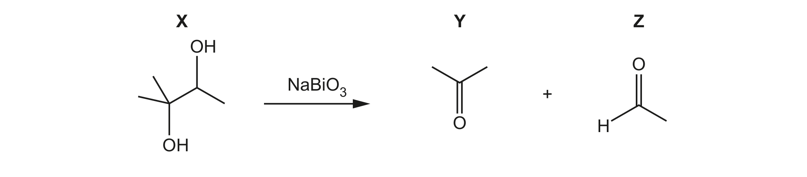

# ch17 Carbonyl compounds · 9701/22 Feb/March 2024

> 题卷 `originalpdf/9701_m24_qp_22.pdf` ｜ 答案 `originalpdf/9701_m24_ms_22.pdf`
> 本卷本章共 1 题 / 16 分：镜像 Q1 [16]（主章 ch3）

---

## Q1 [16]　⟨镜像 · 主章 ch3 Chemical bonding⟩

> 本题正本在 [`ch03-chemical-bonding/9701_m24_22.md`](../ch03-chemical-bonding/9701_m24_22.md)，此处为镜像。**不要在本文件里改它** —— 改正本，再跑 `python tools/mirror.py`。

Bismuth is an element in Group 15 of the Periodic Table.

### (a) [1] · ch3

Bismuth has metallic bonding.

Draw a labelled diagram to show the metallic bonding in bismuth.

**答案** — 画三排、每排 5 个标 "+" 的圆圈（代表 metal cation），整齐紧密堆积排列；圆圈之间点缀
若干小 "−" 号，代表包围着这些正离子的 delocalised electrons。

**判分** — 图必须同时体现两点：① regular arrangement of positive ions；② AND surrounded by /
(sea of) delocalised electrons。

### (b) Bismuth reduces water to form bismuth oxide, Bi₂O₃. A colourless gas that ignites with a squeaky pop also forms.

### (b)(i) [1] · ch2

Construct an equation for the reduction of water by bismuth.

**答案** — 2Bi + 3H₂O → Bi₂O₃ + 3H₂

### (b)(ii) [2] · ch4

Bi₂O₃ is a yellow insoluble solid that melts at 1090 K. The molten compound conducts electricity.

Deduce the structure and bonding of Bi₂O₃. Explain your answer.

**答案**
- M1 giant **AND** has a high melting point
- M2 ionic **AND** conducts electricity (only) when molten

### (c) Bi₂O₃ can be used to form NaBiO₃, as shown in equation 1.

equation 1　Na₂O + Bi₂O₃ + O₂ → 2NaBiO₃

### (c)(i) [1] · ch6

Deduce the oxidation number of Bi in Bi₂O₃ and in NaBiO₃.

**答案** — Bi₂O₃ 中 Bi 为 (+)3 / III　**AND**　NaBiO₃ 中 Bi 为 (+)5 / V

### (c)(ii) [1] · ch6

Identify the reducing agent in equation 1.

**答案** — Bi₂O₃

### (d) NaBiO₃ is an oxidising agent with similar properties to KMnO₄.

Figure 1.1 shows an example of the use of NaBiO₃ as an oxidising agent: 化合物 **X**（一个连有两个
OH 的叔醇/仲醇二醇结构）与 NaBiO₃ 反应，生成 **Y**（丙-2-酮，CH₃COCH₃）加 **Z**（乙醛，CH₃CHO）。

### (d)(i) [1] · ch6

Explain the term oxidising agent.

**答案** — a substance that removes electrons from another / causes electron loss / gains electrons

### (d)(ii) [1] · ch14

Compound **X** forms when methylbut-2-ene reacts with KMnO₄.

State the essential conditions for this reaction.

**答案** — (KMnO₄ is) cold and dilute

### (d)(iii) [4] · ch17

Complete Table 1.1 to show what is observed when compounds **Y** and **Z** react separately with the
named reagents.

**Table 1.1**

| reagent | observation with Y | observation with Z |
|---|---|---|
| Na₂CO₃(aq) | no reaction | no reaction |
| alkaline I₂(aq) | yellow precipitate (ppt) | yellow ppt |
| 2,4-dinitrophenylhydrazine (2,4-DNPH) | red / orange / yellow ppt | red / orange / yellow ppt |
| Tollens' reagent | no reaction | silver mirror |

### (d)(iv) [1] · ch17

Construct an equation for the reaction of **Z** with NaBH₄. Use [H] to represent an atom of hydrogen
from the reducing agent.

**答案** — CH₃CHO + 2[H] → CH₃CH₂OH

### (e) [3] · ch2

NaBiO₃ can be used to determine the concentration of Mn²⁺(aq). The ionic equation for the reaction
is shown in equation 2.

equation 2　2Mn²⁺ + 5BiO₃⁻ + 14H⁺ → 2MnO₄⁻ + 5Bi³⁺ + 7H₂O

A student uses the following procedure: 取 100.0 cm³ saturated Mn²⁺(aq) 定容稀释到 1.00 dm³；
取 25.00 cm³ 稀释液，用 0.100 mol dm⁻³ NaBiO₃(aq) 滴定，终点消耗 21.50 cm³。

Calculate the concentration, in mol dm⁻³, of Mn²⁺(aq) in the saturated solution. Show your working.

**答案**
- moles of NaBiO₃ = 21.50 / 1000 × 0.100 (= 2.15 × 10⁻³ mol)
- moles of Mn²⁺ in dil. = 2.15 × 10⁻³ × 2 / 5 × 40 (= 0.0344 mol)
- conc. saturated Mn²⁺ = 0.0344 × 1000 / 100 = **0.344 mol dm⁻³**

**判分** — 三步各占 1 分：算出 NaBiO₃ 的 mol 数、用方程式 2:5 比例换算并 ×40（25→1000 cm³ 稀释因子）
得到稀释液中总 Mn²⁺ 的 mol 数、再除以原始 100.0 cm³ 换算成浓度。

---

**[Total: 16]**
