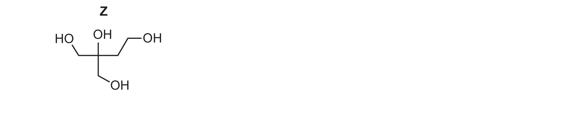
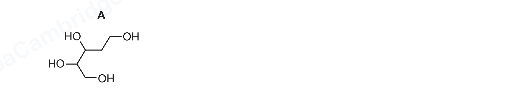
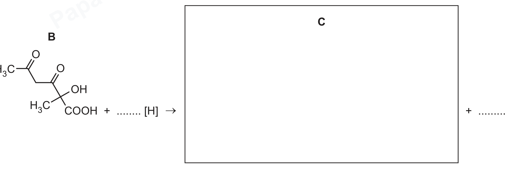

# ch17 Carbonyl compounds · 9701/21 May/June 2026

> 题卷 `originalpdf/9701_s26_qp_21.pdf` ｜ 答案 `originalpdf/9701_s26_ms_21.pdf`
> 本卷本章共 1 题 / 9 分：镜像 Q4 [9]（主章 ch16）

---

## Q4 [9]　⟨镜像 · 主章 ch16 Hydroxy compounds⟩

> 本题正本在 [`ch16-hydroxy-compounds/9701_s26_21.md`](../ch16-hydroxy-compounds/9701_s26_21.md)，此处为镜像。**不要在本文件里改它** —— 改正本，再跑 `python tools/mirror.py`。

### (a) Compound Z is oxidised to produce organic compound W, C₅H₆O₇, by heating under reflux with an excess of acidified Cr₂O₇²⁻(aq).

Z 的结构：中心碳直接连一个 OH，另接三条支链 —CH₂OH、—CH₂OH、—CH₂CH₂OH（经渲染页逐键核对，右侧支链是 2 个碳，不是 1 个碳，否则凑不出 C₅H₁₂O₄）。

### (a)(i) [1] · ch16

Describe the colour change in this reaction.

**答案** — colour of mixture at start of the reaction: orange；colour of mixture after the reaction: green

**判分** — A 橙/绿的任何色号；BOD 绿写成 blue/grey；BOD 绿写成 brown（因为 dichromate 过量）

### (a)(ii) [1] · ch2

The complete oxidation of 0.025 mol of Z requires 0.050 mol of Cr₂O₇²⁻(aq). W is produced in this reaction. Balance the equation for this reaction.

**答案** — 1 C₅H₁₂O₄ + 2 Cr₂O₇²⁻ + 16 H⁺ → 1 C₅H₆O₇ + 4 Cr³⁺ + 11 H₂O

### (b) Compound A is a structural isomer of Z.

A 的结构（渲染页逐键核对后确认为 5 个碳）：HOCH₂CH₂–CH(OH)–CH(OH)–CH₂OH（pentane-1,2,3,5-tetraol）。

### (b)(i) [2] · ch16 ch17

Complete Table 4.1 to show what is observed when separate samples of A are added to each reagent. State 'none' if no reaction occurs.

**Table 4.1**

| reagent | observation with A |
|---|---|
| Na(s) | effervescence / fizzing / bubbling |
| 2,4-dinitrophenylhydrazine (2,4-DNPH) | none |
| Fehling's reagent | none |

**判分** — Na(s) 一行：I 只写「产生气体」不写现象；I 气体名称/检验气体的方法；I 固体消失/变无色溶液。Fehling's 一行：A（仍为）orange 溶液/无沉淀/无反应/无现象；I 写成"变橙色"

### (b)(ii) [1] · ch17

Suggest why Fehling's reagent does not react with A but does react with aldehyde functional groups.

**答案** — Alcohols / Compound A are not oxidised by Fehling's reagent（aldehydes are oxidised by Fehling's reagent）

**判分** — A alcohol groups = hydroxy = hydroxyl = OH group；R hydroxide/OH⁻ 表述算 alcohol group；A "Fehling's 对 alcohol 而言不是足够强的 oxidising agent"／"Fehling's 对 aldehyde 而言是足够强的 oxidising agent"；I "Fehling's 是温和氧化剂"（不加限定）；R ketone 也被 Fehling's 氧化

### (b)(iii) [2] · ch16

Compound A is heated under reflux with an excess of acidified Cr₂O₇²⁻(aq) to produce organic compound Y. Draw the structure of Y.

**答案** — A 的 2 个 primary alcohol（两端 CH₂OH）被氧化为 COOH，2 个 secondary alcohol（中间两个 CHOH）被氧化为酮 C=O，中间的 CH₂（无 OH）不受影响：

Y = HOOC–CO–CO–CH₂–COOH

**判分** — A 任何无歧义的结构；I connectivity 表达方式

### (c) [2] · ch16 ch17

Compound B reacts with an excess of LiAlH₄ to produce organic compound C.

Complete the equation in Figure 4.3 to show the reaction of B with an excess of LiAlH₄ to produce C. [H] represents one atom of hydrogen from the reducing agent, LiAlH₄.

B 的结构（渲染页逐键核对）：CH₃–CO–CH₂–CO–C(OH)(CH₃)–COOH（7 个碳：2 个 ketone + 1 个 tertiary alcohol + 1 个 carboxylic acid）。

**答案** — 过量 LiAlH₄ 把 COOH 还原成 CH₂OH（耗 4[H]，副产物 H₂O），把 2 个 ketone 分别还原成 CH(OH)（各耗 2[H]），tertiary alcohol 不受影响：

C = HOCH₂–C(OH)(CH₃)–CH(OH)–CH₂–CH(OH)–CH₃（共 8 个 [H]）

B + 8[H] → C + H₂O

**判分** — M1 A C 的任何无歧义结构；M2 按该结构配平的化学计量数；A ecf：若结构错但仍正确配平，且结构含 7 个碳，同样给分

---

**[Total: 9]**
