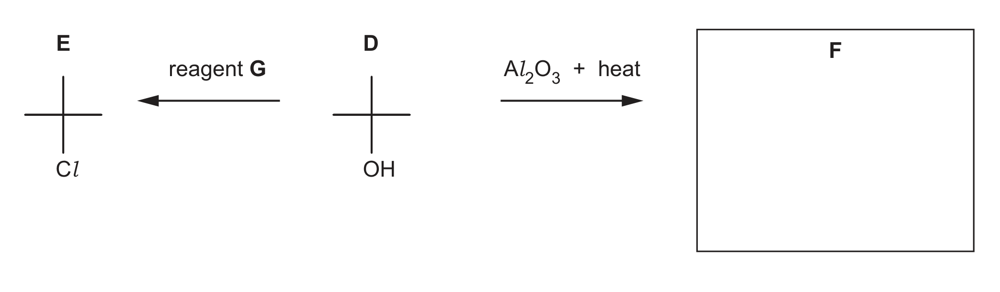
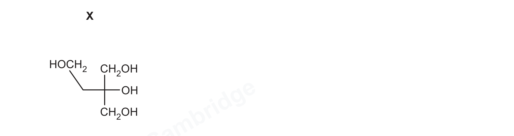

# ch17 Carbonyl compounds · 9701/22 May/June 2026

> 题卷 `originalpdf/9701_s26_qp_22.pdf` ｜ 答案 `originalpdf/9701_s26_ms_22.pdf`
> 本卷本章共 1 题 / 10 分：镜像 Q4 [10]（主章 ch16）

---

## Q4 [10]　⟨镜像 · 主章 ch16 Hydroxy compounds⟩

> 本题正本在 [`ch16-hydroxy-compounds/9701_s26_22.md`](../ch16-hydroxy-compounds/9701_s26_22.md)，此处为镜像。**不要在本文件里改它** —— 改正本，再跑 `python tools/mirror.py`。

### (a) Figure 4.1 shows two reactions of compound D.

D = (CH₃)₃C–OH（2-methylpropan-2-ol / tert-butanol，图中以十字骨架 + OH 标注表示）。

### (a)(i) [1] · ch16 ch15

D reacts with a single reagent, G, to produce compound E. Identify reagent G.

**答案** — PCl₅ **OR** SOCl₂ **OR** HCl **OR** PCl₃（或等效名称）

**判分** — A thionyl chloride / sulfur oxide dichloride（SOCl₂）；A phosphorus pentachloride / phosphorus trichloride；A conc. HCl / concentrated hydrochloric acid；A hydrogen chloride / HCl(g)；I 单独 hydrochloric acid / HCl(aq) / dilute HCl；I NaCl／KCl + conc. H₂SO₄／H₃PO₄；R PCl₅(aq)

### (a)(ii) [1] · ch16

D is heated with Al₂O₃ to produce organic compound F. Identify the role of Al₂O₃ in this reaction.

**答案** — catalyst **OR** dehydrating agent

**判分** — A causes dehydration；A 加快反应速率且本身不变；A 降低 E꜀；I heterogeneous/homogeneous；R redox

### (a)(iii) [1] · ch16

Draw the structure of F in Figure 4.1.

**答案** — F = 2-methylpropene，H₂C=C(CH₃)₂

**判分** — A 任何无歧义结构；I 只写 C₄H₈

### (b) The structure of compound X is shown in Figure 4.2.

> 读图提示：X 的左支链在折点处**有一个 CH₂**（骨架式的拐点就是一个碳），所以 X = HOCH₂CH₂–C(OH)(CH₂OH)₂，共 5 个碳，正是题干给的 C₅H₁₂O₄（*M*ᵣ = 136）。注意 X **不是** pentaerythritol C(CH₂OH)₄，两者是结构异构体。

The molecular formula of X is C₅H₁₂O₄. Complete oxidation of 0.255 g of X occurs when it reacts with exactly 10.0 cm³ of 0.500 mol dm⁻³ acidified K₂Cr₂O₇(aq).

### (b)(i) [1] · ch16

Describe the colour change in this reaction.

**答案** — colour of mixture at start of the reaction: orange；colour of mixture after the reaction: green

**判分** — A 橙/绿的任何色号；BOD 绿写成 blue/grey 或 brown（dichromate 过量）

### (b)(ii) [1] · ch2

Calculate the amount, in mol, of K₂Cr₂O₇(aq) used in the reaction.

**答案** — amount = 0.005 mol（**OR** 5 × 10⁻³）

**判分** — I 1/200 这类未化简写法

### (b)(iii) [1] · ch2

Calculate the amount, in mol, of X present in the 0.255 g sample.

**答案** — amount = 1.875 × 10⁻³ mol（*M*ᵣ(X) = 136）

**判分** — A 1.88 × 10⁻³ **OR** 1.9 × 10⁻³；A 2 × 10⁻³（须有过程）；R 1.880 × 10⁻³ **OR** 1.90 × 10⁻³ **OR** 2.0 × 10⁻³ **OR** 1.87 × 10⁻³

### (c)(i) [2] · ch2

Compound X and W are a pair of structural isomers. 0.0012 mol of W is completely oxidised when it is heated under reflux with exactly 0.0020 mol of acidified K₂Cr₂O₇(aq) to produce compound Z. Complete the equation for this reaction.

**答案** — 3 C₅H₁₂O₄ + 5 Cr₂O₇²⁻ + 40 H⁺ → 3 C₅H₆O₆ + 10 Cr³⁺ + 29 H₂O

**判分** — M1 系数 5Cr₂O₇²⁻；M2 全式配平正确

### (c)(ii) [2] · ch16 ch17

Each molecule of W contains four hydroxyl groups. Only two of these are primary hydroxyl groups. Table 4.1 shows the observations when separate samples of Z are added to each reagent. Use the information in 4(c) to suggest the structure of W.

**Table 4.1**（题目给出，非填空）

| reagent | observations with Z |
|---|---|
| 2,4-dinitrophenylhydrazine (2,4-DNPH) | orange precipitate |
| Fehling's reagent | none |

Z 对 2,4-DNPH 有反应（含 C=O）但对 Fehling's 无反应（不是 aldehyde，是 ketone）——说明 W 的 4 个 hydroxyl 里，2 个 primary 被完全氧化成 carboxylic acid（COOH），1 个 secondary 被氧化成 ketone（C=O），1 个 tertiary 氧化不了、原样保留。按此推出 W = HOCH₂–CH(OH)–C(OH)(CH₃)–CH₂OH 时，Z = HOOC–CO–C(OH)(CH₃)–COOH，分子式 C₅H₆O₆，与 (c)(i) 配平方程里的 C₅H₆O₆ 完全对上，交叉验证成立。

**答案** — W = HOCH₂CH(OH)C(OH)(CH₃)CH₂OH （**OR** (HOCH₂)₂C(OH)(CHOHCH₃)）：2 个 primary alcohol（两端 CH₂OH）、1 个 secondary alcohol（CH(OH)）、1 个 tertiary alcohol（C(OH)(CH₃)）

**判分** — A 任何无歧义结构；I 尝试命名；Max 1：全部基团正确但有 1 处或以上 connectivity 错误（如写成 C−H−O）

---

**[Total: 10]**
