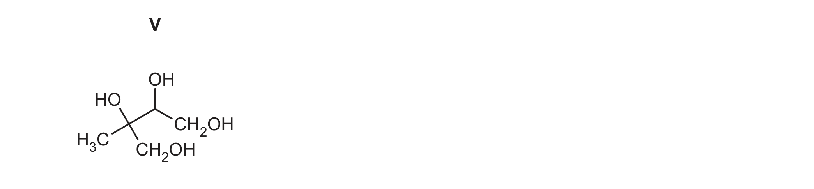
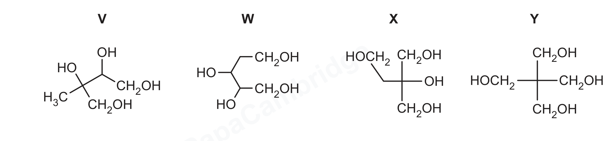
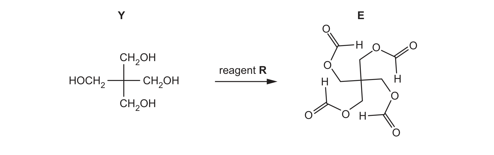

# ch17 Carbonyl compounds · 9701/23 May/June 2026

> 题卷 `originalpdf/9701_s26_qp_23.pdf` ｜ 答案 `originalpdf/9701_s26_ms_23.pdf`
> 本卷本章共 1 题 / 14 分：镜像 Q4 [14]（主章 ch16）

---

## Q4 [14]　⟨镜像 · 主章 ch16 Hydroxy compounds⟩

> 本题正本在 [`ch16-hydroxy-compounds/9701_s26_23.md`](../ch16-hydroxy-compounds/9701_s26_23.md)，此处为镜像。**不要在本文件里改它** —— 改正本，再跑 `python tools/mirror.py`。

The structure of compound V is shown in Figure 4.1.

V 的结构（渲染页逐键核对）：HOCH₂–C(OH)(CH₃)–CH(OH)–CH₂OH。

### (a)(i) [2] · ch16

Complete Table 4.1.

**Table 4.1**

| | primary hydroxyl groups | secondary hydroxyl groups | tertiary hydroxyl groups |
|---|---|---|---|
| number of groups in one molecule of V | 2 | 1 | 1 |

### (a)(ii) [2] · ch16 ch17

Complete Table 4.2 to show what is observed when separate samples of V are added to each reagent. State 'none' if no reaction occurs.

**Table 4.2**

| reagent | observation with V |
|---|---|
| Na(s) | effervescence / fizzing / bubbling |
| 2,4-dinitrophenylhydrazine (2,4-DNPH) | none |
| Fehling's reagent | none |

**判分** — Na(s) 一行：I 只写「产生气体」不写现象／写气体名称／写检验方法／固体消失或变无色溶液；2,4-DNPH 一行：A（仍为）orange 溶液/无沉淀/无反应/无现象；I 写成"变橙色"

### (a)(iii) [1] · ch17

Suggest why Fehling's reagent does not react with V but does react with aldehyde functional groups.

**答案** — Alcohols / Compound V are not oxidised by Fehling's reagent（aldehydes are oxidised by Fehling's reagent）

**判分** — A alcohol groups = hydroxy = hydroxyl = OH group；R hydroxide/OH⁻ 表述算 alcohol group；A "Fehling's 对 alcohol 不是足够强的 oxidising agent"／"Fehling's 对 aldehyde 是足够强的 oxidising agent"；I "Fehling's 是温和氧化剂"（不加限定）；R ketone 也被 Fehling's 氧化

### (b) Figure 4.1 is repeated for use in 4(b).

V is completely oxidised by heating under reflux with an excess of acidified K₂Cr₂O₇(aq) to produce organic compound Z.

### (b)(i) [1] · ch16

Describe the colour change in this reaction.

**答案** — colour of mixture at start of the reaction: orange；colour of mixture after the reaction: green

**判分** — A 橙/绿的任何色号；BOD 绿写成 blue/grey 或 brown（dichromate 过量）

### (b)(ii) [1] · ch16

Draw the structure of Z.

V 的 2 个 primary alcohol（两端 CH₂OH）氧化成 COOH，1 个 secondary alcohol（CH(OH)）氧化成 ketone（C=O），1 个 tertiary alcohol（C(OH)(CH₃)）氧化不了、原样保留：

**答案** — Z = HOOC–C(OH)(CH₃)–CO–COOH （**OR** (HOOC)C=OC(COOH)(OH)CH₃，即同一结构的另一种写法）

**判分** — A 任何无歧义结构；I connectivity 表达方式

### (c) Compounds W, X and Y are structural isomers of V.

> 读图提示：骨架式的每个拐点都是一个碳。Figure 4.2 的四个结构**全是 C₅H₁₂O₄**——V = CH₃–C(OH)(CH₂OH)–CH(OH)–CH₂OH；W = HOCH₂–CH(OH)–CH(OH)–CH₂–CH₂OH（左侧竖线下端到 CH₂OH 之间那个折点是 CH₂）；X = HOCH₂CH₂–C(OH)(CH₂OH)₂；Y = C(CH₂OH)₄（pentaerythritol）。W 的 C2、C3 各连 4 个不同基团，所以 (c)(ii) 说「both have 2 chiral centres」成立。

### (c)(i) [2] · ch13

Describe structural isomerism.

**答案**

- M1 — (molecules / isomers with) the same molecular formula / same number of atoms of each element
- M2 — different arrangement of atoms

**判分** — M1 A same molecular formula；I same chemical formulas；I same/similar molecular number。M2 A different structures／different structural formulas／different displayed formulas／different skeletal formulas；I arrangement of bonds／不同空间排布；I 只提 carbon skeleton／functional groups／chain 不同

### (c)(ii) [2] · ch13

Identify which of structures V, W, X and Y show stereoisomerism. Explain your answer by referring to the relevant parts of the molecule that cause stereoisomerism.

**答案**

- M1 — compound W **AND** compound V
- M2 — both have (2) chiral centres / (2) asymmetric carbon atoms

**判分** — chiral = 4 个不同的 group/atom 连在同一个碳上；R 说成"molecules/compounds"而非 atoms/groups 连接；R "C 连 4 个不同的 alkyl group"（应是 4 个不同基团，不限烷基）；M2 也可以用在 Figure 4.2 上标注星号表示手性碳来给分

### (c)(iii) [1] · ch16

Y reacts with reagent R to produce compound E（图中 E 是 Y 的四个 –CH₂OH 都与 reagent R 发生酯化后的产物）。Name reagent R.

**答案** — methanoic acid

**判分** — A formic acid

### (d) Exactly 0.03 mol of one of the isomers, V, W, X or Y, is completely oxidised by 0.08 mol of acidified K₂Cr₂O₇(aq) to produce only one organic compound with molecular formula C₅H₄O₈.

### (d)(i) [1] · ch16

Identify which isomer, V, W, X or Y, is used in this reaction.

**答案** — (isomer) Y

**判分** — A the structure of isomer Y

### (d)(ii) [1] · ch2

Complete the equation for this reaction.

**答案** — 3 C₅H₁₂O₄ + 8 Cr₂O₇²⁻ + 64 H⁺ → 3 C₅H₄O₈ + 16 Cr³⁺ + 44 H₂O

---

**[Total: 14]**
