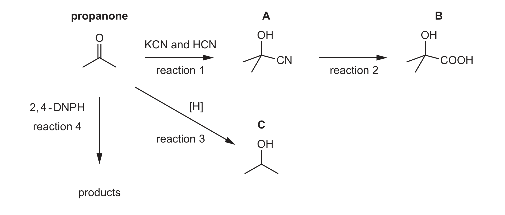
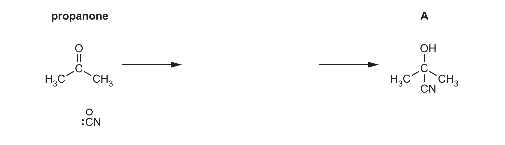
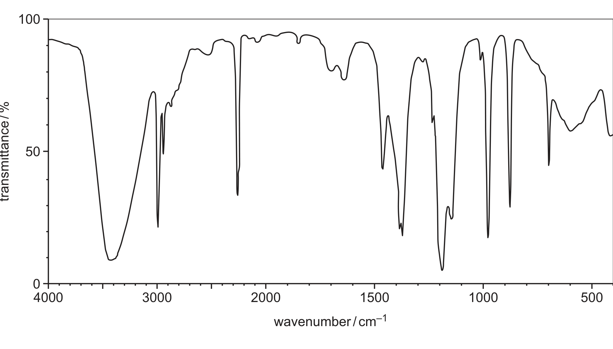

# ch17 Carbonyl compounds · 9701/21 Oct/Nov 2024

> 题卷 `originalpdf/9701_w24_qp_21.pdf` ｜ 答案 `originalpdf/9701_w24_ms_21.pdf`
> 本卷本章共 1 题 / 11 分：本章主管 Q4 [11]
> 本卷与 9701/23 同卷（逐字一致，仅条形码与印刷码不同）

---

## Q4 [11]

Propanone, CH₃COCH₃, is an important organic reagent. Fig. 4.1 shows some reactions of
propanone and its derivatives: reaction 1 (KCN and HCN) converts propanone to **A**;
reaction 2 converts **A** to **B**; reaction 3 ([H]) reduces propanone to **C**; reaction 4
(2,4-DNPH) converts propanone to products.

### (a) Reaction 1 is a nucleophilic addition reaction.

### (a)(i) [3]

Complete Fig. 4.2 to show the mechanism for the formation of A from propanone.
Include charges, dipoles, lone pairs of electrons and curly arrows as appropriate.

**答案**（nucleophilic addition of HCN 到 propanone 的羰基碳，生成 A =
2-hydroxy-2-methylpropanenitrile）
- M1 curly arrow from lone pair on C of CN⁻ to carbonyl C
- M2 correct dipole on C=O **AND** curly arrow from C=O bond to O
- M3 correct intermediate（此点不需要画出 lone pair(s)）**AND** curly arrow from lone pair on
  the alkoxide —O⁻ to (source of) H⁺，质子化生成 —OH

**判分** — M1/M2/M3 各 1 分，共 [3]；correct intermediate 一条不需要画 lone pair(s) 也能得分

### (a)(ii) [1]

Explain why A does not show optical isomerism.

**答案** — A's central carbon atom is not bonded to four different atoms/groups of atoms

### (b) [1]

Suggest the reagents and conditions for reaction 2.

**答案** — H₂SO₄(aq) or HCl(aq)

### (c) Reaction 3 is a reduction reaction.

### (c)(i) [1]

Construct an equation to represent reaction 3. Use [H] to represent one atom of hydrogen from
the reducing agent.

**答案** — CH₃COCH₃ + 2[H] → CH₃CH(OH)CH₃

### (c)(ii) [1]

Name C.

**答案** — propan-2-ol

### (d) [1]

State what is observed in reaction 4.

**答案** — red / orange / yellow ppt

### (e) [1]

Explain why Fehling's reagent does not react with propanone.

**答案** — Fehling's solution cannot oxidise ketones　OR　ketones are not easily oxidised

### (f) Compounds A, B and C can be distinguished using infrared spectroscopy.

A = 2-hydroxy-2-methylpropanenitrile (OH, CN)；B = 2-hydroxy-2-methylpropanoic acid
(OH, COOH)；C = propan-2-ol (OH)。Fig. 4.3 shows the infrared spectrum of one of the
compounds.

**Table 4.1** — characteristic infrared absorption range

| bond | functional groups containing the bond | absorption range / cm⁻¹ |
|---|---|---|
| C–O | hydroxy, ester | 1040–1300 |
| C=C | aromatic compound, alkene | 1500–1680 |
| C=O | amide | 1640–1690 |
| C=O | carbonyl, carboxyl | 1670–1740 |
| C=O | ester | 1710–1750 |
| C≡N | nitrile | 2200–2250 |
| C–H | alkane | 2850–2950 |
| N–H | amine, amide | 3300–3500 |
| O–H | carboxyl | 2500–3000 |
| O–H | hydroxy | 3200–3600 |

### (f)(i) [1]

Explain why the absorptions at 2850–2950 cm⁻¹ are not useful to help determine which of the
compounds A, B or C produces the infrared spectrum in Fig. 4.3. Use Table 4.1 to answer this
question.

**答案** — All three have a C—H　OR　CH bond

### (f)(ii) [1]

Identify which of compounds A, B or C produces the infrared spectrum in Fig. 4.3. Explain your
answer.

**答案** — compound A **AND** absorption at 2200–2250 cm⁻¹ indicates C≡N

---

**[Total: 11]**
