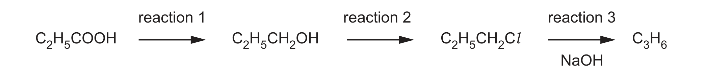
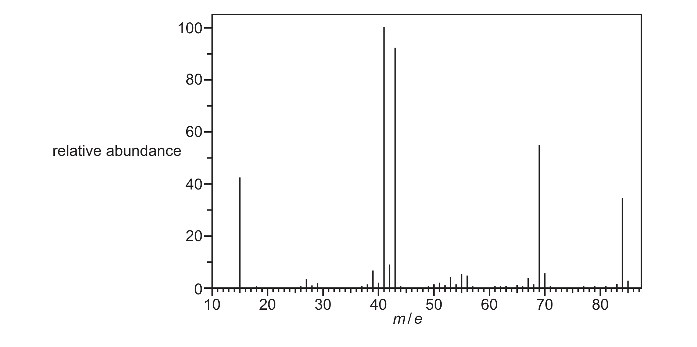

# ch21 Organic synthesis · 9701/21 Oct/Nov 2025

> 题卷 `originalpdf/9701_w25_qp_21.pdf` ｜ 答案 `originalpdf/9701_w25_ms_21.pdf`
> 本卷本章共 1 题 / 16 分：本章主管 Q4 [16]
> 本卷与 9701/23 同卷（逐字一致，仅条形码与印刷码不同）

---

## Q4 [16]

Figure 4.1 shows a possible synthesis of propene, C₃H₆.



### (a)(i) [1]

Identify the type of reaction that occurs in reaction 1.

**答案** — reduction

### (a)(ii) [1]

Suggest a suitable reagent for reaction 2.

**答案** — PCl₅ / PCl₃ / SOCl₂ OR KCl / NaCl **AND** conc. H₂SO₄ / conc. H₃PO₄

### (a)(iii) [2]

Reaction 3 is an elimination reaction. Write an equation for this reaction and identify the
solvent and conditions used.

**答案**
- equation — C₂H₅CH₂Cl + NaOH → C₃H₆ + H₂O + NaCl
- solvent and conditions — ethanol (solvent) **AND** heat / reflux

### (a)(iv) [1]

C₂H₅CH₂OH can be directly converted to C₃H₆. Suggest the reagent and conditions for this
conversion.

**答案** — conc. H₂SO₄ OR conc. H₃PO₄ OR Al₂O₃ **AND** heat

### (b)(i) [1]

Under suitable conditions, propene polymerises to form poly(propene). Identify the type of
polymerisation that forms poly(propene) from propene.

**答案** — addition

### (b)(ii) [2]

Poly(propene) exhibits stereoisomerism. Define stereoisomerism.

**答案**
- M1 (molecules that have the) same structural formula (and same molecular formula)
- M2 but different 3D / spatial arrangement of atoms / groups

### (b)(iii) [3]

Draw a section of poly(propene), showing two repeat units. Use your diagram to identify the type
of stereoisomerism shown by poly(propene). Explain your answer.

**答案**
- M1 画出四碳骨架 —CH(CH₃)—CH₂—CH(CH₃)—CH₂—，两个重复单元上的甲基各标在骨架第 1、3 个碳上
- M2 optical isomerism
- M3 the methylated carbon has four different groups attached

```tikz
\usepackage{chemfig}
\begin{document}
$\Big[$\chemfig{-C(-[2]H)(-[6]H)-C(-[2]CH_3)(-[6]H)-C(-[2]H)(-[6]H)-C(-[2]CH_3)(-[6]H)-}$\Big]$
\end{document}
```

### (b)(iv) [2]

State two difficulties associated with the disposal of poly(propene).

**答案**
1. non-biodegradability
2. harmful combustion products

### (c)(i) [1]

Under different conditions, two molecules of propene can combine to form compounds X and Y.

- X：CH₂=C(CH₃)–CH(CH₃)–CH₃
- Y：(CH₃)₂C=C(CH₃)₂

Name X.

**答案** — 2,3-dimethylbut-1-ene

### (c)(ii) [1]

Figure 4.2 shows the mass spectrum of either compound X or compound Y.



Identify which of X and Y gives this mass spectrum. Give one reason for your answer, referring to
the fragmentation pattern.

**答案** — (The spectrum is of) X **AND** 41 is [CH₂=CCH₃]⁺ / C₃H₅⁺ OR 43 is [CH₃CHCH₃]⁺ / C₃H₇⁺ OR
X would NOT have a significant peak at 54 / [(CH₃)₂C=C]⁺ / C₄H₆⁺ OR X would NOT have a significant
peak at 42 due to [(CH₃)₂C]⁺ / C₃H₆⁺

### (c)(iii) [1]

The molecular ion peak in the spectrum in Figure 4.2 has relative abundance 34.7. Calculate the
relative abundance of the [M+1]⁺ peak in this spectrum.

**答案** — [M+1]⁺ / 34.7 × 100 / 1.1 = 6，所以 [M+1]⁺ = 2.29

---

**[Total: 16]**
