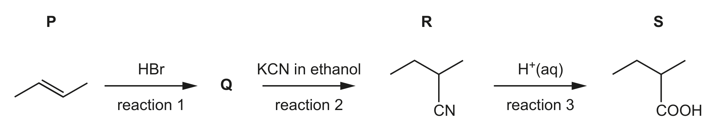
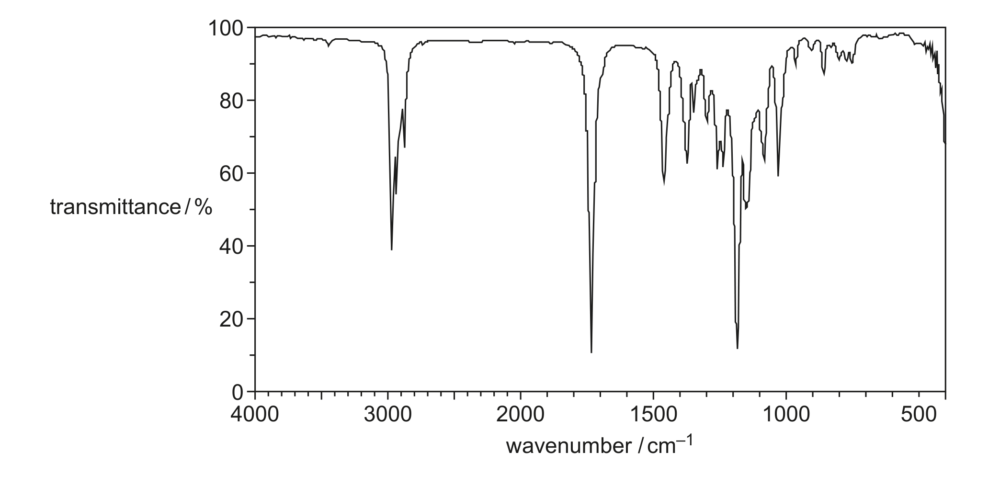

# ch22 Analytical techniques · 9701/22 Feb/March 2024

> 题卷 `originalpdf/9701_m24_qp_22.pdf` ｜ 答案 `originalpdf/9701_m24_ms_22.pdf`
> 本卷本章共 1 题 / 11 分：镜像 Q4 [11]（主章 ch21）

---

## Q4 [11]　⟨镜像 · 主章 ch21 Organic synthesis⟩

> 本题正本在 [`ch21-organic-synthesis/9701_m24_22.md`](../ch21-organic-synthesis/9701_m24_22.md)，此处为镜像。**不要在本文件里改它** —— 改正本，再跑 `python tools/mirror.py`。

Compound S is used in food flavourings. A possible synthesis of S is shown in Figure 4.1.



### (a) [2] · ch13

P, Q, R and S show stereoisomerism. Complete Table 4.1 by identifying with a tick (✓) the type
of stereoisomerism that each molecule shows. The type of stereoisomerism shown by Q is given.

**Table 4.1**

| | P | Q | R | S |
|---|---|---|---|---|
| geometrical isomerism | ✓ | | | |
| optical isomerism | | ✓（已给） | ✓ | ✓ |

**答案** — P 只显示 geometrical isomerism；Q（已给）、R、S 都只显示 optical isomerism
**判分** — geometrical 一行（P✓其余×）与 optical 一行（Q✓给定、R✓、S✓）分别各占 1 分

### (b)(i) [1] · ch14 ch21

Give the structural formula of Q.

**答案** — CH₃CHBrCH₂CH₃

### (b)(ii) [1] · ch13 ch21

Name the mechanism in reaction 2.

**答案** — nucleophilic substitution

### (b)(iii) [1] · ch19 ch21

Complete the equation for reaction 3. R is represented as C₄H₉CN.

C₄H₉CN + ……

**答案** — C₄H₉CN + 2H₂O + H⁺ → C₄H₉COOH + NH₄⁺

### (c)(i) [2] · ch22

Compounds S and T react to form organic compound U, which has a single functional group
(S + T → U + H₂O). Table 4.2 shows some data from the mass spectrum of U. Use the data from
Table 4.2 to show that U contains 7 carbon atoms. Show your working.

**Table 4.2**

| peak | relative abundance |
|---|---|
| M⁺ | 7.2 |
| [M+1]⁺ | 0.55 |

**答案**
- *n* = (100 / 1.1) × (0.55 / 7.2)
- = 6.94（所以 U 含 7 个碳原子）

### (c)(ii) [2] · ch22

Figure 4.2 shows the infrared spectrum of U.



**Table 4.3**

| bond | functional groups containing the bond | characteristic IR absorption range / cm⁻¹ |
|---|---|---|
| C–O | hydroxy, ester | 1040–1300 |
| C=C | aromatic compound, alkene | 1500–1680 |
| C=O | amide | 1640–1690 |
| | carbonyl, carboxyl | 1670–1740 |
| | ester | 1710–1750 |
| C≡N | nitrile | 2200–2250 |
| C–H | alkane | 2850–2950 |
| N–H | amine, amide | 3300–3500 |
| O–H | carboxyl | 2500–3000 |
| | hydroxy | 3200–3650 |

Use Figure 4.2 and Table 4.3 to identify the functional group present in U. Explain your answer
fully.

**答案**
- FG = ester / (R)COOR(′)
- (absorption at) 1040–1300 cm⁻¹ indicates C—O (stretch) **AND** (absorption at) 1710–1750 cm⁻¹
  indicates (C=O stretch)

### (c)(iii) [2] · ch18 ch21

T also has a single functional group. Use the information in (c)(i) and your answer to (c)(ii) to
identify T and U. Draw the structures of T and U in the boxes.

**答案**（官方 MS 把这一问的题号误印成 "4(c)(iv)"，
QP 上实际是 (c)(iii)，以 QP 为准）
- T = ethanol，HOCH₂CH₃
- U = ethyl 2-methylbutanoate，CH₃CH₂CH(CH₃)COOCH₂CH₃（与 (c)(i) 的 7 个碳、S 的 2-methylbutanoic
  acid 结构一致）

```tikz
\usepackage{chemfig}
\begin{document}
T: \chemfig{HO-CH_2-CH_3}
\end{document}
```

```tikz
\usepackage{chemfig}
\begin{document}
U: \chemfig{CH_3CH_2-CH(-[2]CH_3)-C(=[2]O)-O-CH_2CH_3}
\end{document}
```

**判分** — T、U 各 1 分

---

**[Total: 11]**
