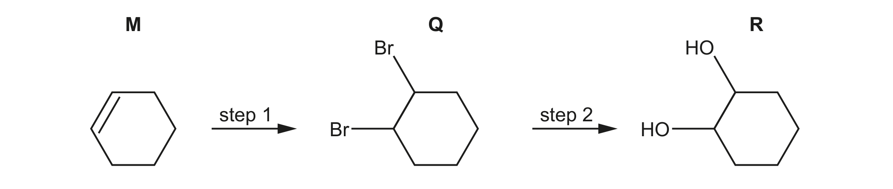
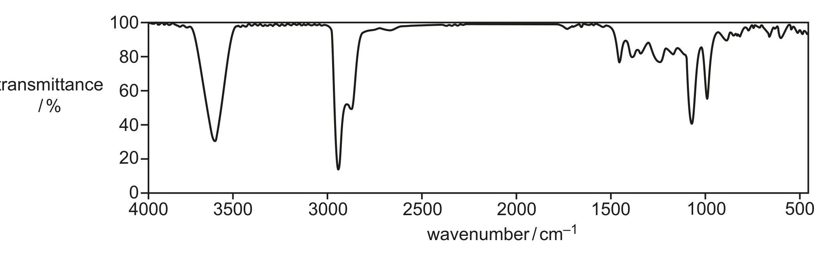
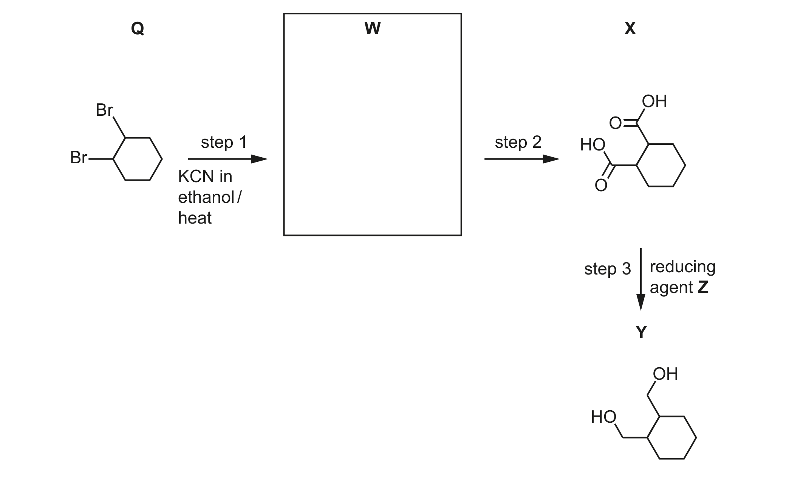

# ch22 Analytical techniques · 9701/23 May/June 2024

> 题卷 `originalpdf/9701_s24_qp_23.pdf` ｜ 答案 `originalpdf/9701_s24_ms_23.pdf`
> 本卷本章共 1 题 / 10 分：镜像 Q5 [10]（主章 ch21）

---

## Q5 [10]　⟨镜像 · 主章 ch21 Organic synthesis⟩

> 本题正本在 [`ch21-organic-synthesis/9701_s24_23.md`](../ch21-organic-synthesis/9701_s24_23.md)，此处为镜像。**不要在本文件里改它** —— 改正本，再跑 `python tools/mirror.py`。

### (a) [1] · ch14 ch21

M reacts to form R by the addition of one reagent, as shown in Figure 5.1.

Identify the reagent and conditions for this reaction.

**答案** — cold dilute KMnO₄ OR cold dilute potassium manganate(VII)

### (b)(i) [2] · ch14 ch15 ch21

R is also made from M by two steps, as shown in Figure 5.2.

Identify the reagents and conditions for steps 1 and 2 in Figure 5.2.

**答案**
- step 1 — Br₂ (in the dark)
- step 2 — NaOH(aq) + heat

### (b)(ii) [1] · ch13 ch21

Name the mechanism for step 1 in Figure 5.2.

**答案** — electrophilic addition

### (c) [2] · ch22

The infrared spectrum of R is shown in Figure 5.3.

**Table 5.1**

| bond | functional groups containing the bond | characteristic IR absorption range / cm⁻¹ |
|---|---|---|
| C–O | hydroxy, ester | 1040–1300 |
| C=C | aromatic compound, alkene | 1500–1680 |
| C=O | amide | 1640–1690 |
| | carbonyl, carboxyl | 1670–1740 |
| | ester | 1710–1750 |
| C≡N | nitrile | 2200–2250 |
| C–H | alkane | 2850–2950 |
| N–H | amine, amide | 3300–3500 |
| O–H | carboxyl | 2500–3000 |
| | hydroxy | 3200–3650 |

Use the absorptions in the region above 1500 cm⁻¹ in Table 5.1 when answering this question.
- Add F to Figure 5.3 to identify the peak that is present in an infrared spectrum of both Q and
  R. Identify the bond that corresponds to the absorption for F.
- Add G to Figure 5.3 to identify the peak that is **not** present in an infrared spectrum of Q.
  Identify the bond that corresponds to the absorption for G.

**答案**
- F：peak shown around 2850–2950 cm⁻¹，对应 C—H
- G：peak shown around 3200–3600 cm⁻¹，对应 O—H (in hydroxy(l) / alcohol)

### (d)(i) [1] · ch15 ch21

Y is made from Q in a three-step reaction, as shown in Figure 5.4.

Draw the structure of W in the box in Figure 5.4.

**答案** — W = cyclohexane-1,2-dicarbonitrile（cyclohexane 1,2 位上 Q 的两个 Br 都被 KCN 取代成 –CN）

### (d)(ii) [1] · ch19 ch21

In step 2, W is heated with HCl(aq) to produce X and an inorganic product. Identify the formula
of the inorganic product.

**答案** — NH₄Cl

### (d)(iii) [1] · ch18 ch21

In step 3, X reacts with reducing agent Z to produce Y. Complete the equation for the reaction of
X with Z. Use a molecular formula to represent the organic product. Use [H] to represent one atom
of hydrogen from Z.

…… C₈H₁₂O₄ + ……[H] →

**答案** — C₈H₁₂O₄ + 8[H] → C₈H₁₆O₂ + 2H₂O

### (d)(iv) [1] · ch18 ch21

Identify Z.

**答案** — LiAlH₄

---

**[Total: 10]**
