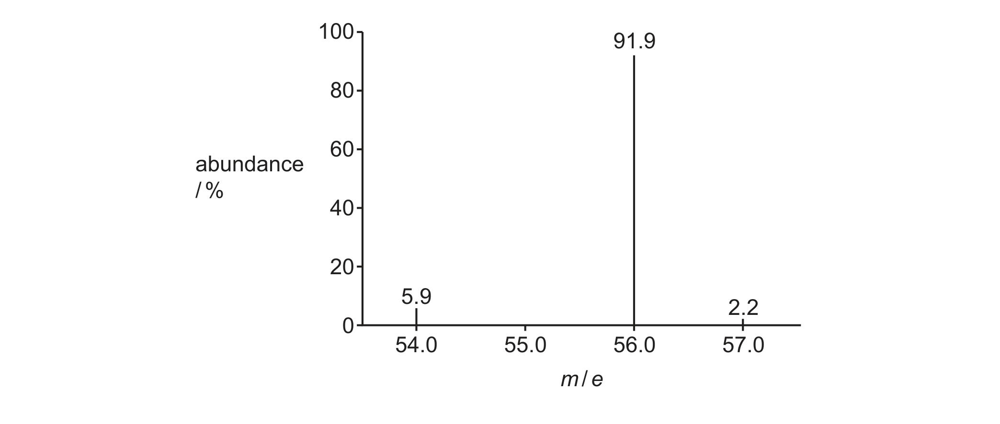

# ch22 Analytical techniques · 9701/21 May/June 2025

> 题卷 `originalpdf/9701_s25_qp_21.pdf` ｜ 答案 `originalpdf/9701_s25_ms_21.pdf`
> 本卷本章共 1 题 / 11 分：镜像 Q2 [11]（主章 ch1）

---

## Q2 [11]　⟨镜像 · 主章 ch1 Atomic structure⟩

> 本题正本在 [`ch01-atomic-structure/9701_s25_21.md`](../ch01-atomic-structure/9701_s25_21.md)，此处为镜像。**不要在本文件里改它** —— 改正本，再跑 `python tools/mirror.py`。

A sample of iron is analysed using a mass spectrometer. The mass spectrum shows three isotopes of
iron are present in the sample.

### (a) [1] · ch1

Define isotopes.

**答案** — atoms (of an element) with same number of protons and different number of neutrons

### (b) Fig. 2.1 shows the mass spectrum of the sample of iron.

### (b)(i) [2] · ch22

Use Fig. 2.1 to calculate the relative atomic mass, *A*ᵣ, of iron to one decimal place. Show your
working.

**答案**
- M1 method showing each abundance multiplied by *m*/*e* value：(5.9 × 54) and (91.9 × 56) and
  (2.2 × 57)　**OR** (0.59 × 54) and (9.19 × 56) and (0.22 × 57)
- M2 三个值化成百分比后相加，结果保留 1 位小数：
  $\frac{5.9}{100}\times54+\frac{91.9}{100}\times56+\frac{2.2}{100}\times57=55.9$

*A*ᵣ of iron = **55.9**

### (b)(ii) [2] · ch1

Complete Table 2.1 to show the number of protons and nucleons in one atom of ⁵⁶Fe.

**Table 2.1**

| particle | number of particles in one atom of ⁵⁶Fe |
|---|---|
| protons | **26** |
| nucleons | **56** |

**答案** — 见上表加粗格

### (c) [1] · ch1

Deduce the number of pairs of electrons in the shell with principal quantum number *n* = 3 in an
Fe atom.

**答案** — 5

### (d) [1] · ch1

Write an equation to represent the first ionisation energy of iron.

**答案** — Fe(g) → Fe⁺(g) + e⁻

### (e) [4] · ch1

Suggest how the value for the first ionisation energy of ⁵⁴Fe compares to the first ionisation
energy of ⁵⁶Fe. Explain your answer in terms of the factors that affect ionisation energy.

**答案**
- M1 same electronic configuration **OR** same shielding
- M2 same number of protons **OR** same nuclear charge
- M3 so same nuclear attraction to outer shell electron
- M4 no change / will not be affected

---

**[Total: 11]**
