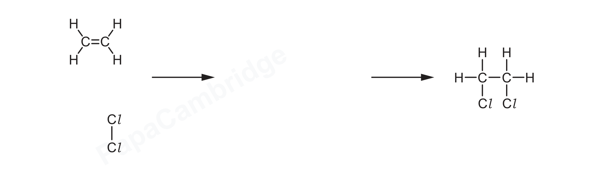
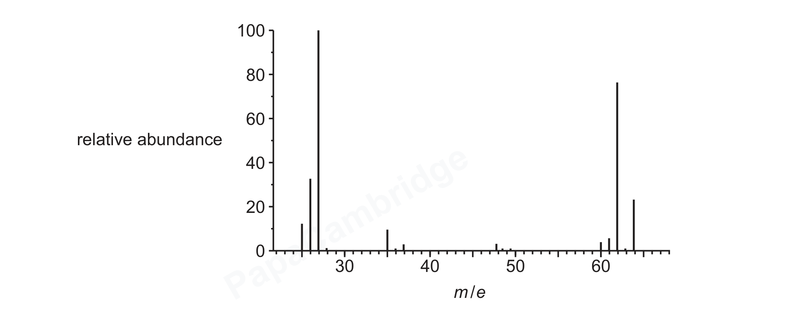

# ch22 Analytical techniques · 9701/21 May/June 2026

> 题卷 `originalpdf/9701_s26_qp_21.pdf` ｜ 答案 `originalpdf/9701_s26_ms_21.pdf`
> 本卷本章共 1 题 / 15 分：镜像 Q5 [15]（主章 ch14）

---

## Q5 [15]　⟨镜像 · 主章 ch14 Hydrocarbons⟩

> 本题正本在 [`ch14-hydrocarbons/9701_s26_21.md`](../ch14-hydrocarbons/9701_s26_21.md)，此处为镜像。**不要在本文件里改它** —— 改正本，再跑 `python tools/mirror.py`。

Figure 5.1 describes a sequence of reactions starting with ethene to produce poly(chloroethene),
PVC：

ethene —reaction 1→ 1,2-dichloroethane —reaction 2→ chloroethene —reaction 3→
poly(chloroethene)

### (a) [2] · ch13

Complete Table 5.1.

Table 5.1

| compound | type of hybridisation of carbon atoms |
|---|---|
| 1,2-dichloroethane | sp³ |
| chloroethene | sp² |

**判分** — M1 sp³ 的各种写法（sp3、SP³ 等）都给分；M2 sp² 同理

### (b) [1] · ch14

In reaction 1, ethene reacts with Cl₂(g) at room temperature. Name the mechanism for reaction 1.

**答案** — electrophilic addition

**判分** — 只写 addition 不给分（I addition alone）

### (c) [2] · ch13

Describe what is meant by heterolytic fission of a covalent bond.

**答案**
- M1 when a (covalent) bond / it is broken
- M2 one atom takes both of the electrons from the shared pair

**判分** — M2 必须明确是在描述"某个共价键断裂"这一过程中，才能因"一个原子拿走两个电子"
得分；**R** 用 element / molecule / compound 代替 species；**I** radical、uneven number of
electrons、formation of (positive and negative) ions、formation of nucleophile and electrophile
这类表述

### (d) [4] · ch14

Complete Figure 5.2 to show the mechanism for the reaction of ethene with Cl₂ in reaction 1.
Include charges, dipoles, lone pairs of electrons and curly arrows, as appropriate.

**答案** — ethene（对称分子）与 Cl₂ 的 electrophilic addition：
- curly arrow 从 C=C 双键指向离双键较近的那个 Cl 原子
- Cl–Cl 键上标出 dipole：靠近双键的 Cl 为 δ+、远离双键的 Cl 为 δ−；另一条 curly arrow 从
  Cl–Cl 键指向 δ− 的 Cl，使该键异裂生成 Cl⁻
- 生成的 intermediate 是碳正离子：一个碳接 Cl，相邻碳带正电荷 C⁺
- 第三条 curly arrow 从 :Cl⁻ 的 lone pair 指向该 C⁺，生成 1,2-dichloroethane

**判分**
- M1 curly arrow from C=C bond to Cl closest to C=C
- M2 correct dipoles Clδ⁺—Clδ⁻ AND curly arrow from bond of Clδ⁺—Clδ⁻ to Clδ⁻
- M3 correct carbocation intermediate
- M4 curly arrow from lone pair of :Cl⁻ to C⁺ of intermediate
- 曲箭头即使画得偏直也接受，但绝不能是单尖头（fishhook）；M1 的箭头起点只要落在 π 键上、
  终点指向 Cl 或接近 Cl 原子即可；M3 不接受在 C⁺ 上另画 lone pair 或标 + 号在错误位置；
  M4 若 M3 的中间体错误但已 ecf（正电荷位置一致）仍可给分

### (e) [1] · ch13

When 1,2-dichloroethane is heated in reaction 2, thermal decomposition occurs. The reaction is
endothermic. State the type of reaction that occurs.

**答案** — elimination

### (f) [1] · ch20

Draw the repeat unit of poly(chloroethene).

**答案** — -[CH₂-CHCl]-（方括号 + 两端悬空键，Cl 可以画在骨架的任一个碳上）

**判分** — I 括号形式（any）、I n；A 悬空键写法（骨架式时悬空键需与主链不同，如虚线 / 明显更
长，或穿过括号）

### (g) Figure 5.3 shows the mass spectrum of chloroethene.

### (g)(i) [2] · ch22

Identify the species responsible for the peaks at m/e = 64 and m/e = 27.

**答案**
- peak at m/e = 64：M1 [CH₂CH³⁷Cl]⁺
- peak at m/e = 27：M2 [CH₂CH]⁺

**判分** — M1 also accepts C₂H₃Cl⁺（标注 Cl = Cl-37）、CH₂=CH³⁷Cl⁺ 等等价写法；两个都缺
方括号或电荷，或两个都错标负电荷 / 同样错误的正电荷，最多给 1 分

### (g)(ii) [2] · ch22

Explain the difference in relative abundance of the peaks at m/e = 62 and m/e = 64.

**答案**
- M1 2 chlorine isotopes (exist)
- M2 ³⁵Cl is 3 times more abundant than ³⁷Cl

**判分** — 也接受 "75% ³⁵Cl and 25% ³⁷Cl"；m/e = 62 对应含 ³⁵Cl 的分子离子，m/e = 64 对应
含 ³⁷Cl 的 [M+2]⁺ 离子

---

**[Total: 15]**
