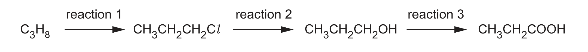
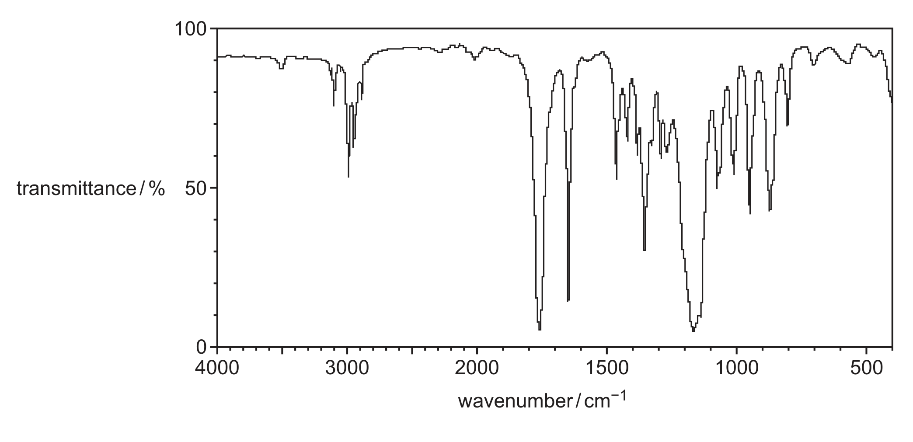

# ch22 Analytical techniques · 9701/22 Oct/Nov 2025

> 题卷 `originalpdf/9701_w25_qp_22.pdf` ｜ 答案 `originalpdf/9701_w25_ms_22.pdf`
> 本卷本章共 1 题 / 16 分：镜像 Q4 [16]（主章 ch21）

---

## Q4 [16]　⟨镜像 · 主章 ch21 Organic synthesis⟩

> 本题正本在 [`ch21-organic-synthesis/9701_w25_22.md`](../ch21-organic-synthesis/9701_w25_22.md)，此处为镜像。**不要在本文件里改它** —— 改正本，再跑 `python tools/mirror.py`。

Figure 4.1 shows how propane, C₃H₈, can be converted to propanoic acid, CH₃CH₂COOH.

### (a)(i) [1] · ch13 ch21

Reaction 1 in Figure 4.1 takes place in the presence of sunlight.

C₃H₈ + Cl₂ → CH₃CH₂CH₂Cl + HCl

The reaction takes place via initiation, propagation and termination steps. Name the mechanism
shown by reaction 1.

**答案** — free-radical substitution

### (a)(ii) [3] · ch14

Complete the mechanism for reaction 1. Construct equations to describe the steps of the
mechanism.

initiation：Cl₂ → 2Cl•

**答案**
- propagation 1 — C₃H₈ + Cl• → CH₃CH₂CH₂• + HCl（OR C₃H₈ + Cl• → C₃H₇• + HCl）
- propagation 2 — CH₃CH₂CH₂• + Cl₂ → CH₃CH₂CH₂Cl + Cl•（OR C₃H₇• + Cl₂ → C₃H₇Cl + Cl• 等）
- termination — CH₃CH₂CH₂• + Cl• → CH₃CH₂CH₂Cl（OR C₃H₇• + Cl• → CH₃CH₂CH₂Cl）

### (a)(iii) [1] · ch13

Reaction 1 is initiated by the bond fission of Cl₂. State the type of bond fission shown in the
initiation step.

**答案** — homolytic

### (a)(iv) [1] · ch13 ch21

Compound Q is a by-product of reaction 1：CH₃–CHCl–CH₂Cl。Name Q.

**答案** — 1,2-dichloropropane

### (a)(v) [2] · ch13

The molecular formula of Q is C₃H₆Cl₂. Identify the types of structural isomerism and
stereoisomerism that a molecule with molecular formula C₃H₆Cl₂ can show.

**答案**
- type of structural isomerism — positional
- type of stereoisomerism — optical

### (b) [1] · ch15 ch21

State the reagent and solvent required for reaction 2.

**答案** — sodium hydroxide **AND** water

### (c)(i) [1] · ch16

Reaction 3 takes place when CH₃CH₂CH₂OH is heated under reflux with acidified potassium
dichromate(VI) solution. State the colour change that takes place in the reaction mixture.

**答案** — orange to green

### (c)(ii) [1] · ch16 ch21

Construct an equation to represent reaction 3. Use [O] to represent an atom of oxygen from the
oxidising agent.

**答案** — CH₃CH₂CH₂OH + 2[O] → CH₃CH₂COOH + H₂O

### (d)(i) [1] · ch13 ch21

CH₃CH₂COOH reacts with an unsaturated alcohol R to form unsaturated ester S. State the type of
reaction that forms S.

**答案** — condensation

### (d)(ii) [3] · ch22

The infrared spectrum of S is shown in Figure 4.2.

Three absorptions in the infrared spectrum in Figure 4.2 confirm that S is an ester and is
unsaturated. Write 1, 2 or 3 on Figure 4.2 against each of these three absorptions. Complete
Table 4.1 to show which bond is responsible for each absorption that you have identified in
Figure 4.2.

**Table 4.1**

| absorption | 1 | 2 | 3 |
|---|---|---|---|
| bond responsible | C=O | C=C | C–O |

**Table 4.2**

| bond | functional groups containing the bond | characteristic IR absorption range / cm⁻¹ |
|---|---|---|
| C–O | hydroxy, ester | 1040–1300 |
| C=C | aromatic compound, alkene | 1500–1680 |
| C=O | amide | 1640–1690 |
| | carbonyl, carboxyl | 1670–1740 |
| | ester | 1710–1750 |
| C≡N | nitrile | 2200–2250 |
| C–H | alkane | 2850–2950 |
| N–H | amine, amide | 3300–3500 |
| O–H | carboxyl | 2500–3000 |
| | hydroxy | 3200–3650 |

**答案**
- absorption 1，约 1750 cm⁻¹ → C=O
- absorption 2，约 1650 cm⁻¹ → C=C
- absorption 3，约 1170 cm⁻¹ → C—O

### (d)(iii) [1] · ch22

The mass spectrum of S shows the following peaks. Use Table 4.3 to calculate the number of
carbon atoms in S.

**Table 4.3**

| peak | relative abundance |
|---|---|
| M⁺ | 4.7 |
| [M+1]⁺ | 0.31 |

**答案** — (0.31 / 4.7) × (100 / 1.1) = 6 个碳原子

---

**[Total: 16]**
